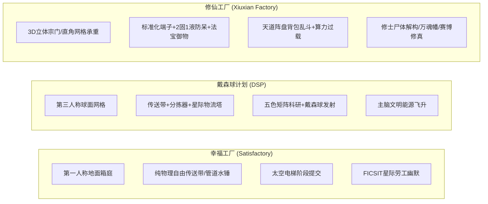
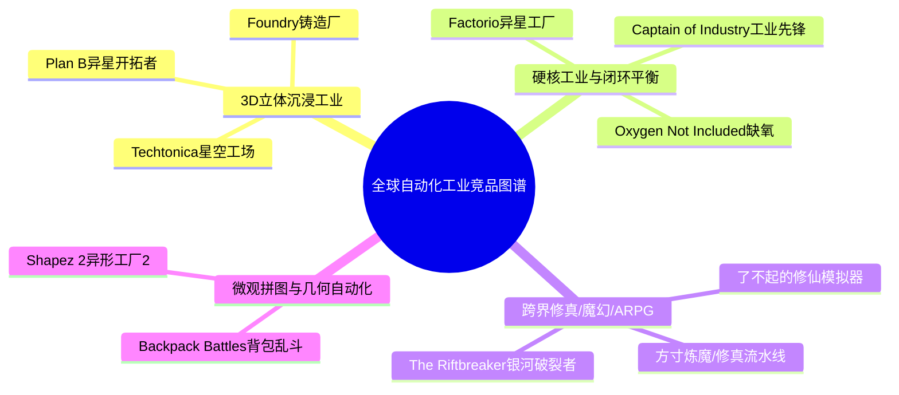

# 《修仙工厂》vs《幸福工厂》vs《戴森球计划》多维度深度对比与全球工业竞品研报

> **文档定位**：全景式游戏设计竞品分析与战略设计咨询报告  
> **对比标杆**：《幸福工厂》（Satisfactory）、《戴森球计划》（Dyson Sphere Program, DSP）  
> **竞品覆盖**：涵盖 3D 立体工业、宏观工业与副产物闭环、修仙/魔幻跨界融合、微观拼图构筑四大维度共 11 款全球代表性作品  
> **分析对象**：《修仙工厂》（UE5 第一/第三人称自动化工厂，融合天道阵盘 CPU、万魂幡与法宝系统、修士尸体生物解构、灵脉流体与煞气对冲）

---

## 目录索引
- [第一部分：三方核心细节深度对比（修仙工厂 vs 幸福工厂 vs 戴森球计划）](#第一部分三方核心细节深度对比)
  - [1.1 六大核心维度横向对比矩阵](#11-六大核心维度横向对比矩阵)
  - [1.2 维度一：视角沉浸与空间拓扑](#12-维度一视角沉浸与空间拓扑)
  - [1.3 维度二：物流哲学与传输机制](#13-维度二物流哲学与传输机制)
  - [1.4 维度三：工业核心中枢与心流驱动（质变亮点）](#14-维度三工业核心中枢与心流驱动)
  - [1.5 维度四：题材转化与暗黑赛博修真叙事](#15-维度四题材转化与暗黑赛博修真叙事)
  - [1.6 维度五：流体动力、副产物与生态对冲博弈](#16-维度五流体动力副产物与生态对冲博弈)
  - [1.7 维度六：阶段跃迁、战斗整合与终极目标](#17-维度六阶段跃迁战斗整合与终极目标)
- [第二部分：全球 11 款类似自动化竞品深度剖析与借鉴对标](#第二部分全球-11-款类似自动化竞品深度剖析与借鉴对标)
  - [2.1 第一维度：3D 立体第一/第三人称工业建造](#21-第一维度3d-立体第一第三人称工业建造)
  - [2.2 第二维度：宏观工业物流与严苛生存/副产物平衡标杆](#22-第二维度宏观工业物流与严苛生存副产物平衡标杆)
  - [2.3 第三维度：跨界融合（魔幻/修仙/RPG + 工业自动化）](#23-第三维度跨界融合魔幻修仙rpg--工业自动化)
  - [2.4 第四维度：微观构筑与拼图型自动化](#24-第四维度微观构筑与拼图型自动化)
- [第三部分：《修仙工厂》落地漏洞自查与优化落地策略（避坑指南）](#第三部分修仙工厂落地漏洞自查与优化落地策略)
  - [3.1 核心漏洞与工程风险分析](#31-核心漏洞与工程风险分析)
  - [3.2 优化建议与落地演进策略](#32-优化建议与落地演进策略)
- [第四部分：总结与差异化决胜模型](#第四部分总结与差异化决胜模型)

---

# 第一部分：三方核心细节深度对比

## 1.1 六大核心维度横向对比矩阵

| 评估维度 | 《幸福工厂》（Satisfactory） | 《戴森球计划》（DSP） | 《修仙工厂》（Xiuxian Factory） |
| :--- | :--- | :--- | :--- |
| **1. 视角沉浸与空间拓扑** | **第一人称（FPP）纯地面箱庭** • 固定外星星球手工大地图，强调垂直落差与自然地貌穿越 • 自由网格与地基吸附结合，手拉式复杂传送带与立交桥立体穿插 | **第三人称上帝/俯视 全球球面网格** • 多星系、多行星球体表面（经纬度网格+极点畸变） • 空间维度向星系宇宙拓展，多层传送带堆叠架构 | **第三人称越肩/自由工控俯视（宗门灵脉洞天）** • 1m×1m 标准化直角地基网格（BD_119~121），垂直承重分层（1~99层） • 灵脉洞穴/修真宗门地貌，强调“地基梁跨障碍+垂直传送带（BD_129）立体多层工坊” |
| **2. 物流哲学与传输机制** | **纯物理传送带实体化 + 无分拣器** • 建筑输入/输出端直接对准传送带拉线 • 分流器/合流器中继分配，管道液体带水力扬程/重力模拟 • 后期火车/无人机站对站长途货运 | **传送带 + 分拣器（Sorter）机械抓取** • 建筑贴带，依靠高速分拣器（抓取时差与过滤器）出入料 • 后期星际/行星物流运输塔（ILS/PLS）+ 空间翘曲器，点对点航运颠覆地面网 | **传送带直接对接入料 + 智能分合流 + 导脉/法宝御物** • 建筑正面/背面标准化端子（1进1出 / 2进2出） • 2固1液多轨物理校验（组装机BD_111防呆退料） • 导脉总线与高阶法宝空间折跃（如山河社稷图平移矿脉、万魂幡御魂搬运） |
| **3. 工业核心中枢与心流** | **太空电梯（Space Elevator）阶段里程碑** • 物理极具压迫感的垂直天梯，各阶段提交复合超重零件（智能镀层、自适应控制单元等） • 仅作为解锁科技层级（Tier）的“黑洞吞吐器”，不具备主动数值调节与算力调谐功能 | **主脑矩阵研究站（Matrix Labs）科技飞升** • 五色糖（电磁/能量/结构/信息/引力/宇宙矩阵）研发消耗 • 戴森球壳面规划绘制 + 太阳帆轨道弹射 + 垂直发射井打火箭，将工业产能具象化为恒星级巨构 | **天道阵盘·中央处理器（Backpack Battles 背包乱斗式构筑）** • 16m×16m 实体 CPU 母基座（带三色法兰/算力核/外设插槽/法宝耦合台） • 8×8 阵盘网格管理：构件异形占格、`★`星级指向触发、100 FLOPS 算力配平、脉冲波心跳传导、水火对冲与温度过载博弈（过热炸膛停线） |
| **4. 题材转化与叙事张力** | **FICSIT 冷酷星际企业资本剥削** • 开拓者沦为无情工业螺丝钉，外星资源被彻底压榨，冷幽默宣贯“不要浪费公司财产” | **人类文明虚拟主脑（COSMO）科技飞升** • 为维持人类意识虚拟宇宙运转，在银河系抽取恒星能量的宏大浪漫与孤独探索 | **赛博修真与暗黑功利功法解构** • “修士尸体”直接进入解构机（BD_107）提炼生物芯片与科技点 • 人造灵根原型量产、万魂幡炼化十万生魂驱动产线超频，将玄幻飞升彻底工业化 |
| **5. 副产物博弈与流体循环** | **流体动力学死锁（水锤/扬程/排气）** • 重油裂解副产石油焦/聚合物，废液满仓直接锁死全线；铝业生产水循环自锁 • 解决手段：粉碎机（Sink）兑换票据，或闭环水回路阀门精算 | **化学双相过剩死锁（氢气/重油/石墨烯）** • 早期精炼石油裂解氢过剩或石油过剩导致产线瘫痪；光子提纯反物质副产大量氢 • 解决手段：火炬塔烧毁、储液罐堆叠或可燃冰/分馏塔循环消纳 | **生化废液满仓、煞气外溢污染与水火热对冲** • 提取器副产“生物浑浊废液”（满仓即停机）、三昧熔铸高温发热、煞气腐蚀设备 • 解决手段：净化塔（BD_118）中和、冷热对冲水箱（水冷回路）、万魂幡煞气吸纳转化为狂暴动能 |
| **6. 阶段跃迁与战斗整合** | **异星生物近身自卫 / 纯工业向（无防守压力）** • 地图原生异星怪物（蜘蛛/角龙），击杀仅用于开辟矿脉与基因胶囊解锁 • 终极目标：完成太空电梯 Phase 4/5 巨量组件交付，获得金杯员工认证 | **黑雾崛起（Rise of the Dark Fog）星际攻防** • 敌对机械蜂群从太空/地面巢穴持续进化并主动空袭 • 生产激光塔/高爆炮弹/护盾发生器构筑全球防御体系 • 终极目标：点亮戴森球，肃清黑雾星系基地 | **防卫反击 + 飞剑诛仙 + 造化金身终极塑形** • 兽潮/敌宗修士受煞气吸引入侵基地，自动化飞剑阵列（剑匣连携CPU）自动秒杀强敌 • 战斗掉落直接作为核心生物原材料反哺工业链 • 终极目标：完成 20 具人造灵根原型，锻造“造化金身”突破天道桎梏 |

---

## 1.2 维度一：视角沉浸与空间拓扑
- **Satisfactory** 的第一人称带来了强烈的“尺度震撼”。玩家亲自踩在地基上，肉眼仰望近百米高的精炼装置与高架立交，但缺点是视野受限，复杂布线极其容易迷路。
- **DSP** 巧妙地采用了球体六边形网格，利用宏观全景让玩家轻松俯瞰整颗工业行星。但球面经纬度在两极附近的网格扭曲，给极度追求规整矩阵的强迫症玩家带来了天然的对齐痛苦。
- **《修仙工厂》** 采用“第三人称越肩 + 工控建造俯视”双模，并回归了经典直角笛卡尔网格（1m×1m 标准地基）：
  - **立体垂直度**：通过 `BD_119~121` 基础地基与 `BD_122` 玄铁梁、`BD_103` 支撑柱，引入明确的**承重与层高规范**（支持垂直堆叠至 99 层）；
  - **空间痛点解决**：比起 Satisfactory 自由拉带带来的弯曲穿模，《修仙工厂》的 `BD_129` 垂直传送带（3-8m 自适应拉伸）与 `BD_114` 传送门（垂直空间折跃），将空间利用率推向了“立体高层仓储工坊”的极限，契合修真洞天福地的“多层禁制阁楼”设定。

---

## 1.3 维度二：物流哲学与传输机制
- **Satisfactory 的“带对口”**：机器有固定的进出口，传送带直接连入端口，不需要中间机械臂。流体则有真实的压力、高程差（Head Lift）和倒流判定。
- **DSP 的“带旁抓”**：传送带从建筑旁边穿过，由分拣器（抓手）高速抓入抓出。这使得一条多物料混合带（寿司带/Sushi Belt）在早期成为可能，但后期高吞吐下分拣器的判定极占 CPU 线程。
- **《修仙工厂》的“标准化端子 + 轨道防呆校验”**：
  - 采矿机、精炼炉、粉碎机统一遵循“正面输入、背面输出”，便于流水线直线延伸；
  - **重工业组装机（BD_111）的 2固1液多轨机制**：强制要求 2 路固体物料 + 1 路流体输入。策划案明确设定了“多轨物料校验”机制——若传送带送错物料，机器直接停机退料，严谨度对齐专业工控系统；
  - **后期质变——御物与虚空物流**：区别于前两者的无人机/运输飞船，《修仙工厂》引入了法宝级物流（如山河社稷图改变矿脉拓扑、万魂幡生魂凌空抓取物料跨地形运输），将传统修仙的“御剑术/缩地成寸”转化为解决工业物流吞吐瓶颈的终极解法。

---

## 1.4 维度三：工业核心中枢与心流驱动
Satisfactory 和 DSP 的科技解锁本质上是**“黑洞吞料机”**（太空电梯/科研矩阵只需要玩家源源不断往里塞产物），玩家与科技建筑的交互是单向且被动的。
**而《修仙工厂》的天道阵盘·中央处理器（CPU）则彻底重构了工业心流**，将其升华为一套类似《背包乱斗》（Backpack Battles）的深度动态构筑子系统：
1. **空间网格整理与指向连携（★ Target）**：
   - 8×8 阵盘内，芯片（1×1、1×2）、工控件（2×2 推进泵、对撞机）拥有明确的物理占格与朝向；
   - 通过按 `R` 键旋转构件，对准相邻元件的 `★` 触点（例如：加压推进泵对准采矿芯片前端，触发流速 +25%；水火对撞机左右分别对准水火两极源管，爆发 2.5 倍对撞流速）。
2. **脉冲心跳（Pulse Heartbeat）与多米诺传导**：
   - 中央处理器每 2.0 秒产生一次大周天脉冲波，脉冲沿着导脉以 0.15s/格 的速度传导，产生所见即所得的多米诺骨牌级连环光效，最终汇聚于中央八面体算力核，瞬时将“全厂采矿暴产”或“万剑诛仙伤害”结算给世界。
3. **算力（FLOPS）与温度（°C）的双重压迫**：
   - 基础上限 100 FLOPS，超频可至 160%，但温度会从 42°C 飙升至 85°C 警界红区；
   - 玩家必须精妙排布【冷热对冲水箱】贴身吸热，一旦水冷短缺，超温 10 秒即引发**“阵盘烧毁、走火入魔、全厂停摆 30 秒”**的高压惩罚。这种“在高空走钢丝”的工控极限调谐乐趣，远超传统工业游戏的静态数值加成。

---

## 1.5 维度四：题材转化与暗黑赛博修真叙事
- **Satisfactory 的“工贼幽默”**：FICSIT 公司对员工的轻视、咖啡杯、金色小推车，营造出轻松解构的资本主义外包劳工文化。
- **DSP 的“群星孤旅”**：宏大的交响乐、静谧的银河系、从一颗贫瘠星球走向戴森光球，展现人类理性的冷峻与浪漫。
- **《修仙工厂》的“暗黑赛博修真”**：
  - 核心设定不是修仙模拟器里清高缥缈的“闭关打坐”，而是**“将修士工业化、将玄学物理化”**；
  - 开篇直接解构修士遗体（BD_107 解构机提取神经元、鲜活组织、电子生物芯片与科技点），以核聚变/灵煤驱动符文锅炉，以万魂幡炼化千百怨魂转化为全厂自动化动能；
  - 工业科技树与修真境界严格映射（练气 = 基础机械加工；筑基 = 生物芯片与自动化符阵；金丹 = 人造灵根与天道算力矩阵），形成了极度强烈的反差叙事张力。

---

## 1.6 维度五：流体动力、副产物与生态对冲博弈
- **Satisfactory 的废料痛点**：精炼厂副产重油、聚合物树脂、废气。一旦聚合物堵塞，重油燃料立即停产导致全厂大跳闸。玩家必须利用 AWESOME 粉碎机强行粉碎固体副产，或构建精巧的重油水回路。
- **DSP 的双相死锁**：开局炼油必产精炼油与氢气，早期氢气无处消耗直接卡死石油，中期重油堆积卡死制氢。玩家必须建造海量储液罐阵列或点燃火炬塔进行废弃物自损。
- **《修仙工厂》的“生态循环与因果反噬”**：
  - **生化废液**：提取器在产出神经组织的同时副产“生物浑浊废液”，前期若无净化塔（BD_118）与回收池，满仓直接停线；
  - **煞气外溢与魔化反噬**：高阶法宝（如万魂幡）与重型解构机在运转时会持续外泄【煞气值】。煞气不仅腐蚀周围工业建筑耐久，还会招引天道雷劫与畸变妖兽攻城；
  - **闭环解法**：玩家必须建立“净化塔中和液循环”或将煞气高压导向“煞焰稳压泵/万魂帆耦合台”，把致命工业废料驯化为强化飞剑与法宝超频的核心燃料，形成高风险高回报的动态经济学闭环。

---

## 1.7 维度六：阶段跃迁、战斗整合与终极目标
- **Satisfactory**：战斗属于探索副产物，玩家手持钉枪、电击棒清理矿脉边的怪，基地内没有任何防守压力，核心目标纯粹是物流效率的自我实现。
- **DSP**：在《黑雾崛起》更新后引入了星际塔防。黑雾从太空建立中继站并空降地面巢穴，玩家需要布置机枪塔、激光塔、防空导弹形成全球火网，但工业与战斗属于相对分离的“生产线供给弹药”模式。
- **《修仙工厂》的“深层工战交融”**：
  - **工业即战斗**：中央处理器的战斗母板直接与工业产值挂钩（例如生产母板拉出一条“工业总产值飞线”直插战斗核心插座，工厂产能越高，飞剑锋锐度与射速越恐怖）；
  - **战斗即原料**：击退的强敌与兽潮尸体，由智能传送带直接送入解构机，转化为制造人造灵根与高级芯片的必需生物原料，真正实现了“打怪 -> 解构 -> 工业扩产 -> 算力飞升 -> 更强自动化火网”的自洽内循环；
  - **终极终局目标**：不是发射飞船或封顶电梯，而是集全宗门万条流水线之力，批量浇筑 20 具“人造灵根原型”，最终拼装唤醒**“造化金身”**，以凡人工控之躯力抗九重天劫。

---

# 第二部分：全球 11 款类似自动化竞品深度剖析与借鉴对标

---

## 2.1 第一维度：3D 立体第一/第三人称工业建造

### 1. 《星空工场》（Techtonica）
- **核心机制**：第一人称地下发掘与科幻工业。依托地底洞穴生态，融合地形挖掘破坏（MOLE 挖掘枪）、发光真菌与地下生物链提取、高空能量核心球体矩阵（Core Composer）及发光树科技体系。
- **长处设计**：垂直升降井自适应对齐，石灰废渣再加工为基建砖石闭环；地底发光核心沿穹顶高耸堆叠，营造宏伟巨构视觉。
- **致命痛点**：
  - **空间迷航与幽闭压抑**：地下全封闭无自然采光，3D 垂直多层后缺乏清晰楼层切面视图，后期极易成为视距死角。
  - **Core 堆叠引发的性能灾难**：数万个物理科研球体高耸入云，UE 引擎粒子光照与 DrawCall 爆炸，中后期掉帧严重。
- **对《修仙工厂》借鉴**：
  - **【抄作业】**：洞天福地与地下灵脉纵深挖掘（开山诀/遁地凿开辟矿洞）。
  - **【避坑红线】**：坚决摒弃实体科研球无意义堆叠！科研算力直接绑定天道阵盘，严防 3D 物理堆积拖垮 UE5 渲染。

### 2. 《铸造厂》（Foundry）
- **核心机制**：第一人称体素网格（Voxel Grid）工厂建设。全网格吸附、模块化高楼厂房、电网与流体在墙体/管道内暗敷，被称为“3D 版 Factorio + 我的世界工程模组”。
- **长处设计**：严格的 1×1×1 网格化垂直升降机、吸附式装卸器；体素模块化建筑，玩家可自由搭建多层悬空楼板、工厂外墙，空间规整度极高。
- **致命痛点**：缺乏危机感与生态驱动力，纯和平沙盒导致中后期失去目标感；大面积体素铺设容易陷入枯燥疲劳。
- **对《修仙工厂》借鉴**：
  - **【抄作业】**：地基吸附规范（BD_137~139，1x1、4x4、16x16 地基快速对齐，玄铁梁与承重柱支撑高楼）。
  - **【避坑红线】**：不可做纯和平沙盒，必须由天劫、兽潮攻山提供高压危机循环。

### 3. 《异星开拓者》（Plan B: Terraform）
- **核心机制**：极简宏观尺度行星地貌改造与蜂群化物流调度。无复杂传送带穿插，主打蜂巢卡车队、长距离高速列车与大气温室气体泵送，改变地表水文与植被。
- **致命痛点**：缺少第一人称代入感与微观传动机械美学。
- **对《修仙工厂》借鉴**：
  - **【抄作业】**：灵气/煞气宏观环境演化——工业大量排放未净化的“地煞废气”或提取“修士怨气”时，宗门周边地貌转变为魔道焦土；净化塔运转良好则祥云百草丰茂。

---

## 2.2 第二维度：宏观工业物流与严苛生存/副产物平衡标杆

### 4. 《异星工厂》（Factorio: Space Age）
- **核心机制**：2D 工业自动化巅峰。在 Space Age 扩展中引入多行星差异化机制、**物品优质度（Quality 1~5 星）系统** 与轨道太空平台。
- **长处设计**：核废料回收再处理、生化星生物废弃物腐烂机制（Spoilage 时效保鲜系统）；污染扩散触发虫潮演化。
- **对《修仙工厂》借鉴**：
  - **【抄作业】优质度系统（品阶：下品/中品/上品/极品/仙品）**：同一张配方生产飞剑，输入优质灵气与无暇玄铁，组装机可概率产出“极品飞剑”，词条与伤害成倍翻升。
  - **【抄作业】腐烂时效机制（尸体/活体材料活性保鲜）**：修士尸体、断肢灵根在普通传送带上随时间流逝“活性衰减”，需尽快送入“冷凝防腐传送带”或“解构机（BD122）”，否则腐化为恶臭浊水并大量逸散煞气。

### 5. 《工业先锋》（Captain of Industry）
- **核心机制**：硬核海岛重工业生存。无魔法式凭空消失，主打**真实物理渣土倾倒、地表平整挖掘、多相流体/废气平衡与闭环循环**。
- **长处设计**：任何生产必有副产物！炼铁必出矿渣（Slag）、燃煤必出硫与飞灰、海水淡化必出浓盐水，副产物满仓即停机。
- **致命痛点**：死亡螺旋（Death Spiral）极严苛，新手因小疏忽导致电力全线暴毙。
- **对《修仙工厂》借鉴**：
  - **【抄作业】双进双出/废渣配平逻辑**：解构机与精炼炉坚决贯彻——炼玄铁必出“驳杂火毒渣”；解构尸体必出“污浊尸血与白骨废渣”。玩家通过净化塔或炼制为“白骨阵桩/下品鬼火燃料”实现闭环。
  - **【避坑红线】**：提供应急泄放口（如“地火焚化炉”或“万劫坑”），虽有功德损耗或轻微污染，但能避免新手陷入全盘死锁。

### 6. 《缺氧》（Oxygen Not Included, ONI）
- **核心机制**：热力学、流体力学、气体分层与生态热熵管理。冷热对冲、相变循环（气/液/固）。
- **对《修仙工厂》借鉴**：
  - **【抄作业】水火对冲与温度过载博弈**：阵盘上的“极阳地火位”产热与“极阴玄冰位”吸热，架设“玄冰水冷总线”导出热量，沸腾的“灵液蒸汽”导入次级阵眼实现“蒸汽回天阵”。

---

## 2.3 第三维度：跨界融合（魔幻/修仙/RPG + 工业自动化）

### 7. 《了不起的修仙模拟器》
- **核心机制**：五行相生相克、风水布局、灵气聚灵阵、开辟紫府、历劫渡劫、夺舍与魔道炼尸炼宝。
- **致命痛点**：宗门弟子 AI 效率低下，后期数值极繁杂，缺少工业流水线传送带与机械抓手的确定性与爽快感。
- **对《修仙工厂》借鉴**：
  - **【抄作业】五行生克矩阵**：水灵脉流体滋润木属性药田；木屑送入离火精炼炉提高热值；冶炼废渣用于重型基建；阵盘五行相生环路激活 300% 极品加成。
  - **【抄作业】魔道万魂幡**：敌对修士攻山阵亡后，解构机剥离灵根，生魂抽出送入“万魂幡”作为自动化算力单元或护山大阵主魂。

### 8. 《银河破裂者》（The Riftbreaker）
- **核心机制**：基地建造自动化 + 双摇杆机甲 ARPG + 成千上万虫潮防守。机甲即时手操战斗与基地防御工事、地热流体电网完美耦合。
- **长处设计**：白天采矿扩张，夜间万千虫潮如海啸袭来，手操释放大招与自动化炮台协同割草，解压爽快。
- **致命痛点**：重战斗轻自动化，工业深度较浅，无复杂中间件链条。
- **对《修仙工厂》借鉴**：
  - **【抄作业】战斗与工业即时反馈闭环**：玩家手持本命法宝（飞剑、雷印），身后万魂幡黑云遮日；天劫降临或正道攻山时，工厂流水线自动生产的灵能重弩、庚金剑气塔、幽冥炮火力全开，体验“工业转化为战斗力”的爽感。

### 9. 《方寸炼魔》（Fangcun Lianmo）及新晋修真自动化
- **核心机制**：国风玄幻流水线挂机，传送带输送妖魔尸身、灵草炼丹、血祭炉鼎。
- **致命痛点**：轻量级 2D/2.5D 独立 Demo，工业链条极短（采药-入炉-出丹），无多层空间与 3D 视觉奇观。
- **对《修仙工厂》启示**：
  - **【降维打击】**：《修仙工厂》依托 UE5 强大视效、3D 多层立体管道、真第一/第三人称视角，以及深度对标 Factorio 的 144 种建筑体系，直接在体量和画面表现力上对轻度修仙放置游戏形成绝对统治级品质代差。

---

## 2.4 第四维度：微观构筑与拼图型自动化

### 10. 《背包乱斗》（Backpack Battles）
- **核心机制**：微观背包空间管理、异形构件摆放、**`★`星级指向触发连携**、实战自动多米诺脉冲结算与现场武器合成（Fusion）。
- **致命痛点**：纯 2D 背包窗口，缺少大世界的宏观物流承载。
- **对《修仙工厂》借鉴**：
  - **【100% 深度融合：天道阵盘中央处理器】**：
    将阵盘划分为 8×8 网格，芯片与金身骨骼具备 L 型、T 型占格；芯片四周带有 `★` 触发星点；
    - **现场融合**：传送带送来的“千年雷击木”+ 阵盘上的“庚金道胚”在阵位淬火融合为“九霄雷神剑芯”；
    - **脉冲多米诺**：中央心跳脉冲每一跳，顺着星级朝向连锁激活飞剑开刃、水冷泵、算力增幅器，给宏观工厂提供 200% 全局增益。

### 11. 《异形工厂 2》（Shapez 2）
- **核心机制**：纯几何拓扑与立体多层切割拼合逻辑。在宇宙空间站平台上实现 3 层立体传送带跨越式作业。
- **长处设计**：清晰的三层空间结构（Level 1 地面、Level 2 空中、Level 3 高空），跳层器与升降机构极度丝滑，永不缠绕。
- **对《修仙工厂》借鉴**：
  - **【抄作业】清晰明确的 3D 标高分层系统**：
    规定《修仙工厂》的传送带与灵液水管固定吸附于：`Y=0`（地基表层）、`Y=1`（中空物料走廊）、`Y=2`（高空飞剑天轨），通过分层快捷键（Tab 切换透视层级），让玩家轻松理清高低落差。

---

# 第三部分：《修仙工厂》落地漏洞自查与优化落地策略

## 3.1 核心漏洞与工程风险分析
1. **双提交系统造成的认知混乱（P-01 槽点）**：
   - 现案中中央处理器（研究认证/科技解锁）与造化金身（阶段物料/批量供料）在部分流程中界限模糊，玩家容易混淆“我是在研发科技还是在交付终极任务”。
2. **生化材料依赖战斗掉落带来的“产线断料自锁”（P-06 槽点）**：
   - 自动化工厂的核心是“只要供电和矿脉在，产线就能永久平稳运行”。当前版本生物材料（修士尸体、神经组织）深度依赖玩家外出战斗掉落，一旦玩家停止杀怪，下游的电子芯片与人造灵根产线将立刻停摆，破坏工业自动化挂机心流。
3. **阵盘“温度炸膛停线 30 秒”的挫败感控制**：
   - 背包乱斗是短局制对战，容错率高；而工厂类游戏一旦核心中枢停摆 30 秒，全厂传送带堆料、发电机熄火、电力大跳闸（Blackout），极易引发毁灭性雪崩。若惩罚过重，玩家会直接放弃超频构筑，导致阵盘温度玩法形同虚设。
4. **配方与建筑端口约束的标准统一**：
   - 如组装机（BD_111）要求“2固1液输入，最多2固输出”，需严格保证 3D 模型的物理插口位置与 UI 配方提示百分百吻合，防止出现早期管道接口与建筑端口对齐困难的体验硬伤。

## 3.2 优化建议与落地演进策略
1. **重构生物资源供应链：引入“自动化克隆培养池”**：
   - 在筑基中期新增 `BD_145 克隆培育仓`，允许玩家用“原代修士组织 + 高纯营养液”进行自动化组织扩增，使战斗掉落变为“开荒基因样本”，而后期量产回归工厂纯自动化闭环。
2. **中央处理器超频惩罚软化：“降频与过载泄压”替代“直接炸膛”**：
   - 温度达到 85°C 时，先触发声光报警与自动“降频保护（全厂降速 50%）”，并向外喷射高温蒸汽（造成小范围角色扣血），给予玩家 15 秒抢修或手动拉动【过载总闸拉杆】排热的机会，而非粗暴的立即全线瘫痪。
3. **UI 严格分层规范**：
   - 中央处理器 UI 必须坚决拆分为两层逻辑：大地图交互呈现“法兰与外设物理插槽”，内部界面呈现“背包乱斗网格拼图”，并由快捷键 `N` 独立呼出法宝工控界面，确保功能专一、动线清晰。

---

# 第四部分：总结与差异化决胜模型

| 维度 / 系统 | 对标竞品 | 《修仙工厂》差异化决胜方案（核心王牌） |
| :--- | :--- | :--- |
| **3D 建造与空间** | 《Foundry》《Techtonica》 | 规整体素地基 + 3层标高吸附，剔除压抑山洞，打造**云海浮岛仙山与深渊魔窟**的高反差壮丽奇观 |
| **生物解构体系** | 《Factorio Space Age》《ONI》 | 引入**修士尸体保鲜腐败衰减**机制，解构剥离皮肉骨魄，为邪修魔工流提供黑暗工业原料 |
| **废料与副产物** | 《Captain of Industry》 | 双出副产物机制：**煞气、火毒渣、魔血**必须闭环回收净化，否则滋生天魔、毒化宗门 |
| **微观核心构筑** | 《Backpack Battles》《Shapez 2》 | **天道阵盘（8x8 网格 + ★星级朝向 + 算力配平 + 水火对冲 + 现场淬火）**，彻底打破传统工业科技树的单调点击 |
| **战斗与军事输出** | 《The Riftbreaker》《了不起的修仙》 | **万魂幡蓄能 + 飞剑流水线生产 + 护山大阵自动化火力**，直接迎击正道联军攻山与九重天劫 |

《修仙工厂》精准锚定了《幸福工厂》的**微观工业搭建沉浸感**与《戴森球计划》的**宏观终极建造驱动力**，并创造性地通过**“赛博解构修真题材”**与**“天道阵盘背包乱斗构筑”**找到了自动化品类的第三条进化赛道。
只要在后续研发中理清“生物物料自循环”、“工战联动挂机容错”以及“UI双提交界限”，该案完全具备成为工业自动化领域现象级黑马作品的深厚潜质。
