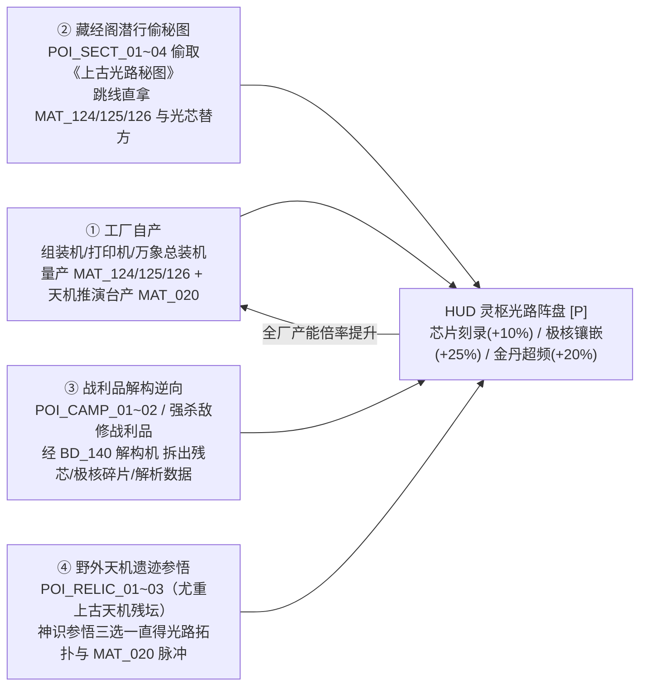

# 《修仙工厂》大地图探索与宗门藏经阁潜行策划案 V1.0

> **文档定位**：UE5《修仙工厂》大地图外围探索、**【方案A：轻量紧张型藏经阁潜行偷窃】**、大地图 4 类 POI 据点布局及 **HUD 灵枢光路阵盘（`[P]`）多途径获取闭环** 的唯一正式策划案。  
> **数据真源**：`02_数值与配置数据表/world_map_poi_table.xlsx`（第 8 张官方配置表，`POI_SECT_01 ~ POI_CAMP_02` 共 13 座据点），经 `06_运维与脚本工具/sync_data_from_xlsx.py` 全量同步至 `xiuxian_data.js` (`XIUXIAN_MAP_POIS`)。  
> **对齐基线**：`法宝系统专项策划案_V1.0.md`（`FAB_001` 万魂幡 / `FAB_002` 山河社稷图）、`relic_scroll_table.xlsx`（`SCR_001 ~ SCR_065` / `POOL_01 ~ POOL_22`）、`HUD快捷面板设计规范.md`、`world_3d.js` 主厂区坐标规范。

---

## 1. 设计总纲与空间坐标规范

### 1.1 为什么引入大地图 POI 与藏经阁潜行
在《修仙工厂》中，主厂区承担“采矿 → 精炼 → 化工 → 丹器总装 → 渡劫飞升”的核心自动化闭环；若玩家只能原地搓线等待科研点数，中后期容易陷入“纯挂机等产线”的枯燥期。通过在大地图外围布置 **4 类共 13 座 POI 据点**，将**“潜行偷图、遗迹参悟、奇观收录、以战养盘”**接入工厂与法宝双循环：
1. **探索反哺工业**：在敌方宗门藏经阁与古修残碑中获取 **古修残卷三选一**（替代配方跳过卡脖子原料）与 **上古光路秘图**（加速解锁 HUD 灵枢光路阵盘）。
2. **法宝双核驱动**：把《法宝系统专项策划案》中的 **万魂幡（鬼域控场）** 与 **山河社稷图（缩地成寸 +50% 移速、山河障隔断视线、移山填海收录奇观矿脉）** 真正用在大地图探索与潜行中。
3. **非强制潜行容错**：采用 **【方案A：轻量紧张型潜行】**，允许“零警戒完美偷窃”，也允许暴露后“强杀清场”或“开图高速撤离”，绝不强行绑定一触即死的硬核潜行惩罚。

### 1.2 坐标避让与外围环带规划
* **主厂区核心半径**：`world_3d.js` 现有主厂区矿脉与水源分布于 `X ∈ [-29, +26]`、`Z ∈ [-14, +26]` 区间。
* **大地图 POI 分布环带**：全部 13 座 POI 据点严格布设于主厂区外围 **`±42 ~ ±68`（总体外围环带 `±52 ~ ±80` 探索圈）**，按**东南西北四象方位 + 境界梯度**向外辐射，确保玩家打开 `[M]` 地脉全域地图或沿外围探矿时目标清晰、零地形冲突。

---

## 2. 【方案A】轻量紧张型藏经阁潜行偷窃规则

藏经阁潜行并非纯暗杀游戏，而是围绕 **“警戒度博弈 × 搜刮读条 × 法宝控场机动 × 暴露双分支应对”** 打造的 60~120 秒高浓缩紧张体验。

### 2.1 核心状态与警戒度机制（`0 ~ 100%`）
每座敌方宗门藏经阁（`POI_SECT_01 ~ POI_SECT_04`）均设有独立的区域警戒条（`0% ~ 100%`）：

| 警戒区间 | 状态命名 | 守卫 AI 行为表现 | 玩家交互与风险变化 |
| :--- | :--- | :--- | :--- |
| **`0% ~ 39%`** | **静谧潜行（绿）** | 守卫沿预设路径低速巡逻，视野扇区为常规角度（`90°`）与常规距（`10m`） | 可正常隐蔽贴近密阁书架，触发完整**搜刮读条** |
| **`40% ~ 79%`** | **生疑巡查（琥珀）** | 守卫头顶出现黄标 `?`，暂停原路线并向最后异响位置/最近书架慢步靠近探查 | 此时搜刮读条不中断，但若继续处于其视野锥内，警戒增速 **`×1.5`** |
| **`80% ~ 99%`** | **临战预警（橙红）** | 护阁精英进入持剑戒备姿态，巡逻步频加快，外围门禁法阵开始闪烁充能 | 最后 `2~3 秒` 脱身或释放【鬼域】/【山河障】压制的绝杀窗口 |
| **`100%`** | **阵眼暴露（赤红）** | 触发全阁警报！隐藏护法与禁制傀儡全数激活并锁定玩家，进入**暴露分支** | 无法继续常规和平搜刮，须立即选择 **强杀破阵** 或 **借图撤离** |

**警戒度增减明细：**
* **上升来源**：
  * 处于守卫正面视野锥内：`+18% / 秒`（随距离衰减，贴脸翻倍）；
  * 踩中未解除的禁制符砖 / 疾跑声响半径 `6m` 内有守卫：`+12% / 次`；
  * 强行撬开高阶密柜（未压制守卫时）：读条期间每秒附带 `+4% ~ +8%` 灵气波动警戒。
* **回落与清零**：
  * 脱离守卫视野与声响范围并隐藏于书架/柱体/山河障后 `3 秒`，警戒度开始以 **`-10% / 秒`** 回落；
  * 完全撤离藏经阁领地外围（脱战半径 `> 28m`）后，若未击杀守卫，警戒度在 `10 秒` 内重置回 `0%`。

### 2.2 搜刮读条规则（禁制密柜 / 古修玉简架）
1. **交互方式**：靠近藏经阁内的【古修秘卷架】或【天机光路密匣】，长按交互键 `E` 启动搜刮读条。
2. **读条时长与打断**：
   * **外门书架**：`3.0 秒`（练气/筑基级）；
   * **内阁金丹密匣**：`4.0 秒`；
   * **宗门核心天机柜**：`5.0 秒`（元婴/化神级，通常含光路秘图或极核图纸）。
   * **打断规则**：读条期间若主动松手、疾跑位移、受到敌方攻击或警戒瞬间冲顶触发击飞，读条清零；若因警戒升高触发 `40%~99%` 状态但未受击，读条不强制打断，给足“卡秒摸完最后 0.5 秒就跑”的肾上腺素爽点。
3. **单阁可窃次数**：每座藏经阁提供 **2~3 处密藏点位**（1 处核心密匣 + 1~2 处次级书架），每次成功读条即立刻将战利品收入个人背包（**已偷到手绝不因后续暴露而回吐**）。

### 2.3 法宝双核潜行联动（严格对齐 `fabao_table.xlsx`）

| 法宝 | 核心联动技能 | 潜行期战术作用 | 资源消耗与限制 |
| :--- | :--- | :--- | :--- |
| **`FAB_001` 万魂幡 （5 重：人皇旗）** | **【鬼域 / 摄魂域】** 半径 `8m`（7 重 `10m`） 持续 `10s`（3 重 `12s`，10 重 `15s`） | **控场造窗**：插入地面展开鬼域，将周围普通巡逻弟子减速并拉扯向幡旗位置背对密匣，同时降低其感知；5 重解锁**【魂幕】**额外压制敌修攻击频率与反应 | 鬼域耗 **35 魂力**，魂幕耗 **25 魂力**；连续施法推高魂压，`>80%` 缩圈 `15%`，`100%` 强制收幡禁魔 `3s`；不可穿墙插幡 |
| **`FAB_002` 山河社稷图** | **【缩地成寸】**（被动） **【山河障】**（主动墙体 `5m / 8m / 10m`） | **高速机动 + 阻断视线**：展开画卷后在覆盖范围内移速 **`+50%`**，用于高速转点摸柜与暴露后极限逃生；展开【山河障】横亘走廊，**直接截断巡逻视线、迫使普通守卫绕远路、并吞没远程剑气/符弹** | 阻挡攻击与展开均消耗**灵韵**并产生磨损；灵韵归 `0` 进入休眠，须回 `BD_156 炼宝台` 用 `MAT_070 稳定液` 等材料修补唤醒 |

### 2.4 暴露后双分支应对：强杀破阵 vs 借图撤离
当警戒度达到 `100%` 暴露时，系统不强制失败重来，而是即时转化为两种合规收益路线：
1. **路线 1：强杀破阵（工战收割流）**
   * **做法**：直接拔剑/掐诀击杀阁内护阁弟子与精英护法（利用【鬼域】聚怪 + 【山河障】挡远程子弹，逐个破盾抽魂处决）。
   * **收益**：除强行开启阁内剩余密匣外，还可额外获得**对应境界修士尸体**（如 `MAT_017 练气修士尸体` 等高阶战利品），带回基地投入 `BD_140 解构机` 拆解或供 `FAB_001` 邪修整尸血炼，同时残魂直接补满万魂幡魂力槽。
   * **代价**：消耗丹药与法宝耐久/灵韵，且该宗门进入 `180 秒` 戒严刷新冷却。
2. **路线 2：借图撤离（极限轻功流）**
   * **做法**：摸到关键密卷后不恋战，立刻展开 `FAB_002 山河社稷图` 触发 **缩地成寸（+50% 移速）**，反手在身前/身后拍出 **山河障** 堵死通道并吞没追击远程弹道，直线冲出 `28m` 脱战圈。
   * **收益**：零战损安全带回已窃取的古修残卷与光路秘图；外围灵气平息后可再次潜入搜刮未开启的书架。

### 2.5 藏经阁核心窃取产物
1. **古修残卷三选一（绑定 `relic_scroll_table.xlsx`）**：
   * 偷取【古修秘卷】后弹窗触发“三选一”参悟（对标《幸福工厂》硬盘三选一），直接永久解锁 1 条对应卡池（`POOL_01 ~ POOL_22`）的 **古修秘传替代配方**（如跳过生物培养直出光芯、废水废渣闭环、高产熔炼等）。
2. **上古光路秘图（直通 HUD 阵盘）**：
   * 藏经阁核心密匣固定掉落【上古光路秘图】（包含现成 `MAT_124 光路芯片` / `MAT_125 神识光芯` / `MAT_126 阵盘极核` 与 `MAT_020 解析数据` 秘包，并解锁对应境界的光路直刻/替代工艺）。

---

## 3. 大地图 4 类 POI 据点总览（13 座据点）

全部 13 座据点严格同步自 `02_数值与配置数据表/world_map_poi_table.xlsx`：

### 3.1 类别一：敌方宗门藏经阁（4 座 · 核心潜行点）
| 据点ID | 据点名称 | 所属境界 | 坐标 `(X, Z)` | 警戒阈值 | 核心卡池与秘图产出 | 守卫配置与特色 |
| :--- | :--- | :--- | :---: | :---: | :--- | :--- |
| **`POI_SECT_01`** | 青云外门藏经阁 | I~II 练气/筑基 | `(-58, -48)` | `100` | `POOL_01~06`、`SCR_001/002/011`、初级光路秘图（`MAT_124`×2 + `MAT_020`×20） | 2 名外门巡逻弟子 + 1 名筑基值守管事；入门级练手潜行阁 |
| **`POI_SECT_02`** | 血煞宗秘库 | III 金丹 | `(62, -52)` | `100` | `POOL_07~12`、`SCR_008/009/039/042`、进阶光路秘图（`MAT_125`×2 + `MAT_020`×40） | 3 名血煞暗哨 + 1 名金丹血卫；走廊狭窄，极适合【山河障】卡视线 |
| **`POI_SECT_03`** | 万兽宗灵阁 | IV 元婴 | `(-64, 56)` | `100` | `POOL_13~17`、`SCR_046~050/063`、灵兽光路耦合图（`MAT_125`×3 + `MAT_126`×1） | 2 名驭兽巡卫 + 2 只嗅觉灵兽（高侦测）+ 1 名元婴长老；推荐【鬼域】控兽 |
| **`POI_SECT_04`** | 天机分阁秘藏 | V 化神 | `(68, 58)` | `100` | `POOL_18~22`、`SCR_018/019/052/053/062`、终极天机秘图（`MAT_126`×2 + `MAT_137` 线索） | 2 座天机扫描傀儡 + 2 名化神剑侍 + 1 名护阁尊者；双法宝协同攻坚终极密库 |

### 3.2 类别二：古修遗迹残碑（3 座 · 和平参悟与解谜点）
| 据点ID | 据点名称 | 所属境界 | 坐标 `(X, Z)` | 警戒阈值 | 核心产出与阵盘关联 | 玩法说明 |
| :--- | :--- | :--- | :---: | :---: | :--- | :--- |
| **`POI_RELIC_01`** | 残破丹鼎碑 | I~II 练气/筑基 | `(-52, 12)` | `0`（无潜行警戒） | `POOL_02/04/15`、`SCR_002/015/026`；参悟丹火热路纹，赠 `MAT_020 解析数据`×15 | 修复碑前断灵柱后触发残卷三选一，侧重炼丹、灵草与水循环替代配方 |
| **`POI_RELIC_02`** | 上古天机残坛 | II~III 筑基/金丹 | `(58, -18)` | `0`（偶发守坛傀儡） | `POOL_18/19`、`SCR_018/019/052`；**直悟光路阵盘核心拓扑**，赠 `MAT_124`×2 + `MAT_020`×30 | **途径④核心点**：交互神识共鸣刻录上古光路，解锁纯工业光芯替代生物兽魂秘方 |
| **`POI_RELIC_03`** | 太古剑冢碑林 | III~IV 金丹/元婴 | `(12, -62)` | `0`（剑意试炼触发） | `POOL_11/16/20`、`SCR_040/041/060`；剑意淬炼阵盘节点，赠 `MAT_125`×1 + `MAT_020`×35 | 触摸残剑碑林并抵御短暂剑意幻影（可用【山河障】挡剑气），获取兵工与法宝胚秘方 |

### 3.3 类别三：山河奇观与秘矿（4 处 · 山河图收录与资源拓展点）
| 据点ID | 据点名称 | 所属境界 | 坐标 `(X, Z)` | 警戒阈值 | 山河社稷图（`FAB_002`）专项联动 | 玩法说明 |
| :--- | :--- | :--- | :---: | :---: | :--- | :--- |
| **`POI_WONDER_01`** | 灵瀑天湖 | I~II 练气/筑基 | `(-48, -24)` | `0` | **1 重收录计数 +1；满足 3 重突破条件“收录 1 处大型水源”**；恢复大量灵韵（+50） | 大地图核心大型灵泉水源奇观，亦可架设水泵或收录入山河图滋养洞天福地 |
| **`POI_WONDER_02`** | 翠微灵峰 | I~II 练气/筑基 | `(52, 16)` | `0` | **1 重收录计数 +1**；峰顶灵草可收录进【洞天福地】无耗材 **200% 挂机产出** | 高灵韵风景奇观，登顶收录后解锁山河图灵韵自然回复与高品灵草温养样本 |
| **`POI_WONDER_03`** | 赤铜古脉 | II~III 筑基/金丹 | `(-16, 64)` | `0` | **3 重【移山填海】可整座收录并投影至主基地**，且可消耗灵韵升级富集度 | 高纯度赤铜外围古矿脉，前期远征铺天轨/管道，3 重山河图可直接搬回厂区 |
| **`POI_WONDER_04`** | 玄铁天坑 | II~IV 筑基/元婴 | `(22, 66)` | `0` | **3 重【移山填海】可收录并投影基础玄铁矿脉**；坑底外围可采高纯样本 | 深层玄铁露天矿坑，产线扩能核心外矿点，与基地玄铁产线形成双脉共振 |

### 3.4 类别四：守矿修士营地（2 座 · 强攻夺矿与战利品逆向点）
| 据点ID | 据点名称 | 所属境界 | 坐标 `(X, Z)` | 警戒阈值 | 核心战利品与阵盘逆向 | 守卫配置与玩法说明 |
| :--- | :--- | :--- | :---: | :---: | :--- | :--- |
| **`POI_CAMP_01`** | 散修掠矿营 | I~II 练气/筑基 | `(-42, 36)` | `100`（领地警戒） | 掠夺矿箱（玄铁/赤铜/稳脉液）+ 练气/筑基修士尸体 + 残损阵盘零件（送 `BD_140` 拆出 `MAT_124` 原料与 `MAT_020`×20） | 3 名散修巡矿手 + 1 名筑基营头目；清剿后开放营地旁矿脉安全区，支持快速建矿运回基地 |
| **`POI_CAMP_02`** | 天魔前哨坛 | IV~V 元婴/化神 | `(46, -38)` | `100`（高危警报） | `POOL_16~21`、`SCR_061/062/065` + 天魔傀儡残骸/高阶尸身（`BD_140 解构机` 逆向出 `MAT_125` 碎芯、`MAT_067 煞气结晶`、`MAT_020`×45） | 2 名天魔哨兵 + 2 具护坛傀儡 + 1 名元婴坛主；高压战利品农场，适合满配万魂幡+山河图强袭逆向 |

---

## 4. HUD 光路阵盘（`[P]`）4 种多途径获取闭环

在 `js/hud_core.js` (`window.OpticalArrayHUD`) 中，**灵枢光路阵盘**是直接放大全厂算力倍率的核心中枢：
* **光路刻录**：消耗 `MAT_020 解析数据 ×10` + `MAT_124 光路芯片`（或 `MAT_125 神识光芯`）`×1` → 每枚全厂算力 **`+10%`**；
* **极核镶嵌**：消耗 `MAT_020 解析数据 ×25` + `MAT_126 阵盘极核 ×1` → 每枚全厂算力 **`+25%`**；
* **无限超频**：消耗 `MAT_020 解析数据 ×50` + `MAT_085 人造金丹`（或 `MAT_123 飞升道果`）`×1` → 每层全厂算力 **`+20%`**。

为避免玩家被迫“只刷某一种玩法”，特确立 **4 条互为补充、全时期贯通的阵盘资源获取闭环**：

### 4.1 途径①：工厂自产（稳定基石，中后期规模化）
* **链路**：依托基地标准产线（`BD_146 组装机`、`BD_167 打印机`、`BD_186 万象总装机`、`BD_189 仙造重组枢机`）稳定量产 `MAT_124 光路芯片` → `MAT_125 神识光芯` → `MAT_126 阵盘极核`，同时由科研设施（`BD_179 天机推演台` 等）产出 `MAT_020 解析数据`。
* **定位**：自动化玩家的保底大动脉，产能无限扩张，但前期需铺设多级硅基/灵液/生物前置产线，成型较慢。

### 4.2 途径②：藏经阁潜行偷秘图（高回报捷径，跳阶破局）
* **链路**：穿戴双法宝潜入 `POI_SECT_01 ~ POI_SECT_04` 偷取核心密匣中的 **《上古光路秘图》** 与 **高阶古修残卷**。
* **定位**：
  * 练气/筑基期即可在 `POI_SECT_01` 偷得首批 `MAT_124 光路芯片` 成品与 `MAT_020 解析数据`，**提前 1~2 个科技时代点亮阵盘刻录**；
  * 配合偷取的 `SCR_018 / SCR_019 / SCR_052 / SCR_055` 等光芯替代残卷，可彻底绕开繁琐的生物兽魂线，让纯工业流顺滑冲刺 `MAT_125 / MAT_126` 量产。

### 4.3 途径③：战利品解构逆向（以战养盘，战斗变现）
* **链路**：强袭 `POI_CAMP_01 / POI_CAMP_02` 守矿营地，或在藏经阁暴露后选择**强杀破阵**，搜刮敌方【算器傀儡残骸】【宗门阵盘残件】与【修士尸体】。将战利品带回基地送入 **`BD_140 解构机`**（或高阶 **`BD_178 归墟化煞炉`**）进行逆向拆解。
* **定位**：
  * 将战斗玩家的清剿战利品直接转化为 **`MAT_020 解析数据`、`MAT_124/125 光路芯片残件`、`MAT_067 煞气结晶`** 与残魂；
  * 实现“越打架、解构机越忙、光路阵盘倍率越高、防御塔与产线越快”的正向滚雪球闭环。

### 4.4 途径④：野外天机遗迹参悟（探索奇遇，零战斗破境）
* **链路**：大地图探索 `POI_RELIC_01 ~ 03`（尤其 `POI_RELIC_02 上古天机残坛`）与 `POI_WONDER_01 ~ 04`，消耗神识与残碑交互参悟，并在“古修残卷三选一”中择优获取光路/工业核心配方与一次性解析数据脉冲。
* **定位**：
  * 照顾偏好自由探索、不爱正面硬刚也不想高频潜行的玩家；
  * 同时顺带完成 `FAB_002 山河社稷图` 的区域收录与突破要求，一趟远行同时推进**阵盘算力 + 山河图重数 + 秘方图鉴**三条成长线。

---

## 5. 与配置表及前端的数据契约

| 字段名（Excel 表头） | JSON 字段名（`XIUXIAN_MAP_POIS`） | 说明 |
| :--- | :--- | :--- |
| `据点ID` | `id` / `poiId` | 唯一主键，如 `POI_SECT_01` |
| `据点名称` | `name` | 如 `青云外门藏经阁` |
| `据点类型` | `type` / `category` | 4 类枚举：`敌方宗门藏经阁` / `古修遗迹残碑` / `山河奇观与秘矿` / `守矿修士营地` |
| `所属境界` | `realm` | 推荐探索境界梯度 |
| `坐标X` / `坐标Z` | `x` / `z` | 3D 世界外围环带坐标（避让主厂区） |
| `警戒阈值` | `alertThreshold` | `100`（潜行/敌营满值暴露）或 `0`（和平遗迹/奇观） |
| `核心战利品/残卷卡池` | `lootPool` | 关联 `relic_scroll_table.xlsx` 卡池与秘图掉落 |
| `阵盘获取途径` | `arrayDiskSource` | 对应 HUD 光路阵盘 4 大途径标注 |
| `山河图联动` | `shanheLink` | 对应 `FAB_002` 收录、缩地成寸、山河障与移山填海规则 |
| `守卫配置` | `guardConfig` | 巡逻/精英/傀儡数量与行为说明 |
| `玩法说明` | `desc` | 该据点核心交互与策略提示 |
