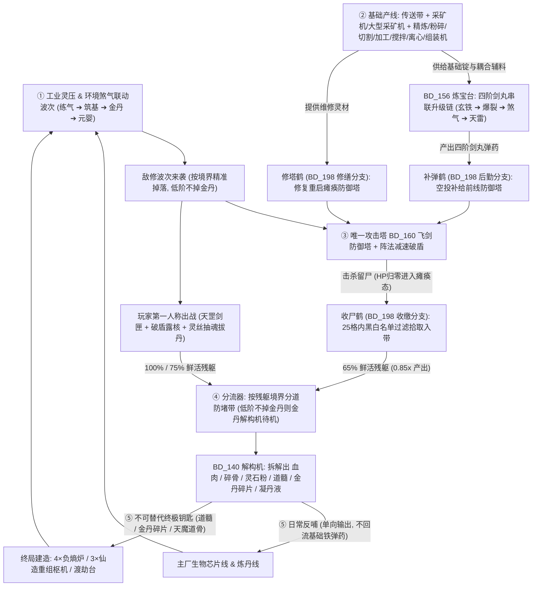
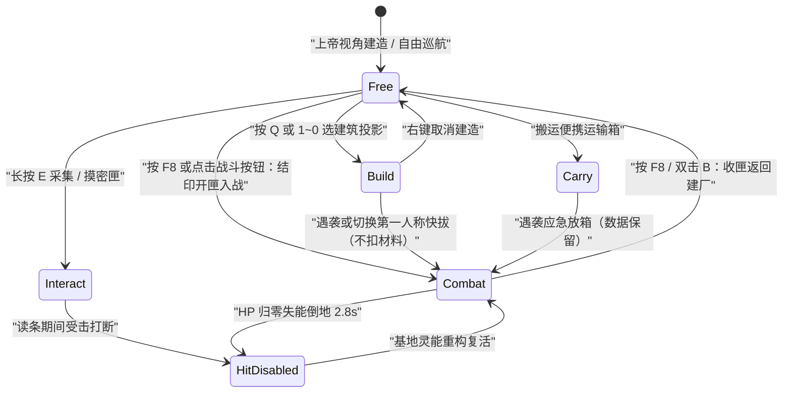
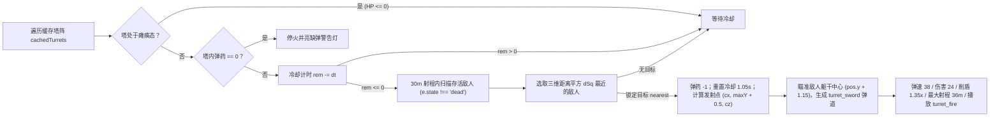
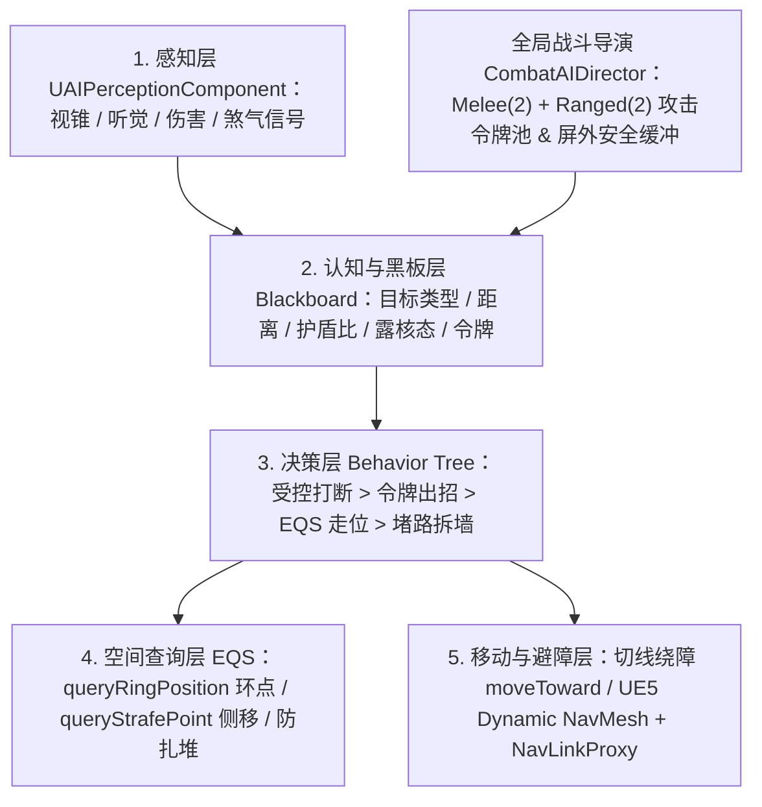
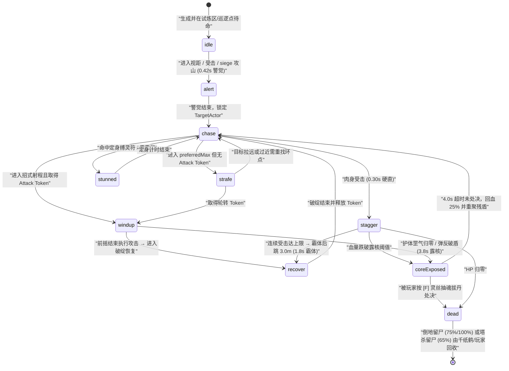
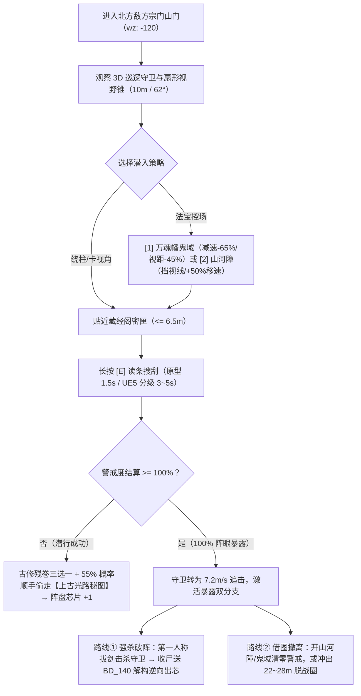

# 《修仙工厂》战斗系统详细策划案（V2.1 正式锁定版）

> **文档定位**：UE5《修仙工厂》全量战斗系统正式策划案，整合第一人称《幽灵线：东京》式结印御剑、**箭塔（飞剑防御塔 / 天雷防御塔 / 纸鹤赋能台三分支）自动化防线**、**敌方分境界 AI 与群体战斗导演**、**宗门藏经阁潜行守卫 AI**、**煞气怨潮攻山波次**、数值框架与 UE5 工程落地映射。  
> **版本与日期**：`V2.1` · `2026-11-27`（修订记录：`V2.1 · 2026-11-27 · 箭塔决策锁定 DEC-13~16`）  
> **真源与对齐基线**：  
> - 战斗配置与开关真源：[combat_config.js](file:///f:/UE5/修仙工厂策划案/js/combat/combat_config.js)  
> - 玩家/剑匣/AI/HUD/VFX/音频原型实现：[combat_player.js](file:///f:/UE5/修仙工厂策划案/js/combat/combat_player.js)、[combat_casket.js](file:///f:/UE5/修仙工厂策划案/js/combat/combat_casket.js)、[combat_ai_director.js](file:///f:/UE5/修仙工厂策划案/js/combat/combat_ai_director.js)、[combat_enemies.js](file:///f:/UE5/修仙工厂策划案/js/combat/combat_enemies.js)、[combat_main.js](file:///f:/UE5/修仙工厂策划案/js/combat/combat_main.js)、[combat_input.js](file:///f:/UE5/修仙工厂策划案/js/combat/combat_input.js)、[combat_hud.js](file:///f:/UE5/修仙工厂策划案/js/combat/combat_hud.js)、[combat_hands_vfx.js](file:///f:/UE5/修仙工厂策划案/js/combat/combat_hands_vfx.js)、[combat_audio.js](file:///f:/UE5/修仙工厂策划案/js/combat/combat_audio.js)  
> - 工业与防御塔数值真源：[xiuxian_data.js](file:///f:/UE5/修仙工厂策划案/xiuxian_data.js)、[tech_tree.js](file:///f:/UE5/修仙工厂策划案/js/tech_tree.js)、[power_shaqi_system.js](file:///f:/UE5/修仙工厂策划案/js/systems/power_shaqi_system.js)  
> - 关联策划文档：[战斗系统详细策划案_模板V1.0.md](file:///f:/UE5/修仙工厂策划案/01_核心策划案/战斗系统详细策划案_模板V1.0.md)、[大地图探索与宗门藏经阁潜行策划案_V1.0.md](file:///f:/UE5/修仙工厂策划案/01_核心策划案/大地图探索与宗门藏经阁潜行策划案_V1.0.md)、[法宝系统专项策划案_V1.0.md](file:///f:/UE5/修仙工厂策划案/01_核心策划案/法宝系统专项策划案_V1.0.md)、[HUD快捷面板设计规范.md](file:///f:/UE5/修仙工厂策划案/01_核心策划案/HUD快捷面板设计规范.md)

---

## 标记图例与阅读约定

| 标记 | 含义 | 执行口径 |
| :--- | :--- | :--- |
| **`【P0 Demo】`** | 练气—筑基最小可玩闭环必须交付的核心功能 | 首批进入 UE5 主干开发 |
| **`【P1 筑基】`** | 筑基进阶战斗、三系扩展、防线自动化与潜行拓展 | Demo 扩容 / EA 版本接入 |
| **`【1.0 扩展】`** | 终局金丹/天魔防线、大型怨潮、全法宝协同 | 正式版阶段释放 |
| **`【当前实现】`** | 已在 Web 3D 原型（`js/combat/*.js`）中落地的参数与逻辑 | 本文档正文以此为基准基线 |
| **`【可改】`** | 已预留配置开关或调参区间的规则与数值 | 可在 `[F9]` 调参抽屉或第 15 章改稿 |
| **`【待策划确认】`** | 原型尚未硬编码或存在新旧口径差异待拍板之处 | 集中汇总于第 15 章决策台 |

---

## 目录索引

- [第 1 章：战斗系统核心定位与“工战交融”闭环](#第-1-章战斗系统核心定位与工战交融闭环)
- [第 2 章：玩家操作、WASD 移动与多模式状态机](#第-2-章玩家操作wasd-移动与多模式状态机)
- [第 3 章：《幽灵线：东京》风格第一人称视听与打击感规范](#第-3-章幽灵线东京风格第一人称视听与打击感规范)
- [第 4 章：玩家战斗技能、天罡剑匣与资源体系](#第-4-章玩家战斗技能天罡剑匣与资源体系)
- [第 5 章：箭塔（防御塔）系统详细设计（BD_160 / 天雷塔 / 纸鹤赋能台）](#第-5-章箭塔防御塔系统详细设计bd_160--天雷塔--纸鹤赋能台)
- [第 6 章：敌方 AI 系统总体架构与群体战斗导演](#第-6-章敌方-ai-系统总体架构与群体战斗导演)
- [第 7 章：敌人图鉴、状态机与分境界 AI 详细规格](#第-7-章敌人图鉴状态机与分境界-ai-详细规格)
- [第 8 章：宗门藏经阁潜行与守卫 AI 机制](#第-8-章宗门藏经阁潜行与守卫-ai-机制)
- [第 9 章：刷怪机制、波次演化与煞气怨潮攻山](#第-9-章刷怪机制波次演化与煞气怨潮攻山)
- [第 10 章：战斗数值框架、伤害公式与 TTK 估算](#第-10-章战斗数值框架伤害公式与-ttk-估算)
- [第 11 章：尸体回收、保鲜衰减与自动化解构作业链](#第-11-章尸体回收保鲜衰减与自动化解构作业链)
- [第 12 章：战斗 HUD、动态准星与屏外预警规范](#第-12-章战斗-hud动态准星与屏外预警规范)
- [第 13 章：玩家死亡、失能倒地与复活惩罚流程](#第-13-章玩家死亡失能倒地与复活惩罚流程)
- [第 14 章：UE5 工程落地架构与原型模块映射表](#第-14-章ue5-工程落地架构与原型模块映射表)
- [第 15 章：数值差异对照表、里程碑与待拍板决策清单](#第-15-章数值差异对照表里程碑与待拍板决策清单)

---

# 第 1 章：战斗系统核心定位与“工战交融”闭环

## 1.1 核心设计哲学与四大支柱

《修仙工厂》的战斗系统不是独立于工厂之外的“附庸射击小游戏”，而是**“赛博修真工业链”的前置生物原料采集端、基地防卫端与大地图秘图破局端**。全系统围绕四大支柱构建：

1. **第一人称“机关掐诀 × 背后天罡剑匣”视觉奇观**
   - 摒弃传统 FPS“右下角端枪管”范式；主角战斗时，前景渲染**赛博玄铁机械双臂与八卦导脉光环**，通过高速手势结印驱动背后**天罡剑匣**中的实体飞剑自双肩弧线出鞘、命中后高速回鞘，配合水墨飞白与赛博故障（Glitch）粒子形成独特东方机甲道法质感。
2. **“破盾 → 露核 → 灵丝抽魂拔丹”处决爽感**
   - 面对带护体罡气的筑基、金丹修士，纯平 A 刮痧效率低；玩家需结合**蓄力齐射、离火爆弹、九霄震雷破盾印（`[V]`）或完美弹反（`Just Guard`）**击碎护体，将其打入“丹田露核态”，再按 `[F]` 发射灵丝凌空扯出并捏爆灵核，一次收割至多 `3` 名露核敌人并获得 `100%` 鲜活度完整尸体。
3. **唯一攻击塔（`BD_160 飞剑防御塔`）× 护山大阵与防壁 × `BD_198 纸鹤赋能台`（千纸鹤三分支）自动化防线**
   - 防线收归“唯一攻击塔 + 战术防壁/护山天幕 + 阵法破盾 + `BD_198 纸鹤赋能台` 三分支统筹”：
   - **唯一攻击塔与防壁/天幕协同**：`BD_160 飞剑防御塔` 为防线唯一攻击塔（必须装填剑丸才可开火，自身不可被摧毁，HP 归零仅进入冒烟瘫痪态），前方布设**前线战术防壁**并由 **`蓄雷塔` 供能开启半透明八卦`护山大阵天幕`**（拦截敌方远程剑气时产生能量闪烁），配合减速破盾阵法压制自**`护山阵眼 / 魔修据点`**涌出的敌修；筑基/金丹敌修亦会主动向 `BD_160` 回射红/紫剑气反击，将其打入冒烟`瘫痪态`。
   - **【纸鹤赋能台 (`BD_198`) 千纸鹤三分支】**：
     1. **收尸鹤（收缴分支）**：`25` 格半径内自动拾取按境界区分的敌修残躯（带黑白名单过滤防堵带），并送入传送带；
     2. **补弹鹤（后勤分支）**：空投补给剑丸给前线 `BD_160 飞剑防御塔`；
     3. **修塔鹤（修缮分支）**：当 `BD_160 飞剑防御塔` 被敌修反击打入冒烟`瘫痪态`时，自动携带灵材飞赴现场修复重启。
4. **五层戴森球级深度“工战交融”正循环（5-Layer DSP-Depth Closed Loop）**
   - **① 工业灵压与环境煞气联动波次**：工厂产能灵压与环境煞气共同驱动敌修自前线**`护山阵眼 / 魔修据点`**阵列分波刷出，并按境界演化（练气 ➔ 筑基 ➔ 金丹 ➔ 元婴）。
   - **② 四阶剑丸串联升级链与多口直连/流体管线**：全线依托基础 `conveyor` 传送带、`pipe` 流体水管与标准 `采矿机 / 大型采矿机` 采掘基础矿石，经 `精炼炉 / 粉碎机 / 切割机 / 加工台 / 搅拌机 / 离心机 / 组装机` 制备耦合辅料；**`BD_156 炼宝台 / 组装机`** 支持消除单口合流器瓶颈，**直接并接 `2~3` 条平行输入 `conveyor` 传送带与侧面 `pipe` 流体水管**（如输送 `火精燃油 / 二阶真火剂`），在 **`BD_156 炼宝台`** 中逐级消耗前阶剑丸完成串联升级：**`玄铁剑丸 ➔ 爆裂剑丸 ➔ 煞气剑丸 ➔ 天雷剑丸`**（`玄铁剑丸` → 耦合 `绝缘板/符文电路 + 火精燃油` 铸 `爆裂剑丸` → 耦合 `煞气合金片 + 煞气晶` 铸 `煞气剑丸` → 耦合 `高压电容器 + 二阶真火剂` 铸 `天雷剑丸`），形成工业纵深。
   - **③ 唯一攻击塔 + 前线防壁/护山天幕 + 纸鹤三分支防线**：`BD_160 飞剑防御塔` 在**前线战术防壁**与 `蓄雷塔` 供能的半透明八卦 **`护山大阵天幕`** 掩护下，配合阵法减速破盾迎战从 **`护山阵眼 / 魔修据点`** 杀出并回射红/紫剑气的筑基/金丹敌修；塔体受击进入冒烟`瘫痪态`后由 `BD_198` 修塔鹤飞入抢修，补弹鹤、收尸鹤同步维持火力与战利品回流。
   - **④ 按境界精准掉落 + 黑白名单过滤 + 分流器分道防堵带**：敌修严格按境界掉落对应残躯（低阶不掉金丹），经收尸鹤黑白名单过滤后入带，再由 `分流器` 按残躯境界分道送入对应 `BD_140 解构机`（低阶阶段无金丹残躯时，金丹解构机保持待机，避免混料堵带）。
   - **⑤ 解构多口直出与双价值（单向对外输出，绝不回流基础铁矿/基础铁剑丸）**：`BD_140 解构机` 支持**直接输出 `2~3` 条平行 `conveyor` 传送带直连下游工坊（`生物培养底座 / 血炼丹炉 / 推演台 / 提取器`）**，拆解出**血肉、碎骨、灵石粉、道髓、金丹碎片、凝丹液**及天魔战利品（`天魔道骨`），兼具两重不可替代价值：
     - *日常工业反哺*：单向输出供给主厂生物芯片线与炼丹线（`MAT_090 回气散`、`MAT_080 气血丹`、`MAT_081 破障丹` 等）；
     - *终极建筑钥匙*：**道髓 / 金丹碎片 / 天魔道骨** 作为不可替代的核心原料，用于建造 **`4×负熵炉`、`3×仙造重组枢机` 与 `渡劫台`** 等终局设施。

## 1.2 “工战交融”核心闭环图



## 1.3 五大核心战斗场景分类

| 场景类型 | 触发条件 | 核心玩法目标 | 敌军 AI 模式 | 失败/撤退后果 |
| :--- | :--- | :--- | :--- | :--- |
| **1. 试炼场与野外矿脉开荒战**<br>`【P0 Demo】` | 踏入试炼区（半径 `28m`）或外围守矿营地（`POI_CAMP_01/02`） | 清理守矿修士，占领矿脉建 `BD_101` 采矿机，回收首批修士尸体 | `patrol` 领地巡逻模式（带脱战锚点与半径限制） | 玩家失能倒地 `2.8s` 后于基地重构复活 |
| **2. 煞气怨潮攻山战**<br>`【P1 / 1.0】` | 环境煞气 `>= 60%` 潮汐线触发主动引怪，或 `waveThreat` 推高触发天魔袭营 | 依托 **BD_160 飞剑防御塔 + BD_191 天雷塔 + BD_198 纸鹤赋能台（修塔鹤分支）** 协同玩家收割尸骸 | `siege` 攻城推进模式（优先拆防御塔与高煞设施） | 敌方冲击防御塔与高煞气建筑，堵路时强拆阻挡墙 |
| **3. 宗门藏经阁潜行/强袭战**<br>`【P1 筑基】` | 潜入 `POI_SECT_01 ~ 04` 偷取古修残卷与上古光路秘图 | `0~99%` 警戒内摸柜盗图；`100%` 暴露后切换强杀破阵或开山河图撤离 | 区域警戒状态机（静谧 → 生疑 → 临战 → 暴露） | 暴露后无法和平摸柜；强杀清场则进入 `180s` 戒严冷却 |
| **4. 精英守卫与遗迹试炼战**<br>`【P1 筑基】` | 争夺高纯度灵脉、太古剑冢碑林（`POI_RELIC_03`） | 应对筑基护体罡气、三连剑气与地面红圈 AOE | 筑基精英 AI（掩体回盾 + 远程压制 + 阵法爆破） | 脱离领地后精英重置护盾 |
| **5. 渡劫防卫战**<br>`【1.0 扩展】` | 启动 `tribulation_table 渡劫台` 凝练人造金丹 | 边控温防雷，边阻截被天劫吸引的敌宗金丹首领与天魔 | `jindan` 多阶段 Boss AI + 召唤护卫 | 渡劫中断、材料部分损毁 |

---

# 第 2 章：玩家操作、WASD 移动与多模式状态机

## 2.1 WASD 地面与立体机动手感规范

原型已将移动控制实现于 [combat_player.js](file:///f:/UE5/修仙工厂策划案/js/combat/combat_player.js) 与 [combat_config.js](file:///f:/UE5/修仙工厂策划案/js/combat/combat_config.js)，强调**零滑步粘滞、可踏上低矮地基/传送带（顶面 `<= 0.55m` 自动上台阶不卡脚）**。

| 参数类别 | 参数名称 | `【当前实现】` 值 | 手感设计意图 | `【可改】` 调节区间 |
| :--- | :--- | :--- | :--- | :--- |
| **基础速度** | 行走速度（Walk） | `5.2 m/s` | 兼顾工厂穿梭与对准 1×1 格 | `4.5 ~ 6.0 m/s` |
| **疾跑速度** | 疾跑速度（Sprint） | `8.6 m/s` | 野外赶路与拉扯身位 | `7.5 ~ 9.5 m/s` |
| **方向衰减** | 侧移系数（`strafeMult`） | `0.92×` | 保持第一人称横移躲剑气灵活性 | `0.80× ~ 1.00×` |
| **方向衰减** | 后退系数（`backMult`） | `0.85×` | 防止纯倒退无脑风筝 | `0.75× ~ 0.90×` |
| **动作减速** | 蓄力期间移速（`chargeSlowMult`） | `0.62×` | 制造蓄力齐射的走位博弈 | `0.50× ~ 0.75×` |
| **动作减速** | 格挡期间移速（`guardSlowMult`） | `0.55×` | 持盾稳守节奏 | `0.45× ~ 0.70×` |
| **加减速** | 起步加速度（`accel`）/ 急停减速度（`decel`） | `34.0 / 28.0`（速率混合） | 按键即走、松手即停不滑出地基 | `20.0 ~ 45.0` |
| **跳跃重力** | 跳跃高度（`jumpHeight`）/ 重力（`gravity`） | `1.65 m` / `22.0 m/s²` | 单跳越过低矮设备与一层台阶 | `1.40 ~ 1.85 m` |
| **手感容错** | 郊狼时间（`coyoteTime`）/ 跳跃缓冲（`jumpBuffer`） | `0.12 s` / `0.12 s` | 边缘起跳与落地连跳零吞键 | `0.08 ~ 0.15 s` |
| **灵步短冲** | 冲刺速度 / 持续 / 冷却 | `20.0 m/s` × `0.22 s`（位移约 `4.4m`），CD `1.15 s` | 瞬间取消蓄力并横向规避红圈 AOE | 开关 `[DEC-02]` |
| **灵步代价** | 灵力消耗 / 无敌帧（`dashInvuln`） | 消耗 `22` 灵力；附带 **`0.16 s` 无敌帧** | 高回报躲避不可格挡地面符阵 | `15 ~ 30` 灵力 |
| **碰撞体** | 玩家胶囊半径 / 眼高（`eyeHeight`） | 半径 `0.48 m` / 眼高 `1.72 m` | 贴合 1 格建筑通道通行 | `0.40 ~ 0.55 m` |

## 2.2 全键位映射表（零冲突校验）

根据 [combat_input.js](file:///f:/UE5/修仙工厂策划案/js/combat/combat_input.js)、[combat_hud.js](file:///f:/UE5/修仙工厂策划案/js/combat/combat_hud.js) 与 [HUD快捷面板设计规范.md](file:///f:/UE5/修仙工厂策划案/01_核心策划案/HUD快捷面板设计规范.md)，以下键位已实现并避开浏览器热键（如移除 `Ctrl` 避免 `Ctrl+W` 关闭网页）：

| 功能分类 | 动作名称 | 键鼠`【当前实现】` | Xbox 手柄建议映射 | 触发与生效说明 |
| :--- | :--- | :--- | :--- | :--- |
| **移动转向** | 四向移动 / 视角 | `W A S D` / 鼠标移动（方向键备用微调） | 左/右摇杆 | 支持 PointerLock 锁屏与中键拖拽兜底 |
| **机动** | 疾跑 / 跳跃 | `Shift`（按住疾跑）/ `Space`（跳跃） | `L3` / `A` | 全战斗态生效 |
| **机动** | **灵步短冲（Dash）** | `C` 或点按 `Left Shift` | `B` | 无方向键时默认向前冲；取消蓄力 |
| **核心攻防** | **轻击（轮发飞剑）** | `鼠标左键`（点按/短按 `< 190ms`） | `RT` 点按 | 从背后剑匣双肩轮流御剑出鞘 |
| **核心攻防** | **蓄力重击（全匣齐射）** | `鼠标左键`（长按 `> 190ms` 进入蓄力，蓄满 `0.65s` 松开） | `RT` 长按 | 蓄力 `< 85%` 或灵力不足时自动降级为轻击 |
| **核心攻防** | **玄铁格挡 / 完美弹反** | `鼠标右键`（按住格挡，命中前 `0.20s` 内按下触发精防） | `LB` | 按下右键立即安全取消当前蓄力 |
| **处决交互** | **灵丝抽魂拔丹** | `F` | `RB` | 准星 `14m` 内锁定露核敌人触发 |
| **处决交互** | **尸体装箱** | 长按 `E`（`0.65s`） | 长按 `X` | 靠近 `4.2m` 内未装箱尸体读条入库 |
| **技能法宝** | **定身缚灵符** | `G` | `十字键 上` | 准星/前方 `10.5m` 展开 `4.2m` 禁锢阵（CD `7.5s`） |
| **技能法宝** | **九霄震雷破盾印** | `V` | `十字键 右` | 轰落天雷破盾并麻痹（CD `9.0s`） |
| **技能法宝** | **万魂帆·万魂域** | `T` | `LT + RB` | 展开 `18m` 紫金魂域减速 `40%`（CD `16.0s`） |
| **法宝快捷键** | **3D 鬼域 / 3D 山河障** | `1`（插万魂幡 8m 鬼域）/ `2`（展开 10m 山河障） | 快捷轮盘 | 来自底部战斗操作栏法宝快捷位 |
| **补给切换** | **快捷服用丹药** | `H` | `十字键 下` | 优先消耗 `MAT_080 气血丹` / `MAT_090 回气散`（CD `6.0s`） |
| **系统切换** | **调参抽屉 / 进出战斗** | `F9`（调参面板）/ `F8` 或 `B`（切回上帝建厂） | `Menu` / `View` | 无模态窗时生效；`Tab` 打开背包装备飞剑 |

## 2.3 六大互斥主状态机与切换规则



## 2.4 动作帧段与输入缓冲规范

- **输入缓冲**：跳跃支持 `0.12 s` 输入缓冲（`jumpBufferTimer`）与 `0.12 s` 郊狼时间（`coyoteTimer`）。
- **高优先级取消（Cancel Window）**：
  - 任何蓄力过程中按下 **`鼠标右键（格挡/弹反）`** 或 **`C/Shift（灵步）`**，立即调用 `cancelCharge()` 无损取消蓄力并切入防御/闪避，绝不卡手。
  - 按住左键 `190 ms` 以内松手视为轻击点射，超过 `190 ms` 自动进入蓄力态（`chargeTriggeredByHold = true`），防止点射误触蓄力。

---

# 第 3 章：《幽灵线：东京》风格第一人称视听与打击感规范

## 3.1 第一人称双臂前景美学（`combat_hands_vfx.js`）

主角设定为**半机械修真开拓者**，第一人称前景通过独立 Canvas 叠加层（UE5 中对应 `Separate FOV Pass` 等效 `72°` 前景骨骼 `SKM_FP_Arms`）渲染：
- **三档外观风格开关（`[DEC-12]`）**：
  - `hybrid`（`【默认推荐】`）：70% 赛博玄铁机械臂 + 30% 古风道袍宽袖束甲，兼顾机器人身份与道士掐诀飘逸感。
  - `mech`：100% 硬核工业工程机械臂。
  - `xianxia`：偏仙侠真人手部佩戴机械义指腕表。
- **动态换色**：双臂导脉光纤、掌心八卦阵纹与悬停剑影随当前出鞘飞剑属性实时切换色彩（庚金 `#38BDF8/#FBBF24`、玄水 `#22D3EE`、离火 `#FB7185/#F97316`、木灵 `#10B981`）。
- **构图红线**：双臂常驻屏幕下 `1/3` 左右两侧（占屏面积 `<= 25%`），保证中央 `60%` 视野通透，不遮挡敌方头顶前摇闪烁晶核与地面红圈。

## 3.2 第一人称手势与结印动作矩阵（`ACT_031 ~ ACT_080`）

| 动作 ID | 动作名称 | 前景双手动作分解 | 标准时长 | 同步音效事件（`combat_audio.js`） | 里程碑 |
| :--- | :--- | :--- | :--- | :--- | :--- |
| `ACT_031` | 开匣入战结印 | “临·兵·斗·剑”四拍仪式感结印，背后剑匣震颤展开 | `0.35 s` | `mudra_beat_1/2/3` | `P0` |
| `ACT_032` | 收起剑匣 | 双手下压收敛，符环折叠归入腕具 | `0.30 s` | `sword_sheath_back` | `P0` |
| `ACT_033` | 普通御剑轮发 | 左右肩侧交替掠出实体飞剑，指尖微点引导 | 随剑匣攻速 | `sword_whoosh_back` | `P0` |
| `ACT_034` | 蓄力全匣齐射 | 双手合印蓄力，松手瞬间双肩对称全匣齐出 | 蓄 `0.65 s` | `metal_charge` | `P0` |
| `ACT_072` | 三系织法切换 | 指印翻花切换金/水/火导脉光谱 | `0.28 s` | `switch_element` | `P1` |
| `ACT_073` | 玄水横江浪诀 | 右掌斜劈水墨扇形弧；蓄力推掌扩增震荡环 | 轻 `0.42s` / 蓄 `0.78s` | `water_light` / `water_charge` | `P1` |
| `ACT_074` | 离火赤煞爆诀 | 单掌轰出赤煞爆弹；蓄力搓出高压火球 | 轻 `0.65s` / 蓄 `0.85s` | `fire_light` / `fire_charge` | `P1` |
| `ACT_075` | 玄铁符盾格挡 | 双臂交叉呈 X 型十字印，腕具投射八卦光盾 | 抬手瞬间 | `guard_up` | `P0` |
| `ACT_076` | 完美弹反震开 | 敌攻撞盾瞬间双臂向两侧崩开，迸发金色冲击波 | `0.30 s` | `parry_clang` | `P0` |
| `ACT_077` | **灵丝抽魂拔丹** | 五指成爪前探发射灵丝钩住露核敌人，拉锯 `0.62s` 后狠狠捏爆 | `0.62 s` | `core_grab_pull` + `core_grab_shatter` | `P0` |
| `ACT_078` | 灵步短冲手势 | 向反方向单手划符借力推空，边缘产生速度线残影 | `0.22 s` | `dash` | `P0` |
| `ACT_079` | 投掷符箓/雷印 | 左手夹纸符甩腕抛出（`[G]` 缚灵符 / `[V]` 震雷印） | `0.25 s` | `talisman` / `thunder_skill` | `P0/P1` |
| `ACT_080` | 快捷吞服丹药 | 左手捏碎丹丸化作灵雾吸入，光纤泛起翠绿波纹 | `0.32 s` | `pill` | `P0` |

## 3.3 镜头语言、动态 FOV、顿帧与四层声学

- **动态 FOV（基准 `84°`，`[可改 80°~110°]`）**：
  - 疾跑（速度 `> 6.2 m/s`）：`+5°`
  - 灵步短冲：`+7°`
  - 蓄力过程：`-6° × chargeRatio`（聚焦准星）
  - 灵丝扯核瞬间：`-10°`（强力特写压迫感）
- **局部 Hitstop 顿帧（严禁冻结工厂传送带全局时间）**：
  - 破盾瞬间：`35 ms`（`0.035 s`）
  - 完美弹反：`50 ms`（`0.050 s`）
  - 灵丝扯核捏爆：`65 ms`（`0.065 s`）
- **Camera Shake 三档震屏**：轻击微震 `amp 0.18 / 0.08s`；受击/齐射 `amp 0.85~0.95 / 0.18s`；弹反/扯核 `amp 1.60~1.65 / 0.25~0.28s`。
- **四层声学叠层（48kHz 分总线）**：机械伺服底噪 + 东方器乐道音（古钟/剑鸣/木鱼结印）+ 赛博电磁脉冲 + 物理重击 Sub-Bass（`40~80Hz`）。

---

# 第 4 章：玩家战斗技能、天罡剑匣与资源体系

## 4.1 玩家基础战斗属性与资源槽

| 资源/属性 | `【当前实现】` 基准值 | 恢复与消耗机制 | 成长联动 |
| :--- | :--- | :--- | :--- |
| **机身耐久（HP）** | `100` | 不自动恢复；通过 `[H]` 服用丹药（单次 `+55 HP`、`+45 灵力`、`+20 罡气`）恢复 | 科技轨 B5、金身芯片 |
| **护体罡气（Shield）** | `60` | 受击后延迟 `4.0 s` 开始以 **`15 / 秒`** 自动充能；**灵丝拔核瞬回 `+20`**；优先替本体承伤 | 金身淬皮芯片、`z2_jinshen_heal` |
| **灵力储量（Qi）** | `100` | 自然恢复 **`11 / 秒`**；**完美弹反瞬回 `+20`**；**灵丝拔核每目标瞬回 `+35`**；青灵竹剑命中 `+3.5` | 丹田反应堆、回气散 |

## 4.2 天罡剑匣系统（`combat_casket.js` · 背后装备式御剑）

原型将传统“手动按 1/2/3 切元素”重构为更具修仙特色的**背后天罡剑匣（4 槽位，按 `[Tab]` 配置飞剑）**：
- **核心机制**：
  1. **装剑越多攻速越快**：基础发射间隔 `baseFireInterval = 0.44 s`，随已装备飞剑数量（`0 ~ 4` 把）查表加速：

| 剑匣装备数量 | `0` 把（保底虚剑） | `1` 把 | `2` 把 | `3` 把 | `4` 把（满匣） |
| :--- | :---: | :---: | :---: | :---: | :---: |
| **攻速倍率（`speedMultByCount`）** | `0.85×` | `1.00×` | `1.35×` | `1.75×` | **`2.25×`** |
| **实际攻击间隔（`0.44 / mult`）** | `0.518 s` | `0.440 s` | `0.326 s` | `0.251 s` | **`0.196 s`** |
| **等效射速（发/秒）** | `1.93 /s` | `2.27 /s` | `3.07 /s` | `3.98 /s` | **`5.11 /s`** |

  2. **自动轮发与虚剑补位**：每次左键点射按游标 `dispatchCursor` 顺次从在匣待命（`docked`）的飞剑中调遣一把，自玩家**背后双肩外侧**弧线掠出并追踪准星目标，命中或飞至最大距离后进入 `returning` 状态高速飞回背后剑匣（超时 `2.8 s` 强制归匣）。若所有实体剑都在空中飞行，自动化出同源词条剑气（伤害 `0.80×`）保证高攻速绝不卡手。
  3. **蓄力全匣齐射**：长按左键蓄满 `0.65 s`（消耗 `18` 灵力）后松手，一次性调遣匣中**全部已装备飞剑**自双肩对称分层齐射，造成高额爆发与 `1.35×` 额外削盾倍率。

- **六大原型飞剑词条总表（`SWORD_ARCHETYPES`）**：

| 飞剑 ID | 名称 | 归属系别 | 轻击/蓄力伤害 | 弹速 / 射程 | 灵耗 | 削盾倍率 | 核心专属词条 |
| :--- | :--- | :--- | :---: | :---: | :---: | :---: | :--- |
| `sword_wood` | **青灵竹剑** | 木·金属位 | `25 / 44` | `48 / 46m` | `1.8` | `0.85×` | **命中回复 `3.5` 灵力**，强追踪（`6.5`） |
| `sword_fire` | **炽阳炎剑** | 火·爆裂 | `36 / 72` | `38 / 42m` | `4.0` | **`1.85×`** | **`3.4m` 火焰溅射** + `10/s` 灼烧持续破盾 |
| `sword_ice` | **玄冰寒魄剑** | 水·穿透 | `28 / 52` | `42 / 44m` | `2.8` | `1.10×` | **穿透 `2` 名敌人** + **`3.2s` 减速** |
| `sword_thunder` | **紫霄惊雷剑** | 雷·神品 | `44 / 82` | `58 / 52m` | `3.2` | **`2.15×`** | 极速弹道 + `2.2m` 溅射 + 穿 `1` 敌 + 回灵 `1.5` |
| `sword_iron` | **寒铁飞剑** | 金·穿甲 | `32 / 58` | `46 / 46m` | `2.2` | `1.40×` | 穿 `1` 敌，稳健破盾锋刃 |
| `sword_dragon` | **斩龙巨剑** | 煞·重剑 | `52 / 96` | `35 / 42m` | `4.5` | **`2.00×`** | 高单发重伤 + `2.8m` 溅射 + 穿 `2` 敌 |
| `phantom_basic` | 凝气虚剑（空匣保底） | 金·虚剑 | `18 / 34` | `40 / 40m` | `2.0` | `0.90×` | 剑匣全空时保底可用 |

## 4.3 三系灵脉织法数值基线（`elements` 配置表）

当不通过剑匣直接按元素模板结算或扩展法术流派时，三系织法核心参数如下：

| 织法系别 | 轻击形态与数值 | 蓄力重击形态与数值 | 核心战术定位 |
| :--- | :--- | :--- | :--- |
| **庚金·疾风剑诀**<br>`【P0 Demo】` | 伤 `22` / 间隔 `0.23s`（`4.3/s`）/ 耗灵 `2.0` / 射程 `44m` / 弹速 `42` / 削盾 `0.65×` | 蓄力 `0.68s` / **3剑齐发 `36×3=108`** / 耗灵 `20` / 弹速 `50` / 削盾 `1.55×` | 中远距主力点杀与单体破盾 |
| **玄水·横江浪诀**<br>`【P1 筑基】` | 伤 `26` / 间隔 `0.42s` / 耗灵 `4.5` / 射程 `15m`（`80°` 扇面）/ 弹速 `28` / 削盾 `0.85×` | 蓄力 `0.78s` / **覆海震荡波 `62`（半径 `11.5m`）** / 耗灵 `24` / 削盾 `1.15×` / 减速 `3.5s` | 近中距群怪割草与防包围解围 |
| **离火·赤煞爆诀**<br>`【P1 筑基】` | 伤 `38` / 间隔 `0.65s` / 耗灵 `7.0` / 射程 `30m`（`3.0m` 溅射）/ 弹速 `24` / 削盾 `1.45×` | 蓄力 `0.85s` / **九幽裂地弹 `135`（`6.0m` 溅射）** / 耗灵 `32` / 弹速 `21` / **削盾 `2.35×`** | 重装破盾与聚怪范围轰炸 |

## 4.4 防御、完美弹反（Just Guard）与灵丝抽魂拔丹

1. **普通格挡（按住右键）**：防御前方扇面（`dot > 0.15`）攻击，**减免 `70%` 伤害**，剩余 `30%` 优先由护体罡气吸收，每次格挡消耗 `6` 点灵力；无法挡住筑基/金丹的红圈地面 AOE（`isUnblockable = true`）。
2. **完美弹反（命中前 `0.20 s` 内按下右键）**：
   - **免伤 `100%`**，瞬间回复 **`20` 灵力**，触发 `50ms` 顿帧与青铜古钟震鸣；
   - **反制近战**：对攻击者造成 `20` 基础伤 × **`3.8×` 削盾（约 `76` 点护体削减）**，并将其打入 **`1.6 s` 大硬直破绽**；
   - **反制远程剑气**：将敌方剑气以 **`2.0×` 伤害、`2.8×` 削盾、`1.45×` 弹速** 精确反弹回原施法者！
3. **灵丝抽魂拔丹（Core Grab，`[F]`）**：
   - **露核条件**：敌人护体罡气归零（破盾露核持续 `3.8s`）或练气/煞傀血量跌破 `32% / 35%`（残血露核持续 `4.2s`）。
   - **操作与连锁**：准星 `14.0 m` 内锁定露核敌人按 `F`，若开启 `[DEC-05]`，自动分叉钩住主目标 **`4.5 m` 半径内最多 `3` 名露核敌人**同步拉锯 `0.62 s` 捏爆（期间开启 `[DEC-06]` 获得无敌保护并直接将 `100%` 鲜活尸体吸入背包/运输箱）。
   - **收益**：每拔核 1 名敌人回复 **`35` 灵力**，并回复 **`20` 护体罡气**，触发 `65ms` 顿帧。

## 4.5 辅助符箓、丹药与本命法宝接入

| 快捷键 | 技能/道具名称 | 冷却 | 核心效果与数值 | 工业/法宝来源 |
| :---: | :--- | :---: | :--- | :--- |
| **`G`** | **定身缚灵符** | `7.5 s` | 投掷在目标点展开 `4.2 m` 紫金禁锢环，强制定身范围内敌人 **`3.2 s`** | 加工台/组装机量产 |
| **`V`** | **九霄震雷破盾印** | `9.0 s` | 射程 `24 m` 轰落天雷柱（半径 `5.5 m`），造成 **`68` 伤害 × `2.6×` 削盾（`176.8 SP`）** 并麻痹 `1.15 s` | 雷系印诀 / 雷符 |
| **`T`** | **万魂帆·万魂域** | `16.0 s` | 以自身为中心展开半径 `18 m`（策划案 `8~10m` 鬼域 / 扩展 `30m` 魂域）持续 `10 s`，敌移速 **`-40%`、前摇延长 `+25%`** | `FAB_001` 万魂幡（`N` 键配置） |
| **`1` / `2`** | **3D 鬼域 / 3D 山河障** | 视法宝资源 | `[1]` 插万魂幡展开 `8m` 鬼域聚怪；`[2]` 展开 `10m` 山河社稷图屏风阻挡视线/弹道且自身移速 **`+50%`** | `FAB_001` / `FAB_002` |
| **`H`** | **快捷战斗丹药** | `6.0 s` | 优先消耗背包 `MAT_080 气血丹` 或 `MAT_090 回气散`，恢复 **`55 HP + 45 灵力 + 20 罡气`** | 炼丹炉 `BD_163` 量产 |

---

# 第 5 章：箭塔（防御塔）系统详细设计（BD_160 / 天雷塔 / 纸鹤赋能台）

> **术语对齐说明**：玩家与口头沟通中常称的**“箭塔”**，在本项目工业与战斗体系中正式对应以 **`BD_160 飞剑防御塔`** 为核心、由 **`BD_191 天雷防御塔（九霄雷暴塔）`** 及 **`BD_198 纸鹤赋能台（千机纸鹤枢，含收尸/补弹/修塔三分支）`** 共同组成的**“自动化修真防卫塔阵体系”**。

## 5.1 系统定位与“防挂机白嫖”核心原则

1. **防线明确分工（箭塔杀敌 / 前线防壁与护山天幕掩护 / `BD_198 纸鹤赋能台` 三分支统筹收尸·补弹·修塔）**：
   - **箭塔只负责猎杀**：`BD_160 飞剑防御塔` 与 `BD_191 天雷防御塔` **必须装填对应剑丸/雷丸才可开火**（无弹药即使通电也不开火），按“最近存活敌人”索敌击杀；**箭塔不再自带牵引收尸**。
   - **前线战术防壁与 `护山大阵天幕` 掩护**：在炮塔阵线前方布设**前线战术防壁**阻挡地面突进，并由 **`蓄雷塔` 供能支撑半透明八卦`护山大阵天幕`**，在拦截自前线 **`护山阵眼 / 魔修据点`** 射来的敌方远程剑气时产生八卦闪烁吸收伤害，延缓塔阵受创节奏。
   - **收尸鹤与补弹鹤负责回流与补给**：击杀后的尸体留在地面，由 `BD_198 纸鹤赋能台`（千纸鹤）在 `25` 格半径内自动飞去捡回（支持按境界黑白名单过滤防堵带），送入储藏箱或传送带，同时向塔内空投各阶剑丸补给。
   - **修塔鹤负责重建冒烟瘫痪塔**：箭塔拥有独立血量且**不可被摧毁**，当筑基/金丹敌修主动回射红/紫剑气将其击入**冒烟瘫痪状态（`瘫痪态`）**时，塔体留在原地停火，由 `BD_198 纸鹤赋能台（修塔鹤分支）` 携带修复灵材飞抵修复重启（或玩家长按 `E` 原地修复）。
2. **防纯挂机白嫖原则**：
   - 箭塔击杀的尸体初始鲜活度为 **`65%`**（解构产出倍率 `0.85×`），低于玩家第一人称常规击杀（`75%` / `1.00×`）与灵丝抽魂拔丹处决（**`100%` / `1.25×`**），以此鼓励高价值精英（筑基/金丹）由玩家亲手破盾拔核收割；
   - 在敌方 AI 仇恨系统中，未瘫痪的箭塔拥有极高的基础威胁权重（`threat = 95`），从 **`护山阵眼 / 魔修据点`** 涌出的攻山敌军会优先集火并将其打入冒烟瘫痪态（筑基/金丹敌修会直接远距离发射红/紫剑气反击炮塔），防止玩家“放几座塔就永久挂机”。

## 5.2 防御塔与防务设施全量规格总表

以下数据严格同步自 [xiuxian_data.js](file:///f:/UE5/修仙工厂策划案/xiuxian_data.js) 与 [combat_config.js](file:///f:/UE5/修仙工厂策划案/js/combat/combat_config.js)（含 `2026-11-27` 拍板规则与前线护山/防壁设施口径）：

| 设施编号 | 设施名称 | 占格尺寸 `(X×Y×Z)` | 解锁阶段与前置 | 建造材料（`costs`） | 耗电 | 端口与插件槽 | 核心战斗/防务参数 |
| :--- | :--- | :---: | :--- | :--- | :---: | :--- | :--- |
| **`BD_160`**<br>`bd_160` | **飞剑防御塔**<br>*(核心箭塔)* | `2 × 2 × 4` | **阶段 II（筑基期）**<br>`GATE_2`（飞剑猎修） | `MAT_040`×4 + `MAT_012`×4 + `MAT_013`×2 + `MAT_014`×2 | `15 MW` | 进：`In_Solid_01`<br>出：`Out_Solid_01`<br>容量 `16` 格 | • 耐久：**`600 HP`**（归零进入冒烟`瘫痪态`，不可摧毁）<br>• 射程：**`30 m`** / 间隔 **`1.05 s`** / 伤 **`24`** / 削盾 **`1.35×`**<br>• **必须装填剑丸才可开火；不再自带收尸** |
| **`BD_191`**<br>`thunder_turret` | **天雷防御塔**<br>*(九霄雷暴塔)* | `2 × 2 × 3` | **阶段 IV（元婴期）**<br>`GATE_4`（天魔雷塔） | `MAT_043`×8 + `MAT_046`×4 + `MAT_105`×6 + `MAT_076`×4 | `90 MW` | 进：`In_Solid_01` 雷丸 / `In_Solid_02` 电容<br>出：`Out_Solid_01` 道骨 / `Out_Solid_02` 金丹尸 | • 耐久：**`1000 HP`**（归零瘫痪，不可摧毁）<br>• 装填 `MAT_139 天雷剑丸` + 高压电容释放九霄神雷，专杀域外天魔与元婴邪修（`FRL_044`） |
| **`BD_198`**<br>`crane_distributor` | **纸鹤赋能台**<br>*(千机纸鹤枢)* | `1 × 1 × 1`<br>*(箱顶不占格)* | **阶段 II（筑基期）**<br>`GATE_2`（纸鹤短途空投） | `MAT_066`×4 + `MAT_014`×2 + `MAT_146`×2 | `15 MW` | 进：`In_Solid_01` 箱顶直吸 / 维修灵材<br>出：`Out_Air_01` 半径 **`25 格`** | • **收尸鹤**：`25` 格内自动拾取战场尸体（支持按境界黑白名单过滤）送入所属储藏箱/传送带<br>• **补弹鹤**：向 `25` 格内防御塔空投各阶剑丸、雷丸与增产剂（`+10` 充能）<br>• **修塔鹤（Lv.3 解锁）**：`BD_160` 进入冒烟瘫痪态时自动携带修复灵材飞入原地修复重启 |
| **前线战术防壁**<br>*(Barricade)* | **战术拒马防壁**<br>*(前线掩体墙)* | 按防线格段布设 | **阶段 II（筑基期）** | 玄铁/岩石建材 | `0 MW` | 无物流端口 | • 部署于 `BD_160` 炮塔阵线前方，物理阻挡地面魔傀与敌修近身切入，迫使敌军滞留减速阵与交叉火力区 |
| **护山大阵天幕**<br>*(`蓄雷塔` 供能)* | **八卦护山天幕**<br>*(半透明能量穹顶)* | 覆盖前线塔阵区 | **阶段 II（筑基期）** | 依赖前线 **`蓄雷塔`** 阵列供电维持 | 由 `蓄雷塔` 供能 | 接入电网阵枢 | • 半透明八卦能量穹顶笼罩防线，**拦截敌方远程剑气弹道时触发八卦纹路闪烁**，保护后方炮塔与军工产线 |

> **数据表同步注记**：按 `2026-11-27` 最新拍板，全防线收尸统一交由 **`BD_198` 千纸鹤** 承担；`xiuxian_data.js` 中 `bd_160`（“自动牵引收尸”）、`battle_base`（`desc` 与 `FRL_045` 收尸描述）及 `combat_enemies.js` 塔杀直入库逻辑后续需同步修订。

## 5.3 弹药体系、配方来源与供弹方式

**开火铁律：没有弹药不开火**——无论电力是否充足，塔内剑丸/雷丸库存为 `0` 时防御塔立即停火并亮起缺弹警告。弹药采用**“分级决定猎杀境界”**的工业驱动设计（每次猎杀周期按 `FRL` 规则消耗）：

| 弹药 ID | 弹药名称 | 适配塔型 | 生产设备与配方原料 | 目标境界与产出（`facilityRules`） | 供弹方式 |
| :--- | :--- | :--- | :--- | :--- | :--- |
| **`MAT_074`** | **铁剑丸**<br>*(玄铁剑丸·I 阶)* | `BD_160` | **`BD_138 加工台`**（玄铁锭×2 + 玄铁粉×2） | `FRL_020`（`30s` 耗 5 枚 → 1 具 `MAT_020 练气残躯`）<br>练气高效率连发收割 | 1. 传送带直连 `In_Solid_01`<br>2. `BD_198` 纸鹤 `25` 格空投 |
| **`MAT_075`** | **爆裂剑丸**<br>*(串联链 II 阶)* | `BD_160` | **`BD_146 组装机`**（玄铁剑丸×2 + 滤渣×2；或+精炼玄铁锭+燃油） | `FRL_021`（`30s` 耗 5 枚 → 1 具 `MAT_055 筑基残躯`）<br>附带高削盾破防特性 | 同上 |
| **`MAT_076`** | **煞气剑丸**<br>*(串联链 III 阶)* | `BD_160` | **`BD_156 炼宝台`**（爆裂剑丸×2 + 煞气结晶×1 + 液态煞气×1） | `FRL_022`（`60s` 耗 5 枚 → 1 具 `MAT_056 金丹残躯`）<br>穿透重甲专打金丹 | 同上 |
| **`MAT_139`** | **天雷剑丸**<br>*(诛仙雷丸·IV 阶)* | `BD_191` / `BD_160` | **`BD_156 炼宝台`**（煞气剑丸×2 + 高压电容×1 + 二阶真火剂×1） | `FRL_044`（`20s` 耗 2 枚 + 电容×1 → 天魔骨×2 + 金丹残躯×1） | 双口传送带或纸鹤空投 |

### 5.3.1 多口直连、无电线供电与复合底座耦合规范（`2026-11-27` 锁定）

- **无电线供电**：全项目无架空电线/输电灵线，建筑依托**地板/建筑底座**即可自动通电。
- **军工制造端（`加工台 ➔ 组装机 ➔ 炼宝台` 职责拆清 + 丹雾喷涂）**：
  - `BD_136 精炼炉` 专注矿石熔炼与玻璃烧制；一阶 `玄铁剑丸` 由 `BD_138 加工台` 冷锻压制；二阶 `爆裂剑丸` 由 `BD_146 组装机` 串联升级；三阶 `煞气剑丸` 与四阶 `诛仙雷丸` 统一由 `BD_156 炼宝台` 专精祭炼，彻底拆分复用度。
  - 前线剑丸出仓干带加装 `BD_177 丹雾喷涂器` 与 `BD_181 乾坤叠物机`，直接提升供弹效率。
- **复合底座与槽位规范**：
  - **灵力引擎（下）`BD_147`**：顶部可挂载 3 联装 `冶炼舱（上）(BD_148)` 或整座占满 3 格的 `炼丹炉（上）(BD_163)`；**前侧垂直电梯进料、背后垂直电梯出料**。
  - **流体处理中枢 `BD_158`**：采用**横置双槽**（两插件左右并排，如 `搅拌机 + 离心机` / `提取器 + 离心机`），液体出口接 **`BD_165 蓄水池/储液罐`**（不进储物盒）。
  - **营养基座 `BD_159` + 培养仓 `BD_142`**：严格遵循**一固（传送带）一液（水管）双入、单出口**规范。
  - **瓶装丹药循环**：`玻璃 ➔ 药瓶压制台 (BD_167) ➔ 炼丹炉 (BD_163) ➔ 瓶装丹药 ➔ 御剑抛射台 (BD_199) / 接引莲台 (BD_200)`（仅丹药/液体用瓶，防御塔只消耗纯实体剑丸）。
- **解构与千纸鹤职责边界（`BD_198` + `BD_140`）**：
  - `BD_198 千纸鹤控制台` 仅负责前线收尸回仓、补弹增产与修塔，基础物料与尸体由千纸鹤控制台内置储仓通过**标准传送带**送入 `BD_140 解构机`；解构机多口平行直出至下游 `营养基座/回收处理塔/万兽仙池/推演台/提取器`。
- **紫色煞气区域、煞气管线与法宝共鸣插座**：
  - 战区西侧划定专属**紫色煞气区域**（紫色地面区域 + 持续上升紫气粒子），内部部署 `煞气调控净化塔`、`煞液提取中枢（横置）`、`液态煞气蓄水池 (BD_165)` 及专用**煞气管线**，直供 `煞气炼宝台` 与生物工坊（享煞气潮汐加成）；
  - 新增 **`fabao_socket` 法宝共鸣插座**（点击可插拔 `万魂幡` / `山河社稷图`），插上法宝后以可见紫色/金光环向周围范围生效，覆盖周边产线与防线。

## 5.4 箭塔索敌与开火逻辑（`combat_ai_director.js` + 弹药/瘫痪前置）

### 5.4.1 索敌开火流程

每座 `bd_160` 飞剑防御塔每帧先校验**瘫痪态**与**弹药库存**，再执行最近敌人索敌开火：



**核心逻辑伪代码（含瘫痪与耗弹校验）**：
```javascript
for (const turret of cachedTurrets) {
  if (turret.isParalyzed) continue;                        // HP <= 0 瘫痪停火
  if ((turret.ammoCount || 0) <= 0) { setLowAmmoLed(turret); continue; } // 无弹药不开火
  if (cooldown[turret.id] > 0) { cooldown[turret.id] -= dt; continue; }
  const originY = turret.maxY + 0.5;
  let nearest = null, minDistSq = range * range; // range = 30m
  for (const e of enemies) {
    if (e.state === 'dead') continue;
    const dSq = distSq(turret.cx, 1.0 - originY, turret.cz, e.pos.x, 0, e.pos.z);
    if (dSq < minDistSq) { minDistSq = dSq; nearest = e; }
  }
  if (nearest) {
    turret.ammoCount -= 1; // 扣减 1 枚剑丸
    cooldown[turret.id] = 1.05; // 间隔 1.05s
    const aimDir = normalize(nearest.pos + (0, 1.15, 0) - turretOrigin);
    spawnProjectile({ owner: 'turret', kind: 'turret_sword', speed: 38, dmg: 24, shieldMult: 1.35, maxDist: 36 });
  }
}
```

### 5.4.2 索敌规则锁定：仅最近存活敌人（`DEC-13` 已拍板）

- 经策划拍板，箭塔索敌**严格只按“射程内三维距离最近的存活敌人”计算**，不设复杂多档优先级切换面板，保持操作与火控逻辑极简直观（后续版本如有需要再行扩展）。

## 5.5 灵压诱饵引怪与纸鹤赋能台（收尸/补弹/修塔）协同

1. **煞气诱饵引怪（`ShaqiSystem.triggerTurretHarvest`）**：
   - 当环境煞气达到 **`>= 60%` 潮汐线**且开启“自动引怪”时，装填弹药且未瘫痪的箭塔可主动吸引煞潮来敌，并消耗弹药完成猎杀。
2. **千纸鹤全自动收尸与补弹（`BD_198 纸鹤赋能台`）**：
   - 敌人被箭塔击杀后，尸体**直接倒地留在战场**，标记鲜活度 **`65%`**（若开启 `[DEC-07]` 腐败则从落地一刻起算倒计时）；
   - 位于 **`BD_198` 半径 `25` 格内**时，空闲收尸鹤自动飞往尸体落点将其捡起（Lv.2 起支持按境界黑白名单过滤防堵带），运回赋能台所在的储藏箱/传送带入口，补弹鹤同步向塔内空投各阶剑丸补给；
   - 若战场超出任何 `BD_198` 覆盖范围，尸体将留在原地等待玩家靠近长按 `E` 手动装箱。
3. **修塔鹤（`BD_198 纸鹤赋能台` 修缮分支）协同修塔重建**：
   - 解锁 Lv.3 金丹修缮鹤后，在 `25` 格覆盖范围内自动派出修塔鹤携带修复灵材，对受损防御塔持续回血，对**瘫痪态 `BD_160 飞剑防御塔`** 执行原地修复重启。

## 5.6 敌方据点反击、箭塔瘫痪与护山天幕重建机制（`DEC-14` 已拍板）

- **敌方宗门据点与远程反击**：
  - 进攻防线的敌方修士自前线宗门据点阵列（**`护山阵眼 / 魔修据点`**）分波刷出并沿攻山路线推进；
  - **筑基/金丹敌修主动反击炮塔**：除贴近强拆外，筑基与金丹境界敌修进入射程后会主动锁定我方 **`BD_160 飞剑防御塔`**，**向炮塔发射红/紫色高能剑气弹道进行对射反击**，持续削减塔体耐久。
- **前线战术防壁与 `护山大阵天幕` 截击缓冲**：
  - 布置在炮塔阵线前方的**前线战术防壁**负责物理挡停近战突进；
  - 由 **`蓄雷塔`** 供能驱动的半透明八卦 **`护山大阵天幕`** 笼罩主防线，当敌方远程剑气命中天幕时，穹顶表面爆发**八卦纹路能量闪烁**并优先拦截抵消部分远程火力。
- **敌人仇恨优先级**：在 `siege` 攻山模式下，未瘫痪的箭塔拥有 **`threat = 95`** 的最高建筑威胁权重；**一旦箭塔进入瘫痪态，其仇恨权重立即降为 `0`**，敌方单位自动转向攻击其他未瘫痪防御塔、高煞建筑或玩家。
- **塔体耐久与不可摧毁规则（已拍板）**：
  - **`BD_160 飞剑防御塔`**：**`600 HP`**
  - **`BD_191 天雷防御塔`**：**`1000 HP`**
  - **HP 归零 → 冒烟瘫痪态（`瘫痪态`）**：塔体**绝不会被摧毁抹除、不掉落、不拆除传送带连线**，而是保留模型原地进入**冒烟瘫痪态**（塔身持续冒出黑灰色浓烟、停火、停止引怪、塔顶剑环停转、晶核转暗红慢闪，**塔内剩余弹药完整保留**）。
  - **原地重建**：
    1. **修塔鹤自动修复重建**：处于 `BD_198 纸鹤赋能台（Lv.3 修塔鹤分支）` `25` 格覆盖范围内时，炮塔进入冒烟瘫痪态会立即**触发 `BD_198` 修塔鹤**携带修复灵材飞赴现场，在塔顶悬停释放修复脉冲原地修复重启；
    2. **玩家手操重建**：靠近瘫痪塔长按 **`E` 读条 `3.0 秒`**，消耗该塔原始建造材料的 **`50%`**，直接满血恢复运转。
- **停电与缺弹表现**：全厂断电或塔内弹药归 `0` 时，塔顶旋转剑环（`turretRing`）停止旋转，晶核转为暗红闪烁，HUD 弹出缺电/缺弹图标。

## 5.7 箭塔成长线（科技树 + 阵盘）

根据 [tech_tree.js](file:///f:/UE5/修仙工厂策划案/js/tech_tree.js) 实现的万象枢机与无限科研库：

| 科技 ID | 科技名称 | 等级上限 | 升级消耗 | 核心增益 |
| :---: | :--- | :---: | :--- | :--- |
| **`C5`** | **诛仙剑阵火控** | `5 级` | 解析数据（`18 + 10×Lv`）+ 玄铁剑丸（`5×(Lv+1)`） | 每级 **`+25%` 飞剑防御塔射速与高阶尸骸爆率**（满级 `+125%` 射速，等效间隔缩短至 `~0.47s`） |
| **`D4`** | **诛仙剑阵威能** | **`∞` 无限级** | 解析数据（`65 + 30×Lv`）+ `MAT_076` 煞气剑丸×5 | 每级 **`+25%` 飞剑防御塔杀伤**，无限突破后期天魔与金丹血量膨胀 |
| **`B2`** | **御剑建造傀儡** | `6 级` | 解析数据 + 玄铁剑丸 | 间接加速防线塔阵批量铺设速度（`+20%/级`） |

## 5.8 塔阵布局建议与“塔杀 vs 手杀”收益平衡

- **推荐阵型**：
  - **前线防壁与护山天幕掩体带**：在 `BD_160` 阵列最前方构筑**前线战术防壁**阻挡地面突袭，并于翼侧/后方配置 **`蓄雷塔`** 为**半透明八卦`护山大阵天幕`**供能，以天幕拦截来自 **`护山阵眼 / 魔修据点`** 的筑基/金丹红紫反击剑气；
  - **外环诱敌带**：`BD_160` 间隔 `20~24m` 交错布置（利用 `30m` 射程形成交叉火力网，防止单塔被近身死角打入瘫痪），并确保处于后方 `BD_198 纸鹤赋能台（修塔鹤分支）` 的 `25` 格修塔覆盖半径内；
  - **核心补给与收尸圈**：在后方储藏箱顶扣装 `BD_198 纸鹤赋能台`，向 `25` 格内所有箭塔自动空投剑丸，并派出千纸鹤自动捡回战场尸体；
  - **玩家协同点**：在塔阵前方展开 `FAB_001 万魂幡（鬼域聚怪减速）` 或 `FAB_002 山河障（挡远程弹道 + 迫使敌修绕行吃满塔伤）`。
- **塔杀 vs 手杀收益对比**：

| 猎杀方式 | 尸体初始鲜活度 | 解构机产出倍率 | 玩家操作/资源回报 |
| :--- | :---: | :---: | :--- |
| **灵丝抽魂拔丹处决（`[F]`）** | **`100%`** | **`1.25×`** | 瞬回 `35` 灵力 + `20` 罡气 + 万魂幡收魂 + 直收入库 |
| **玩家常规御剑击杀** | `75%` | `1.00×` | 需靠近长按 `E` 装箱（`0.65s`） |
| **`BD_160` 箭塔击杀** | `65%` | `0.85×` | **尸体落地，由 `BD_198` 千纸鹤 `25` 格内自动捡回入箱/入带（超出范围需手动按 `E`）** |

## 5.9 箭塔视觉表现与 HUD 交互

- **3D 实体结构（[world_3d.js](file:///f:/UE5/修仙工厂策划案/js/world_3d.js)）**：玄铁重型底座（`3.4×1.2×3.4`）+ 八棱钢柱塔身 + 高速旋转的 **4 枚赤红飞剑环（`turretRing`）** + 顶部双旋青蓝晶核（`apex`）。
- **对射、冒烟瘫痪与天幕拦截视效**：
  - 敌宗筑基/金丹修士从 **`护山阵眼 / 魔修据点`** 涌出并向 `BD_160` 射出**红/紫色反击剑气**；
  - **`护山大阵天幕`**（`蓄雷塔` 供能）呈半透明八卦能量穹顶覆盖防线，每次拦截敌方远程弹道即刻爆发**八卦光纹闪烁**；
  - 当 `BD_160` 被击入**冒烟瘫痪态**时，塔体持续冒出浓烟、剑环停转、晶核转暗红慢闪，同时可见 **`BD_198` 修塔鹤**飞抵塔顶释放青蓝修复光环。
- **齐射高光**：触发天魔防线反杀时，调用 `World3D.flashDefenseTurrets()` 使全厂 `bd_160`、`thunder_turret`、`crane_distributor` 同步迸发高光脉冲与齐射特效。

## 5.10 纸鹤赋能台（BD_198）千纸鹤三分支升级深度

`BD_198 纸鹤赋能台` 采用**“单台多能、三分支解耦 + 三阶境界递进升级”**设计，替代旧版独立修塔建筑，在 `25` 格半径内统筹战场后勤与防线自愈：

- **三大作业分支**：
  1. **① 收尸鹤（收缴分支）**：自动巡航 `25` 格内战场拾取敌修残躯，送入所属储藏箱或传送带；支持**按境界黑白名单过滤**，只收目标境界残躯、屏蔽低阶垃圾，防止混料堵带。
  2. **② 补弹鹤（后勤分支）**：从所属储藏箱抽取各阶剑丸（`玄铁 / 爆裂 / 煞气 / 天雷剑丸`）与增产剂，向防线 `BD_160` / `BD_191` 防御塔精准空投补弹。
  3. **③ 修塔鹤（修缮分支）**：当防线上的 `BD_160 飞剑防御塔` 受创或 HP 归零进入瘫痪态时，自动携带修复灵材飞赴现场执行原地修复与重启。

- **三阶升级深度**：

| 升级阶位 | 解锁阶段 | 解锁分支与核心机制 | 并发上限 | 单次负重 | 作业与过滤特性 |
| :--- | :--- | :--- | :---: | :---: | :--- |
| **Lv.1 初阶纸鹤** | 练气—筑基初期 | 仅解锁 **① 收尸鹤** | `1` 只 | `1` 具 | 仅拾取**练气残躯**，无过滤黑白名单 |
| **Lv.2 筑基赋能鹤** | 阶段 II（筑基期） | 解锁 **② 补弹鹤分支** + **按境界黑白名单过滤** | `1~2` 只 | `3` 具/枚 | 屏蔽低阶垃圾防堵带，支持向防线空投各阶剑丸 |
| **Lv.3 金丹修缮鹤** | 阶段 III（金丹期） | 解锁 **③ 修塔鹤分支**（自动修复瘫痪防御塔） | **`3` 只** | **`5` 具/枚** | 全分支并发调度，飞行与作业速率大幅提升 |

---

# 第 6 章：敌方 AI 系统总体架构与群体战斗导演

## 6.1 UE5 五层商业级 AI 技术架构



### 6.1.1 感知层参数模板

| 感知通道 | 练气修士 | 筑基修士 | 金丹首领 | 触发与穿透规则 |
| :--- | :---: | :---: | :---: | :--- |
| **视觉视距（`sightRange`）** | `26 m` | `32 m` | `42 m` | 试炼区结界内（距 `(0,64)` `<= 28m`）或受到攻击立即激活 |
| **听觉噪音（Hearing）** | `16 m` | `22 m` | `35 m` | 开火、砸矿、重落地与机器爆鸣触发警觉 |
| **伤害感知（Damage）** | 全距离即时 | 全距离即时 | 全距离即时 | `damageFromPlayer > 0` 立即无视巡逻范围锁定玩家 |
| **煞气嗅觉（Siege）** | 全局激活 | 全局激活 | 全局激活 | `aiMode === 'siege'` 时直接越过视距向基地防御塔/高煞机器推进 |

## 6.2 群体战斗导演与攻击令牌池（`CombatAIDirector`）

为彻底解决第一人称视角下“多个怪物同秒齐射导致无法走位与弹反”的痛点，原型在 [combat_ai_director.js](file:///f:/UE5/修仙工厂策划案/js/combat/combat_ai_director.js) 实现了严格的 **Attack Token（攻击令牌）** 与 **屏外安全缓冲**：

1. **令牌申请与归还机制**：
   - `requestToken(enemy, kind, durationSec = 2.6)`：敌人进入射程并选定招式后，向导演申请 `melee` 或 `ranged` 令牌；持有期限默认为 `windup + recover + 0.4 s`（约 `2.6 s`），超时自动 `pruneTokens()` 回收，或硬直/露核/定身/恢复结束时立即调用 `releaseToken(enemy)` 归还。
   - **三档预设上限（`[DEC-09]`）**：
     - `casual`（休闲）：近战 `1` + 远程 `1`
     - **`standard`（标准默认）：近战 `2` + 远程 `2`**
     - `hardcore`（硬核）：近战 `3` + 远程 `3`
2. **无令牌行为**：处于最佳交战环带内但未抢到令牌的敌人，自动转入 `strafe` 状态，通过 `queryStrafePoint()` 沿目标切线左右游走对峙，营造武侠/修真包围压迫感而不乱放冷箭。
3. **屏外安全缓冲（`getOffscreenInfo`）**：
   - 当持有令牌的敌人位于玩家镜头前方夹角 **`> 105°`**（`offscreenAngleDeg = 105°`）的视野盲区时：
     - **强制延长前摇 `+0.42 s`**（`offscreenExtraWindup`）；
     - 强制播放高频预警音效 `offscreen_warn`，并在 HUD 中心圆周亮起红金色威胁方向弧，让玩家有机会转身格挡弹反。

## 6.3 空间战术查询（EQS）

1. **`queryRingPosition()`（最佳交战环点 + 防扎堆）**：在目标周围 `[preferredMin, preferredMax]` 环带采样 `12` 个圆周点，剔除越界及建筑碰撞点（`isPointBlockedByObstacles`）；若距离其他友军 `< 2.8 m` 则重罚分（`-38 × (2.8 - d)`），同时加分偏好玩家正面视野区。
2. **`queryStrafePoint()`（侧移环绕点）**：沿当前半径按 `strafeDir * 0.45 rad` 计算切线落点，遇阻则自动翻转 `strafeDir *= -1`。
3. **障碍绕行（`moveToward`）**：直行被工厂建筑阻挡时，自动沿垂直切线方向滑步绕行；在 UE5 正式版中升级为 `RecastNavMesh (DynamicModifiersOnly)` + 楼梯 `NavLinkProxy`。

## 6.4 双目标仇恨评分与堵路拆墙规则（`selectTarget`）

原型实际执行的仇恨评分逻辑（每秒实时评估）：

$$\text{PlayerScore} = 100 + \max(0, 40 - \text{DistToPlayer}) + 1.2 \times \text{DamageFromPlayer}$$
$$\text{BuildingScore} = \text{ThreatBase} + \max(0, 36 - \text{DistToBuilding})$$

- **目标权重与行为策略**：
  - **玩家角色**：基础分 `100`（玩家倒地时降为 `-999`），受玩家伤害越高仇恨越稳。
  - **箭塔（`bd_160`）**：`ThreatBase = 95`（`siege` 攻山模式或 `[DEC-08] = 'aggressive'` 时参与竞争，极易吸引攻城怪集火）。
  - **高煞建筑（解构机/炼丹台/渡劫台）**：`ThreatBase = 78`。
  - **普通工厂建筑/传送带**：`ThreatBase = 20`。
- **堵路拆墙开关（`[DEC-08]`）**：
  - `never`：绝不攻击玩家建筑；
  - **`blocked_only`（默认推荐）**：平时绕行不拆传送带，仅当寻路前方 `2.2m` 探测点被建筑完全堵死（`blockingObstacle`）时，标记“路径受阻·强拆”并打通缺口；
  - `aggressive`：所有建筑均纳入高威胁拆毁目标。

---

# 第 7 章：敌人图鉴、状态机与分境界 AI 详细规格

## 7.1 通用敌人宏观行为树状态机（`combat_enemies.js`）



## 7.2 敌人 A：练气修士（外门斥候 / 基础杂兵 · `【P0 Demo】`）

- **视觉与辨识**：青灰道袍、青蓝（`#38BDF8`）眼部光条与肩饰，腰悬玄铁长剑，无护体光罩；警觉音效 `enemy_alert_qi`。
- **基础数值**：`100 HP` | `0 SP` | 移速：走 `2.4` / 追 `4.7` / 侧移 `3.2 m/s` | 交战环带 `4.0 ~ 9.5 m` | 视距 `26 m`。
- **特殊机制**：
  - **残血露核**：HP `<= 32%`（`32 HP`）时触发 `4.2 s` 露核态，可按 `F` 拔核秒杀；
  - **防连段锁死**：连续吃 **`3` 次** 轻击硬直后，立即触发 **`1.8 s` 霸体并向后跃步 `3.0 m`**。
- **招式帧表**：

| 招式名称 | 触发距离 | 前摇 | 伤害与判定 | 防御/弹反规则 | 破绽恢复 / 冷却 |
| :--- | :---: | :---: | :--- | :--- | :---: |
| **疾步掌击 (`palm`)** | `<= 3.8 m` | `0.55 s` | 向前滑步 `0.9m`，造成 **`18`** 伤 | 可格挡；**可完美弹反（受 76 削盾并陷入 `1.6s` 大破绽）** | `0.70 s` / `3.4 s` |
| **短距剑气 (`aura`)** | `4.0 ~ 14.5 m` | `0.65 s` | 发射速度 `18 m/s` 剑气，造成 **`15`** 伤 | 可格挡；**完美弹反以 `2.0×` 伤害反弹** | `0.55 s` / `3.8 s` |

- **击杀掉落**：`MAT_020 练气残躯`（`matId: MAT_017`）。

## 7.3 敌人 B：筑基修士（内门护法 / 护体精英 · `【P1 筑基】`）

- **视觉与辨识**：玄黑道袍 + 琥珀金（`#F59E0B`）重型肩甲，周身环绕旋转的**金色二十面体护体罡气盾**；警觉音效 `enemy_alert_found`。
- **基础数值**：`280 HP` | **`180 SP` 护体罡气** | 移速：走 `2.6` / 追 `4.9` / 侧移 `3.0 m/s` | 交战环带 `7.5 ~ 16.0 m` | 视距 `32 m`。
- **护盾博弈机制**：
  - 护盾存续期间免除硬直；护盾归零瞬间溢出 `40%` 伤害并强制打入 **`3.8 s` 破盾露核态**！
  - 若 `10.0 s` 内未被击杀，自动重新撑起 **`120 SP`** 残盾。
- **招式帧表**：

| 招式名称 | 触发距离 | 前摇 | 伤害与判定 | 防御/弹反规则 | 破绽恢复 / 冷却 |
| :--- | :---: | :---: | :--- | :--- | :---: |
| **振袖近身击 (`melee`)** | `<= 3.6 m` | `0.52 s` | 滑步近身震击，造成 **`30`** 伤 | 可格挡；**可完美弹反（`1.6s` 大破绽）** | `0.80 s` / `4.8 s` |
| **三连追踪剑气 (`tripleAura`)** | `6.5 ~ 23.0 m` | `0.75 s` | 间隔 `0.22 s` 连续射出 **`3` 道** 剑气（速度 `23 m/s`），单发 **`18`** 伤 | 可连续三连弹反，每发均可 `2.0×` 反弹 | `0.90 s` / `5.2 s` |
| **地面红圈符阵 (`aoeRing`)** | `5.0 ~ 22.0 m` | `1.35 s` | 玩家脚下生成直径 `6.8m`（半径 **`3.4 m`**）渐满红圈，炸起冲天灵柱造成 **`42`** 伤 | **不可格挡！（`isUnblockable`）** 必须走位或灵步躲出 | `1.15 s` / `8.5 s` |

- **击杀掉落**：`MAT_055 筑基残躯`（`matId: MAT_051`）。

## 7.4 敌人 C：金丹首领 · 玄煞真君（区域 Boss · `【1.0 扩展】`）

- **视觉与辨识**：紫金道袍（`#3B0764` + `#FDE047`），体型 `1.32×`，常驻 **`1.8 m` 悬浮巡航**，周身环绕紫色护体罡气；警觉音效 `enemy_alert_jindan`。
- **基础数值**：`900 HP` | **`360 SP` 灵甲护盾** | 移速：走 `3.2` / 追 `5.4` / 侧移 `3.8 m/s` | 交战环带 `9.0 ~ 20.0 m` | 视距 `42 m` | 破盾 `12.0 s` 后重聚 `240 SP`。
- **三阶段演化 AI**：
  - **P1（`100% ~ 70% HP`）**：中空悬浮御剑游斗，交替使用“五剑扇射”与“九天雷阵”；
  - **P2（`< 70% HP`）**：召唤 **`2` 名练气护卫** 协同作战，形成令牌配合压制；
  - **P3（`< 35% HP` 燃丹狂暴）**：全屏提示“进入三阶段燃丹狂暴！”，高频施放高伤九天雷阵与五剑齐发。
- **招式帧表**：

| 招式名称 | 触发距离 | 前摇 | 伤害与判定 | 防御/弹反规则 | 破绽恢复 / 冷却 |
| :--- | :---: | :---: | :--- | :--- | :---: |
| **五剑齐发扇射 (`fanSwords`)** | `4.0 ~ 26.0 m` | `0.72 s` | 扇形散射 **`5` 道** 高速剑气（速度 `26 m/s`，间隔 `0.14 rad`），单发 **`22`** 伤 | 可格挡与弹反反弹 | `0.85 s` / `4.2 s` |
| **九天雷阵 (`thunderGrid`)** | `5.0 ~ 26.0 m` | `1.45 s` | 目标脚下生成半径 **`4.0 m`** 红色预警法阵，引爆造成 **`46`** 伤 | **不可格挡！** 需灵步闪避 | `1.25 s` / `9.5 s` |

- **击杀掉落**：`MAT_056 金丹残躯`（`matId: MAT_052`）+ 必掉 **`mat_077 金丹碎片×1`**。

## 7.5 敌人 D：煞气狂傀与攻城魔傀（防线特化兵种）

| 兵种 | 定位与外观 | 基础数值与 AI 特征 | 招式与应对解法 |
| :--- | :--- | :--- | :--- |
| **煞气狂傀 (`beast`)**<br>`【当前实现】` | 四足暗紫发光体（`0.85×` 缩放），高机动突进兵 | `65 HP` / `0 SP` / 追击 **`7.2 m/s`** / 交战距 `1.5~2.5m` / 连吃 `2` 次硬直霸体后跳 / 露核阈值 `35%` | **扑咬 (`lunge`)**：距 `2.8m` 前摇 `0.42s`，伤害 `14`（可弹反）。适合玄水扇形波或 `BD_160` 箭塔点杀 |
| **破阵重锤魔傀**<br>`【1.0 扩展】` | `2.8m` 重装巨型傀儡，背负爆裂晶柱弱点 | `450 HP` / 移速 `2.5 m/s` / **对玩家建筑与箭塔造成 `3.0×` 额外破坏** | 优先绕后攻击其背部弱点晶柱（`1.5×` 暴击并引爆溅射周围杂兵） |

---

# 第 8 章：大地图敌方宗门潜行偷盗与守卫 AI 详细设计

> **系统归属定性**：**宗门偷盗玩法属于《修仙工厂》战斗系统的重要外围分支**——它与第一人称战斗、本命法宝（万魂幡/山河社稷图）、尸身解构逆向（`BD_140`）以及 HUD 灵枢光路阵盘（`[P]`）共同构成**“潜战一体（潜行侦察 → 法宝控场盗卷 → 暴露强杀破阵收尸 / 借图隐遁脱战）”**闭环。  
> **对齐真源**：[world_3d.js](file:///f:/UE5/修仙工厂策划案/js/world_3d.js)（`buildGrandEnemySectCompound`）、[world_stealth_actor.js](file:///f:/UE5/修仙工厂策划案/js/world/world_stealth_actor.js)、[map_exploration_system.js](file:///f:/UE5/修仙工厂策划案/js/systems/map_exploration_system.js)、[xiuxian_data.js](file:///f:/UE5/修仙工厂策划案/xiuxian_data.js)（`XIUXIAN_MAP_POIS`）及 [大地图探索与宗门藏经阁潜行策划案_V1.0.md](file:///f:/UE5/修仙工厂策划案/01_核心策划案/大地图探索与宗门藏经阁潜行策划案_V1.0.md)。

## 8.1 “潜战一体”设计定位与完整状态流转图

不同于“被发现即读档重来”的硬核潜行，本作采用**【方案 A：轻量紧张型潜行】**——潜行期考验对 3D 守卫视锥、法宝资源与读条时机的博弈；一旦警戒度达到 `100%` 暴露，立即无缝转入**第一人称战斗强杀收尸**或**双法宝隐遁脱身**，绝不强迫失败重开。



## 8.2 北方巨型敌方宗门“三进四院”3D 建筑群空间规划

在 [world_3d.js](file:///f:/UE5/修仙工厂策划案/js/world_3d.js) 的 `buildGrandEnemySectCompound()` 中，主厂区正北方建有一座占地 **`96 m × 104 m`（`wx: -48..+48`, `wz: -120..-224`）** 的巨型敌方宗门建筑群，形成清晰的递进潜行纵深：

- **引路与山门**：`50 m` 白玉引路古道（`wz: -58..-114`，两侧 `12` 根盘龙朱红灯柱）→ `26 m × 15 m` 三门四柱巨型山门牌坊（`wz: -120`）→ 四周护宗光幕与四角 `14 m` 镇宗角楼。
- **四大藏经阁院落布局与坐标对照**：

| 据点 ID | 院落与据点名称 | 境界 | 北宗四院集中坐标 `(wx, wz)`<br>*(传送落点)* | 外围四象分布式坐标<br>*(`DEFAULT_MAP_POIS`)* | 3D 空间结构与潜行掩体特色 |
| :--- | :--- | :---: | :---: | :---: | :--- |
| **`POI_SECT_01`** | **一进院·外门藏经前殿**<br>*(青云外门藏经阁)* | I~II<br>练气/筑基 | `(0, -142)`<br>*落点 `(0, -112)`* | `(-56, -52)` | 演武八卦盘 + 左右掩体长廊（`x = ±18`）+ 敞开式大堂 `2` 排发光玉简书架，适合新手绕柱潜入 |
| **`POI_SECT_02`** | **二进西院·西厢镇魔秘典阁**<br>*(血煞宗秘库)* | III<br>金丹 | `(-30, -168)`<br>*落点 `(-20, -168)`* | `(56, -54)` | `22m × 22m` 白玉台 + 旋转星枢光路仪 + 四柱窄廊，极适合拍出【山河障】封锁单侧通道 |
| **`POI_SECT_03`** | **二进东院·东厢百草灵兽苑**<br>*(万兽宗灵阁)* | IV<br>元婴 | `(30, -168)`<br>*落点 `(20, -168)`* | `(-60, 54)` | `4` 块发光灵草药畦 + 中央高阶灵兽金笼（高侦测嗅觉圈），推荐先插【万魂幡鬼域】控住兽群 |
| **`POI_SECT_04`** | **三进后院高台·五层镇宗总阁**<br>*(天机分阁秘藏)* | V<br>化神 | `(0, -198)`<br>*落点 `(0, -184)`* | `(62, 52)` | `44m × 32m` 高台 + 左右钟鼓楼（`x = ±18`）+ `24m` 五层飞檐主塔（一楼 3 排书架+金匮）+ `60m` 冲天赤红灵光柱 |

## 8.3 敌宗守卫 AI 巡逻、扇形视野锥与 3D 魂火警戒灯球

在 [world_stealth_actor.js](file:///f:/UE5/修仙工厂策划案/js/world/world_stealth_actor.js) 与 `world_3d.js` 中，每座藏经阁默认配置 **`3` 名 3D 巡逻守卫**（UE5 正式版按据点扩展精英护法/嗅觉灵兽/扫描傀儡）：

1. **环绕巡逻轨迹**：
   - 围绕院落中心以 **`11.2 m`** 半径做圆周巡逻，奇偶守卫采用正反交错角速度（`+0.52 rad/s` 与 `-0.46 rad/s`），制造错峰穿插的潜行空档。
2. **扇形视野锥几何与数学判定**：
   - **常规探测距离**：`10.0 m`（进入【鬼域】后收缩 `45%` 至 `5.5 m`）；
   - **视锥半角**：`0.54 rad`（约 `31°`，全扇区约 `62°`；UE5 正式版可扩至 `90°`），判定条件：$\frac{\vec{v}_{\text{guard}\to\text{player}}}{\|\vec{v}\|} \cdot \vec{f}_{\text{guard}} \ge \cos(0.54)$；
   - **视觉色彩反馈**：常规巡逻为半透明玫红（`0xf43f5e`, 透明度 `0.24`）；发现玩家时高亮赤红（`0xff1e42`, 透明度 `0.56`）；被万魂幡鬼域笼罩时转为暗紫（`0xa855f7`）。
3. **头顶 3D 魂火警戒灯球（`alertOrb`）**：
   - **低警戒（`< 30%`）**：琥珀黄光（`0xfbbf24`），缩放随全局警戒度平滑放大 `1.0 + (alert / 100) × 0.8`；
   - **中警戒（`30% ~ 74%`）**：橙红警示（`0xf97316`）；
   - **高危 / 发现玩家（`>= 75%` 或 `seesPlayer`）**：赤红爆闪（`0xff1e42`）并剧烈脉动：`scale = 1.7 + sin(14t) × 0.35`。
4. **暴露追击与脱战归位**：
   - 警戒度达 `100%` 暴露时，半径 `20 m` 内的守卫立即置为 `chasing = true`，脱离巡逻圆周以 **`7.2 m/s`** 直线追捕玩家；
   - 若玩家开启【山河障】阻断视线、或与守卫距离 `> 18 m`、或脱离院落中心 `> 22 m`（UE5 正式版 `> 28 m`），守卫自动脱战返回原巡逻轨。

## 8.4 警戒度（`0% ~ 100%`）双轨数值公式与消警机制

| 警戒区间 | 状态命名 | 守卫 AI 与读条规则 |
| :--- | :--- | :--- |
| **`0% ~ 39%`** | **静谧潜行（绿）** | 常规 `10m` 视锥巡逻，可贴近密匣安全读条搜刮 |
| **`40% ~ 79%`** | **生疑巡查（琥珀）** | 守卫灯球变橙红并向异响/书架靠近探查；搜刮读条不中断 |
| **`80% ~ 99%`** | **临战预警（橙红）** | 灯球赤红闪烁，门禁法阵充能；最后 `2~3s` 脱身或开法宝压制窗口 |
| **`100%`** | **阵眼暴露（赤红）** | 全阁警报触发追击，禁止和平搜刮，强制进入“强杀破阵”或“借图撤离” |

- **实时视野增减（每帧）**：
  - 处于守卫视野锥内（且未开山河障）：**`+28% / 秒`**（处于万魂幡鬼域内受减速与视距压制）；
  - 脱离视野且未暴露：**`-5% / 秒`** 自然回落（UE5 正式版躲掩体 `3s` 后 `-10% / 秒`）。
- **搜刮结算增量公式（`sneakIntoSectLibrary`）**：
  $$\Delta\text{Alert} = \max\Big(12,\ \text{baseAlert} + \text{rand}(0..8) - \text{FabaoReduction}\Big)$$
  - `baseAlert`：默认 `32`（或各阁配置 `28 / 35 / 42 / 48`）；
  - **法宝被动潜行减免（`getFabaoStealthReduction`）**：装备且未休眠的【山河社稷图】提供 `min(12, 4 + 2×重数)` 减免；未锁定且魂力 `>=10` 的【万魂幡】提供 `min(12, 3 + 2×重数)` 减免，**两者叠加最高减免 `-20%` 警戒增量**。
- **营地灯塔消警**：在 `POI_CAMP_01 / 02` 散修营地灯塔长按 `E` 休整，直接 **`-20%` 警戒度并解除暴露状态**。

## 8.5 潜行交互读条与双法宝主动控场/隐遁（`[E]` / `[1]` / `[2]` / `[V]`）

1. **现场交互读条（`<= 6.5 m`）**：靠近藏经阁光环长按 **`[E]`** 触发读条（原型统一 `1.5 s`；UE5 正式版按外门 `3.0s` / 内阁 `4.0s` / 镇宗天机柜 `5.0s` 分级），松手清零；搜刮成功**战利品立即入包，绝不因后续暴露而回吐**。
2. **`[1]` 万魂幡·3D 鬼域（`cast3DGhostDomain`）**：
   - 在脚下展开半径 **`8.5 m`** 的 3D 鬼域阵环持续 **`10.0 s`**，范围内守卫移速 **`-65%`**、视距 **`-45%`**；
   - 若已处于 `100%` 暴露状态，消耗 **`15` 魂力**（`+10%` 魂压）直接以鬼域迷雾遮断神识，**将警戒度清零并解除暴露**。
3. **`[2]` 山河社稷图·3D 山河障（`cast3DShanheWall`）**：
   - 在身前 `2.8 m` 处横亘展开 **`10 m`** 画卷屏风持续 **`8.0 s`**，**`100%` 阻断守卫视线并强制中止追击**，同时激活被动【缩地成寸】使玩家移速 **`+50%`**；
   - 若已处于 `100%` 暴露状态，消耗 **`15` 灵韵**（`+8` 磨损）直接虚空隐遁，**将警戒度清零并解除暴露**。
4. **`[V]` 灵枢无人机侦察与视角切换**：
   - 地面潜行/第一人称战斗时按 `[V]`，灵枢无人机自肩侧升空（`1.05 s` 飞行插值）切入高空俯瞰视角，配合左上角 `500×500` 实时雷达小地图（`#worldMinimapCanvas`）俯瞰守卫红点分布与路线规划；再按 `[V]` 收回无人机切回第一人称。

## 8.6 暴露后双分支：第一人称强杀破阵收尸 vs 借图撤离

- **路线① 强杀破阵（以战养盘流）**：暴露后不撤退，直接用第一人称天罡剑匣 + 弹反/拔核强杀守卫，将掉落的修士尸体带回基地送入 **`BD_140 解构机`**，并通过 `decodeCorpseChip`（消耗脑髓 `MAT_019×1` 或解析数据 `MAT_020×5`）直接逆向提取 **光路芯片 `+1`** 提升全厂算力倍率。
- **路线② 借图撤离（极限轻功流）**：摸完关键密卷后立刻按 `[2]` 展开山河障挡路加速，或按 `[1]` 插下万魂幡，直线冲出 `22~28m` 脱战圈即可无损带走全部秘图与残卷。

## 8.7 偷盗战利品与全图 13 座 POI 联动总表

- **藏经阁双核心产出**：
  1. **古修残卷三选一**：从 `XIUXIAN_RELIC_SCROLLS`（`POOL_01 ~ POOL_22`）抽取 `3` 枚未参悟残卷现场三选一，永久解锁跳过卡脖子原料的高阶替代配方；
  2. **上古光路秘图（`55%` 伴生偷取率）**：直接触发 `OpticalArrayHUD.grantChipFromSource('sect_steal')`，无需前置产线即可提前点亮阵盘刻录（全厂算力 `+10%/枚`）。
- **大地图 4 类 13 座 POI 协同**：除 `4` 座藏经阁外，外围还分布 `3` 座古修残碑（`POI_RELIC_01~03`，零警戒和平参悟三选一 + 首次赠芯片）、`4` 处山河奇观柱（`POI_WONDER_01~04`，打卡为山河图充能 `+35` 灵韵）与 `2` 座营地灯塔（`POI_CAMP_01~02`，休整 `-20%` 警戒），共同支撑“探索-潜行-战斗-工业”全域循环。

---

# 第 9 章：刷怪机制、波次演化与煞气怨潮攻山

## 9.1 试炼场自动补刷与 5 种预设波次（`combat_enemies.js`）

在原型中，出生点南方 **`镇魔演武试炼场 (wx: 0, wz: 64)`** 设有常驻最大 **`3` 只存活怪（`MAX_ARENA_ALIVE = 3`）** 的自动补刷机制：当场内怪物 `< 3` 只时，每隔 `1.2 s` 自动补刷 1 只（若缺筑基则补 `foundation`，否则补 `qi`）；仅当玩家踏入试炼场半径 `28 m` 内或主动攻击时才激活接战。

同时支持在 `[F9]` 调参抽屉一键召唤 `5` 种测试波次：

| 波次预设 ID | 名称 | 兵种构成 | AI 模式 | 战术测试目的 |
| :--- | :--- | :--- | :---: | :--- |
| **`welcome`** | 默认迎战小队 | `qi ×2` + `foundation ×1` | `patrol` | 练气杂兵走位 + 筑基破盾教学 |
| **`qi_pack`** | 练气斥候三人组 | `qi ×3` | `patrol` | 验证 Attack Token（2+2）与连锁拔核 |
| **`foundation_duo`** | 筑基护法双煞阵 | `foundation ×2` + `qi ×1` | `patrol` | 筑基三连剑气弹反 + 红圈躲避 |
| **`jindan_boss`** | 金丹首领·玄煞真君 | `jindan ×1` + `qi ×2` | `patrol` | Boss 三阶段演化 + P2 召唤护卫 |
| **`siege_wave`** | 煞气怨潮攻山波 | `beast ×1` + `qi ×1` + `foundation ×1` | **`siege`** | 验证敌方优先拆 `bd_160` 箭塔与高煞建筑 |

## 9.2 环境煞气与攻山波次演化（`ShaqiSystem`）

根据 [power_shaqi_system.js](file:///f:/UE5/修仙工厂策划案/js/systems/power_shaqi_system.js)：
- 当环境煞气 `< 50%` 时处于“清朗稳态”；`50% ~ 85%` 进入“潮汐/黄金潮汐”（生物机器加速 `+25% ~ +50%`，同时每秒推高 `waveThreat +0.5`）；`> 85%` 进入“极危煞蚀”（普通机器效率 `-30%`）。
- 煞气 `>= 60%` 解锁**飞剑塔主动引怪猎杀**（`triggerTurretHarvest`）；当 `waveThreat` 积满触发**天魔袭营**（`triggerDemonWaveAssault`）时，全厂 `BD_160 + BD_191` 防御塔齐射反杀，由 **`BD_198` 千纸鹤** 自动捡尸送入箱/传送带产出 `天魔道骨×2 + 反煞晶核×1 + 金丹尸体×2`（`BD_198` 修塔鹤分支同步修塔）。

---

# 第 10 章：战斗数值框架、伤害公式与 TTK 估算

## 10.1 统一伤害、削盾与碎盾公式

$$\text{FinalDamage} = \text{BaseAtk} \times (1 + \text{CPUBonus} + \text{PillBonus}) \times \text{WeakpointMult}$$

- **护体罡气（`SP > 0`）结算**：伤害优先扣除 $\text{ShieldDmg} = \text{BaseAtk} \times \text{ShieldMult}$；护体归零瞬间将溢出伤害的 **`40%`** 穿透至 HP（最低留 `1 HP`），并**强制打入 `3.8 s` 破盾露核态** + `35ms` 顿帧。
- **露核脆弱增伤**：处于 `coreExposed` 露核态的敌人承受所有肉身攻击享受 **`1.5×`** 脆弱倍率（`damageEnemy` 第 357 行）。

## 10.2 各境界敌人 TTK（击杀/破盾时间）估算表

基于 `combat_config.js` 基准数值（无阵盘额外倍率），各核心输出手段对四类敌人的实战效率如下：

| 目标敌人（HP / SP） | 庚金轻击（`22`伤 / `0.23s` / `0.65×`盾） | 庚金三剑蓄力（`108`伤 / `0.68s` / `1.55×`盾） | 离火蓄力（`135`伤 / `0.85s` / `2.35×`盾） | `BD_160` 单座箭塔（`24`伤 / `1.05s` / `1.35×`盾） |
| :--- | :--- | :--- | :--- | :--- |
| **练气修士**<br>(`100 HP / 0 SP`) | **4 发（`0.69 s`）露核按 `F` 秒杀**；纯点死 5 发（`0.92 s`） | **1 次蓄力（`0.68 s`）直接秒杀** | 1 次蓄力（`0.85 s`）直接秒杀 | **5 发（`4.20 s`）** 击杀留尸（千纸鹤收尸） |
| **筑基修士**<br>(`280 HP / 180 SP`) | 破盾需 `13` 发（`2.76 s`）进露核按 `F`；纯点死约 `4.8 s` | 1 次削盾 `167.4 SP`（差 `12.6 SP`），补 1 发轻击（总 **`~0.91 s`**）破盾拔核 | **1 次蓄力削盾 `317.25 SP`，直接一击破盾露核！** 接 `F` 秒杀 | 破盾需 `6` 发（`5.25 s`），纯单塔击杀约 **`14 ~ 16 s`** |
| **金丹首领**<br>(`900 HP / 360 SP`) | 破盾需 `26` 发（`5.75 s`），纯靠轻击极慢 | 破盾需 `3` 次蓄力（`~2.04 s`），接 `F` 拔核或集火 | 2 次蓄力（`1.70 s`）或 1 次蓄力 + `[V]` 震雷印秒破盾 | 单塔破盾需 `12` 发（`11.55 s`）；建议 **3~4 座塔交叉火力** + 科技 C5/D4 |
| **煞气狂傀**<br>(`65 HP / 0 SP`) | 2 发（`0.23 s`）露核；3 发（`0.46 s`）击杀 | 1 次蓄力秒杀 | 1 次蓄力范围溅射秒杀一群 | **3 发（`2.10 s`）** 击杀 |

---

# 第 11 章：尸体回收、保鲜衰减与自动化解构作业链

## 11.1 三种回收路径与鲜活度对照

```text
[敌人死亡倒地]
   ├── 方式 A：玩家 [F] 灵丝抽魂拔丹 ──> 100% 鲜活度 (DEC-06 开启时直接入包/入箱；否则原地高亮)
   ├── 方式 B：玩家常规击杀 ─────────────> 75% 鲜活度 ──> 靠近 4.2m 内 [长按 E 0.65s] 装箱入库
   └── 方式 C：BD_160 箭塔击杀 ──────────> 65% 鲜活度 ──> 尸体落地，由 BD_198 千纸鹤 25 格内自动捡回入箱/入带
                                              │
                                              ▼
                              [送入 BD_107 / BD_140 解构机]
                         产出：血肉 / 脑髓 / 骨板 / 煞水 / 金丹碎片
```

- **保鲜衰减开关（`[DEC-07]`）**：
  - 当前原型默认 **`false`（关闭腐败）**，降低新手期物流焦虑；
  - 开启后，未装箱尸体每秒衰减倒计时（拔核 `480 s` / 常规 `300 s`），鲜活度最低降至 **`20%`**（仍可进解构机提取基础材料，**绝不凭空消失导致白打**）。

---

# 第 12 章：战斗 HUD、动态准星与屏外预警规范

原型在 [combat_hud.js](file:///f:/UE5/修仙工厂策划案/js/combat/combat_hud.js) 中实现了完整且零遮挡的战斗 HUD：

1. **顶部状态条**：PointerLock 锁定提示、AI 导演实时令牌监控（`令牌 近X/2 · 远X/2`）、`[F9]` 调参抽屉开关、`[F8]` 返回建厂开关、金丹 Boss 专属双层血/盾条（`#combatBossBarWrap`）。
2. **屏幕中心动态准星系统**：
   - 四向菱形刻度（随 `metal` / `water` / `fire` 自动切换光谱）；
   - **环形蓄力进度弧（`#combatChargeArc`）**：蓄力时围绕准星顺时针填满；
   - **三档命中反馈（`#combatHitmarker`）**：普通白 `X`、护盾青蓝闪烁、破盾/暴击金红大 `X`；
   - **露核锁定框（`#combatCorePrompt`）**：准星 `14m` 内锁定露核敌人时自动吸附显示 `[F] 抽魂拔丹`；
   - **屏外威胁方向弧**：当屏外 `> 105°` 敌人持有令牌前摇或玩家受背刺时，在屏幕边缘亮起对应方向的红金色警示弧。
3. **底部中央紧凑操作栏（`#fpCombatActionBar`）**：
   - 接管建厂热键栏位置，集成护体罡气条、灵力条、**天罡剑匣 4 颗 LED 指示灯与攻速倍率**，以及 `[G]` 缚灵符、`[V]` 震雷印、`[F]` 抽魂核、`[Shift/C]` 灵步、`[T]` 万魂域、`[H]` 丹药、`[Tab]` 战利品、`[1]` 鬼域、`[2]` 山河障、`[V]` 无人机切出按钮与实时冷却遮罩。
4. **3D 世界血条与状态铭牌（`#fpCombatEnemyPlatesLayer`）**：实时投影显示敌人境界徽章、护盾条、HP 条、当前 AI 状态标签（如“战术侧移·等令牌”“红圈符阵[快躲]”“破盾露核”）。

---

# 第 13 章：玩家死亡、失能倒地与复活惩罚流程

## 13.1 失能演播与基地重构（`combat_player.js`）

1. **触发与演播**：当玩家耐久（HP）降至 `0` 时，`player.isDown = true`，播放 `player_down` 音效，相机视角下沉 `-1.1 m`（UE5 中触发 `ACT_029` Ragdoll 倒地并熄灭双臂导脉光纤），同时覆盖 `#combatDownOverlay` 全屏遮罩提示 `【载体灵能枯竭 · 失能倒地】`。
2. **重构复活**：倒计时 **`2.8 s`**（模板 `3.0 s`）后自动执行 `resetToSpawn()`（UE5 触发 `ACT_030` 于基地 CPU 旁站起），满血（`100 HP`）、满盾（`60 SP`）、满灵力（`100 Qi`）并清空技能冷却恢复控制。

## 13.2 死亡惩罚模式（`[DEC-10]`）

| 选项 | 模式名称 | 具体规则 | 原型当前状态 |
| :---: | :--- | :--- | :---: |
| **`none`** | 轻量休闲风 | 死亡不掉落任何物品，基地直接满状态重构 | — |
| **`drop_bag`** | **标准工业冒险风（默认推荐）** | 已装备剑匣、工程腕具、法宝、科技进度 100% 保留；仅散装原料与未装箱尸体在倒地处凝聚“魂灯光柱”等待跑尸按 `E` 一键全捡 | **`【当前实现取值】`** |
| **`hardcore`** | 硬核惩罚风 | 除掉落背包外，复活后耐久暂锁 `70%` 需在基地维修台或吃丹药修复 | — |

---

# 第 14 章：UE5 工程落地架构与原型模块映射表

## 14.1 原型 JS 模块 → UE5 商业级工程映射表

| Web 3D 原型文件 | 核心职责 | UE5 对应模块与核心类（C++ / 蓝图） |
| :--- | :--- | :--- |
| `combat_config.js` | 全量战斗参数、DEC-01~15 开关、JSON 导出 | `UCombatSettingsDataAsset` + `UDataTable`（直接导入导出的 JSON） |
| `combat_main.js` | 战斗模式进出切换、帧循环、弹道步进、Hitstop | `ACombatGameModeSubsystem` + `AProjectileActor`（Object Pool 对象池） |
| `combat_input.js` | Enhanced Input、PointerLock、190ms 长按蓄力判别 | `UInputMappingContext`（`IMC_BaseMove` / `IMC_Combat` / `IMC_Build` / `IMC_Carry`） |
| `combat_player.js` | WASD 移动、灵步、三系、弹反、灵丝拔核、丹药 | `ACharacter` + `UAbilitySystemComponent (GAS)` + `UCombatAttributeSet` |
| `combat_casket.js` | 天罡剑匣 4 槽管理、攻速倍率、轮发/齐射/归匣 | `UCasketComponent` + `UGameplayAbility_CasketDispatch` |
| `combat_ai_director.js` | 攻击令牌池、屏外预警、EQS 环/侧移、仇恨、**箭塔索敌开火** | `UCombatDirectorWorldSubsystem` + `UEnvQuery`（EQS）+ `ADefenseTurretActor` |
| `combat_enemies.js` | 敌人生成、状态机、分境界招式、护盾/露核、装箱 | `AEnemyBaseCharacter` + `AAIController` + `UBehaviorTree` + `UBlackboardData` |
| `combat_hands_vfx.js` | 第一人称双臂前景、八卦印、相机震动、弹道网格 | `USkeletalMeshComponent (SKM_FP_Arms, Separate FOV 72°)` + `UNiagaraComponent` |
| `combat_hud.js` | 动态准星、蓄力弧、Hitmarker、3D 血条、调参抽屉 | `UUserWidget`（UMG）+ `UCommonActivatableWidget` |
| `combat_audio.js` | 48kHz 四层叠层战斗音效 | `USoundCue` / `MetaSounds`（分总线：`SFX_Combat` / `SFX_Mech` / `SFX_Voice`） |
| `world_stealth_actor.js` | 大地图宗门守卫巡逻、视野锥检测、鬼域/山河障 3D 控场、无人机切换 | `ASectGuardAIController` + `UAISense_Sight` + `UFabaoStealthComponent` |
| `map_exploration_system.js` | 藏经阁潜行警戒结算、残卷三选一、光路秘图偷取、13 座 POI 调度 | `UMapExplorationSubsystem` + `USectAlertnessComponent` |

## 14.2 大规模攻山与工厂同屏性能优化红线

- **AI Significance Manager**：怨潮刷新 `30+` 敌人时，距玩家 `> 45 m` 单位自动关闭 EQS 精细查询、BT Tick 降频至 `0.2 s`；
- **动态寻路**：开启 `RecastNavMesh -> Runtime Generation: DynamicModifiersOnly`，所有 `BD_102` 楼梯内嵌 `NavLinkProxy`；
- **静态缓存**：沿用原型 `cachedVersion` 思想，仅在玩家建造/拆除建筑时更新障碍物与塔阵缓存表，严禁每帧遍历全厂机器。

---

# 第 15 章：数值差异对照表、里程碑与待拍板决策清单

## 15.1 《模板 V1.0》与《原型当前实现》数值差异对照表

在将原型落地至 UE5 正式版时，以下参数在旧版模板与最新 `combat_config.js` / `xiuxian_data.js` 之间存在差异，**本文档正文已采用原型当前实现值**，特列此表供主策划最终锁表：

| 字段 / 规则 | 模板 V1.0 预设值 | 原型当前实现值（`combat_config.js` / `xiuxian_data.js`） | 建议锁定值 | 差异原因说明 |
| :--- | :--- | :--- | :--- | :--- |
| **行走 / 疾跑速度** | `4.5 / 7.5 m/s` | **`5.2 / 8.6 m/s`** | `5.2 / 8.6 m/s` | 工厂与试炼场尺度较大，原型实测提速后手感更轻快 |
| **基础视野 FOV** | `95°` | **`84°`** | `84° ~ 90°`（设置可调） | 降低 3D 边缘畸变，配合动态 FOV 插值更稳 |
| **完美弹反窗口** | `0.18 s` | **`0.20 s`** | `0.20 s` | 略放宽 20ms 提高网页帧率下的弹反成功率 |
| **灵丝拔核射程 / 时长** | `10.0 m` / `0.70 s` | **`14.0 m` / `0.62 s`**（连锁半径 `4.5m`） | `14.0 m` / `0.62 s` | 实测更契合第一人称中距离快速收割节奏 |
| **庚金轻击 / 蓄力伤害** | `18` / `32×3 = 96` | **`22` / `36×3 = 108`**（另受天罡剑匣单剑词条覆盖） | 按天罡剑匣词条体系 | 原型新增了 6 把飞剑独立词条与装剑数量加速倍率 |
| **`BD_160` 箭塔射程** | `28 m` | **`30 m`**（间隔 `1.05s`，伤 `24`，削盾 `1.35×`） | **`30 m`** | 对齐 `combat_ai_director.js` 实际交叉火力覆盖半径 |
| **金丹 Boss 血/盾** | `1200 HP / 400 SP` | **`900 HP / 360 SP`** | `900 ~ 1200 HP` | 原型为单人快速试玩略微下调，1.0 可按人数回调 |
| **筑基地面 AOE 伤害/半径** | `48` / 直径 `4.5m`（`r=2.25m`） | **`42` / 半径 `3.4m`**（直径 `6.8m`） | `42` / 半径 `3.4m` | 半径加大使视觉预警更清晰，单次伤害微降防秒杀 |
| **修士尸体物品 ID** | `MAT_017 / 051 / 052` | 代码用键名 **`MAT_020 / 055 / 056`**（`xiuxian_data.js` 中 `matId` 为 `MAT_017 / 051 / 052`） | **统一按 `resolveCanonicalItemKey` 映射** | 历史数据表 `id` 与 `matId` 错位，UE5 建表须统一主键！ |
| **箭塔收尸归属** | 塔自带牵引收尸 | 原型塔击杀直接入库 | **千纸鹤（`BD_198`）`25` 格内捡尸** | `2026-11-27` 拍板：箭塔只管杀，收尸统一交由千纸鹤 |
| **箭塔开火条件** | 需装填剑丸 | 原型有电+开关即可开火 | **必须有剑丸/雷丸才可开火** | `2026-11-27` 拍板：无弹药即使通电也不开火 |

## 15.2 分阶段研发里程碑（P0 → P1 → 1.0）

- **`【P0 Demo】` 练气闭环**：WASD + 灵步、天罡剑匣轮发/全匣齐射、玄铁格挡与 `0.20s` 完美弹反、灵丝抽魂拔丹、`[G]` 缚灵符/`[V]` 震雷印/`[H]` 丹药、练气修士完整 AI + Attack Token（2+2）+ 屏外红弧、尸体装箱入 `BD_107` 解构机。
- **`【P1 筑基】` 进阶与塔防**：筑基修士 AI（护体罡气 + 三连剑气 + 红圈 AOE）、三系织法全面实装、`BD_160 飞剑防御塔`（有弹才打）+ `BD_198 纸鹤赋能台`（25 格空投补弹 + 自动捡尸）、宗门藏经阁（`POI_SECT_01~04`）潜行与守卫 AI、万魂幡与山河社稷图双法宝联动。
- **`【1.0 扩展】` 终局规模**：金丹首领三阶段 Boss、破阵重锤魔傀、`BD_191 天雷防御塔` + `BD_198 纸鹤赋能台（Lv.3 修塔鹤分支）`（修塔/重建瘫痪塔）防线、大型煞气怨潮攻山与渡劫台防卫战、尸体保鲜腐败（`[DEC-07]`）。

## 15.3 待拍板决策工作台（`DEC-01 ~ DEC-16`）

> 下表包含原 `DEC-01 ~ DEC-12`（已填入原型当前取值）及针对**箭塔系统**已拍板锁定的 **`DEC-13 ~ DEC-16`**：

| 决策编号 | 核心待拍板议题 | 推荐/默认方案 | 原型当前取值 | 备选方案 / 说明 | `【策划拍板】` |
| :---: | :--- | :--- | :---: | :--- | :---: |
| **`DEC-01`** | 织法系别模式 | 三系全开或 P0 仅庚金 | **`tri_element`** | `'single_metal'` \| `'tri_element'` | `【待填】` |
| **`DEC-02`** | 灵步短冲（Dash）开关 | 开启 8 向灵步短冲 | **`true`** | `true` \| `false` | `【待填】` |
| **`DEC-03`** | 普攻资源消耗模式 | 灵力自动循环制 | **`false`** | `false`（灵力）\| `true`（耗背包剑丸） | `【待填】` |
| **`DEC-04`** | 鼠标右键功能分配 | 右键 = 格挡 / 完美弹反 | **`guard_parry`** | `'guard_parry'` \| `'charge_sword'` | `【待填】` |
| **`DEC-05`** | 灵丝拔核多重连锁 | 开启（`4.5m` 内最多 `3` 敌） | **`true`** | `true` \| `false`（仅单目标） | `【待填】` |
| **`DEC-06`** | 拔核无敌与直收入箱 | 开启无敌保护且直收入库 | **`true`** | `true` \| `false`（原地留尸按 E） | `【待填】` |
| **`DEC-07`** | 尸体保鲜腐败倒计时 | P0 关闭，P1/1.0 开启 | **`false`** | `false` \| `true`（300~480s 衰减） | `【待填】` |
| **`DEC-08`** | 敌方破坏玩家建筑权限 | 仅在被围墙彻底堵死时破墙 | **`blocked_only`** | `'never'` \| `'blocked_only'` \| `'aggressive'` | `【待填】` |
| **`DEC-09`** | 攻击令牌同时出手上限 | 标准（近战 `2` + 远程 `2`） | **`standard`** | `'casual'`（1+1）\| `'standard'`（2+2）\| `'hardcore'`（3+3） | `【待填】` |
| **`DEC-10`** | 玩家死亡/失能惩罚 | 保留装备，散装材料留魂灯 | **`drop_bag`** | `'none'` \| `'drop_bag'` \| `'hardcore'` | `【待填】` |
| **`DEC-11`** | CPU/科技树呼出热键 | `K` 键（`C` 留给载具/灵步） | **`'K'`** | `'K'` \| `'C'` \| `'Tab'` 内页签 | `【待填】` |
| **`DEC-12`** | 第一人称双臂外观风格 | 70% 赛博玄铁 + 30% 道袍袖甲 | **`'hybrid'`** | `'hybrid'` \| `'mech'` \| `'xianxia'` | `【待填】` |
| **`DEC-13`** | **【已拍板·箭塔】塔索敌优先级** | **仅按“最近存活敌人”计算**，不做优先级切换 | 仅“最近存活敌人” | 保持火控极简直观 | **`✅ 已锁定：最近敌人`** |
| **`DEC-14`** | **【已拍板·箭塔】塔是否可被摧毁** | **不可被摧毁**：HP（`600/1000`）归零进入**瘫痪态**，长按 `E` 3s（50% 材料）或 `BD_198 纸鹤赋能台（修塔鹤分支）`**原地修复重建** | 暂无塔 HP | 弹药保留，瘫痪后仇恨归零 | **`✅ 已锁定：瘫痪+原地重建`** |
| **`DEC-15`** | **【已拍板·箭塔】塔弹药是否强制消耗** | **必须有子弹（剑丸/雷丸）才能开火** | 原型有电即可开火 | 无弹药即使通电也不开火 | **`✅ 已锁定：必须有弹药`** |
| **`DEC-16`** | **【已拍板·箭塔】收尸归属** | **收尸统一归千纸鹤（`BD_198`）** | 原型由塔击杀直入库 | 塔只负责杀，尸体落地由 25 格内千纸鹤捡回 | **`✅ 已锁定：千纸鹤收尸`** |
