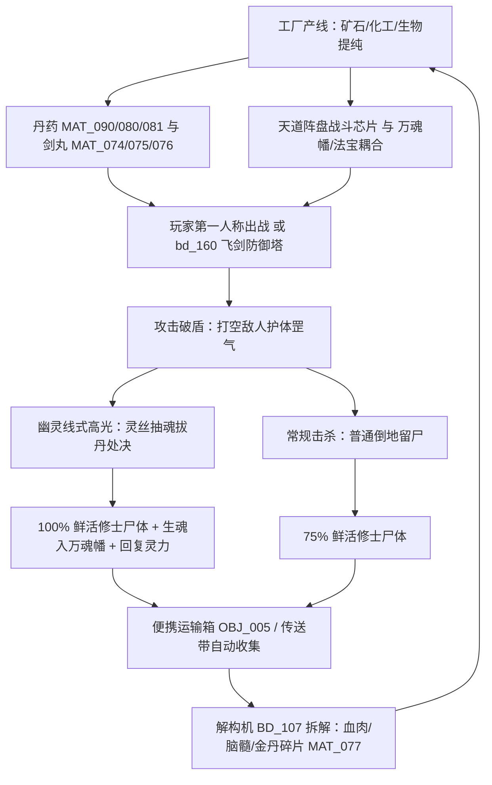
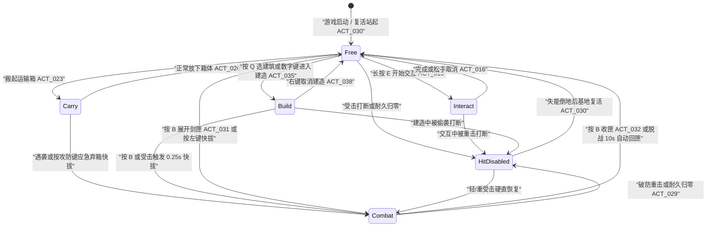
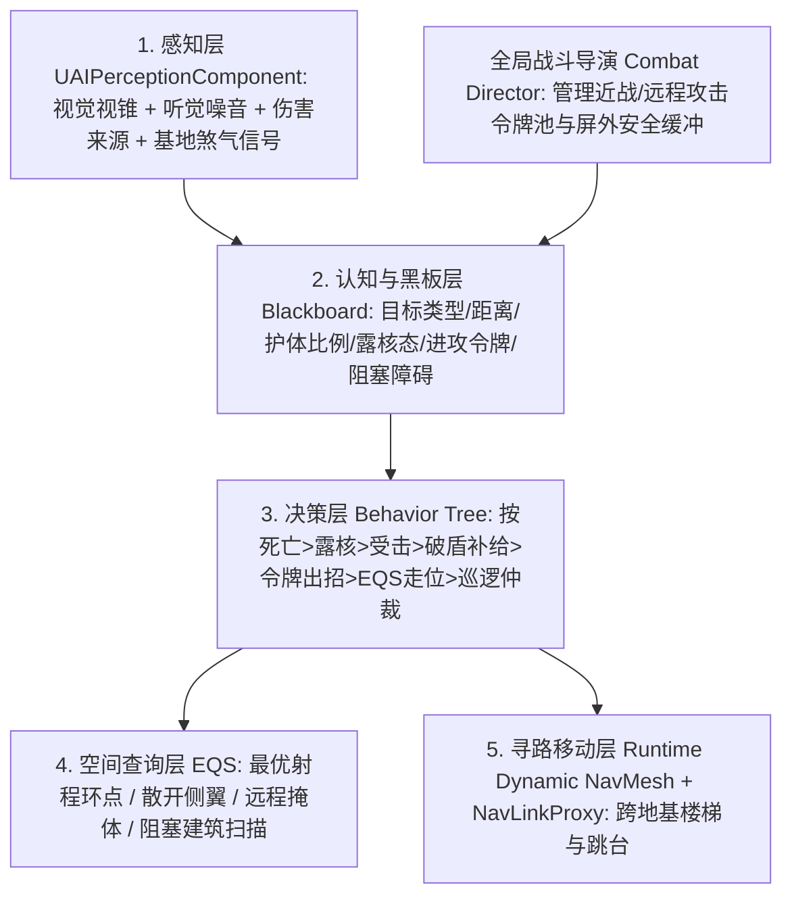
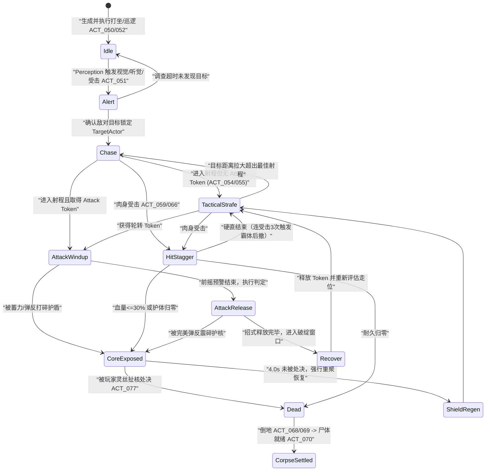

# 《修仙工厂》第一人称战斗与 AI 系统详细策划案（可改写模板 V1.0）

> **文档定位**：UE5《修仙工厂》战斗玩法、第一人称《幽灵线：东京》风格视听表现、WASD 多模式交互及敌方 AI 系统的全量主干设计模板  
> **技术栈基准**：Unreal Engine 5（Enhanced Input System + Gameplay Ability System [GAS] + AnimBP 双层混合 + Niagara VFX + AIController / Behavior Tree / Blackboard / EQS / Dynamic NavMesh）  
> **对齐项目基线**：`HUD快捷面板设计规范.md`、`中央处理器与法宝扩展策划案_初稿.md`、`天道阵盘_中央处理器玩法设计.md`、`xiuxian_data.js`、`配置.txt`、玩家与敌人制作清单（`ACT_001 ~ ACT_071` / `FB_001 ~ FB_027` / `SYS_*`）  
> **文档性质**：**可直接按节删改的工作模板**——所有关键参数、键位、数值与开关均标明预设推荐值与改稿选项，供策划、程序、动作、美术、音频团队统一口径并拆单落地。

---

## 模板使用说明与标记图例

| 标记符号 | 含义说明 | 使用方式 |
| :--- | :--- | :--- |
| **`【默认推荐】`** | 当前最契合《修仙工厂》“工战交融 + 幽灵线手感”的平衡设定 | 若暂不修改，程序与美术直接按此栏开工 |
| **`【可改】`** | 该参数、规则或交互方式已预留备选方案，可直接替换或调参 | 按需求在对应表格填写调整值，或跳至第 12 章拍板 |
| **`【P0 Demo】`** | 练气—筑基 Demo 闭环必须完成的核心功能（最低可玩版） | 优先进入首批制作排期 |
| **`【P1 筑基】`** | 筑基进阶战斗、三系扩展与中度攻防强化内容 | Demo 拓展阶段或抢先体验版接入 |
| **`【1.0 扩展】`** | 完整版高阶内容（金丹首领、大型怨潮攻山、全法宝协同） | 正式版阶段逐步释放 |
| **`[待策划确认]`** | 存在多个互斥设计流派或与旧文档有潜在冲突之处 | 必须由主策划拍板后锁表 |

---

## 目录索引

- [第 1 章：战斗系统核心定位与“工战交融”闭环](#第-1-章战斗系统核心定位与工战交融闭环)
- [第 2 章：WASD 移动系统、全键位交互与多模式状态机](#第-2-章wasd-移动系统全键位交互与多模式状态机)
- [第 3 章：《幽灵线：东京》风格第一人称美术表现、镜头与视听规范](#第-3-章幽灵线东京风格第一人称美术表现镜头与视听规范)
- [第 4 章：玩家战斗技能组、核心机制与资源体系](#第-4-章玩家战斗技能组核心机制与资源体系)
- [第 5 章：敌方 AI 系统总体技术架构（UE5 商业落地级）](#第-5-章敌方-ai-系统总体技术架构ue5-商业落地级)
- [第 6 章：敌人分类、状态机与分境界 AI 详细设计表](#第-6-章敌人分类状态机与分境界-ai-详细设计表)
- [第 7 章：战斗数值框架、伤害公式与成长联动](#第-7-章战斗数值框架伤害公式与成长联动)
- [第 8 章：战斗 HUD、瞄准准星与信息反馈规范](#第-8-章战斗-hud瞄准准星与信息反馈规范)
- [第 9 章：死亡、失能惩罚与尸体回收流程](#第-9-章死亡失能惩罚与尸体回收流程)
- [第 10 章：UE5 工程实现架构与模块清单](#第-10-章ue5-工程实现架构与模块清单)
- [第 11 章：分阶段研发裁剪计划（Demo P0 → 筑基 P1 → 1.0 完整版）](#第-11-章分阶段研发裁剪计划demo-p0--筑基-p1--10-完整版)
- [第 12 章：【策划改稿工作台】核心待拍板决策清单（12 项开关）](#第-12-章策划改稿工作台核心待拍板决策清单12-项开关)

---

# 第 1 章：战斗系统核心定位与“工战交融”闭环

## 1.1 核心设计哲学与三根体验支柱

《修仙工厂》的战斗系统绝不是脱离工厂主循环的“独立射击小游戏”，而是**“赛博修真工业链”的前置原料采集端与基地防卫端**。结合《幽灵线：东京》标志性的第一人称双手结印视觉语言，确立三大体验支柱：

1. **支柱一：第一人称“机关掐诀 + 御剑织法”视觉奇观**
   - 摒弃传统 FPS“右下角端枪管”的冷硬射击范式；主角战斗时，屏幕前下方浮现**机械玄铁双臂与脉冲导脉光环**，通过高速手势结印（剑指、劈掌、合掌、抓魂爪）与东方笔墨/赛博故障特效驱动飞剑、水浪与赤煞火弹。
2. **支柱二：高节奏“破盾 → 露核 → 灵丝抽魂拔丹”处决爽感**
   - 面对高阶修士（筑基及以上），单纯刮痧效率低下；玩家需结合蓄力剑诀、元素克制或**完美弹反**击穿敌人护体罡气，使其陷入“露核失衡态”，再发射灵丝将其体内的灵核/残魂硬生生**凌空扯出并捏碎/吸纳**，同时获得高鲜活度完整尸身。
3. **支柱三：战斗反哺产线，产线武装战斗（工战闭环）**
   - **打怪即进料**：击杀/处决获取的练气、筑基、金丹修士尸体（`MAT_017` / `MAT_051` / `MAT_052`），经便携运输箱（`OBJ_005`）与解构机（`BD_107` / `BD_122`）拆解出**血肉、脑髓、骨板、煞气结晶与金丹碎片**，直接供给生物芯片、人造灵根与人造金丹产线。
   - **产线即战力**：工厂生产的丹药（`MAT_090 回气散` / `MAT_080 气血丹` / `MAT_081 破障丹`）、剑丸（`MAT_074 / 075 / 076` 供 `bd_160 飞剑防御塔`）、天道阵盘战斗芯片与万魂幡，持续放大主角战力与宗门自动化火力网。

## 1.2 “工战交融”核心闭环图



## 1.3 四大核心战斗场景分类模板

| 场景类型 | 触发条件 | 核心玩法目标 | 敌军 AI 模式 | 失败/撤退后果【可改】 |
| :--- | :--- | :--- | :--- | :--- |
| **1. 野外矿脉开荒战**<br>`【P0 Demo】` | 探索新灵石/玄铁矿脉、遗迹据点 | 清理守矿修士，占领矿点建造 `BD_101 采矿机`，回收第一批生物样本 | 领地巡逻模式（带 35m 脱战锚点，离场回血） | 玩家失能回基地重生点，矿物探索延迟 |
| **2. 煞气怨潮攻山战**<br>`【P1 / 1.0】` | 解构机/万魂幡/净化缺位导致基地煞气累积超阈值，或定时周期袭击 | 保卫核心产线与 CPU，依托 `bd_160 飞剑防御塔` + 玩家手操收割并自动装箱 | 攻城推进模式（无脱战距离，优先狙击高煞气源头与防御塔） | 敌方破坏外围机器/停产停电，需用腕具修复（`ACT_022`） |
| **3. 精英守卫与遗迹战**<br>`【P1 筑基】` | 争夺高纯度灵脉、秘境核心或法宝胚蓝图 | 利用破盾与完美弹反击败筑基修士及小队 | 小队协同模式（含护体与掩体/AOE 配合） | 精英重置护盾，需重整丹药再战 |
| **4. 渡劫防卫战**<br>`【1.0 扩展】` | 启动 `tribulation_table 渡劫台` 凝练人造金丹 | 边控温防雷，边阻截受天劫吸引而来的敌宗金丹首领与怨灵 | Boss 多阶段 AI + 召唤杂兵掩护 | 渡劫中断、材料部分损毁并触发设备大修 |

---

# 第 2 章：WASD 移动系统、全键位交互与多模式状态机

> 本章严格对齐现有程序框架：`SYS_PLAYER_STATE`（六大互斥主状态）、`SYS_PLAYER_MOVE`（移动控制）、`ACT_001 ~ ACT_049`（基础动作定义），并**零冲突避让**《HUD快捷面板设计规范.md》中已锁定的全部热键。

## 2.1 WASD 地面与立体机动手感规范（`SYS_PLAYER_MOVE`）

由于《修仙工厂》兼具**精密对准地基/传送带建造**与**高速躲避剑气战斗**，移动响应必须做到“**零滑步粘滞、高速精准微调**”。

### 2.1.1 核心运动参数模板表

| 参数类别 | 参数名称 | `【默认推荐】` 预设值 | 手感设计意图 | `【可改】` 调节区间与备选 |
| :--- | :--- | :--- | :--- | :--- |
| **基础地面速度** | 行走速度（Walk） | `4.5 m/s`（450 cm/s） | 兼顾工厂内部穿梭与准确对准 1×1 格 | `4.0 ~ 5.2 m/s` |
| **疾跑速度** | 疾跑速度（Sprint） | `7.5 m/s`（750 cm/s） | 野外赶路与拉扯拉开身位 | `6.8 ~ 9.0 m/s`（受 `decree_combat_speed` 加成） |
| **方向速度衰减** | 侧移系数（Strafe） | `0.92×` | 保持第一人称横移绕圈躲剑气的灵活性 | `0.80× ~ 1.00×` |
| **方向速度衰减** | 后退系数（Backward） | `0.85×` | 放风筝退步时略低于前冲，避免纯倒退无敌风筝 | `0.75× ~ 0.90×` |
| **战斗姿态修正** | 持法/举手待机移速 | `1.00×`（不减速） | 保持《幽灵线》丝滑移动施法节奏 | `0.85× ~ 1.00×` |
| **战斗姿态修正** | 轻击连发期间移速 | `0.88×` | 轻微稳身感，不卡死走位 | `0.80× ~ 1.00×` |
| **战斗姿态修正** | 蓄力/格挡期间移速 | `0.62×`（蓄力）/ `0.55×`（长按格挡） | 制造“蓄大招/死守”的走位风险博弈 | `0.50× ~ 0.75×` |
| **搬运姿态修正** | 双手搬运（`SYS_CARRY`） | `0.70×`（禁用疾跑） | 体现尸体箱重量与护送需求 | `0.60× ~ 0.80×` |
| **加减速曲线** | 地面起步加速度 | `2800 cm/s²` | 0.16 秒内达到满速，按键即走 | `2000 ~ 4000 cm/s²` |
| **加减速曲线** | 地面摩擦急停减速度 | `3200 cm/s²` | 松开 WASD 瞬间停稳，不滑出地基边缘 | `2400 ~ 4500 cm/s²` |
| **空中与跳跃** | 跳跃最大高度 | `1.55 m`（起跳初速 `580 cm/s`，重力 `1.4G`） | 可轻松单跳越过 1×1 地基平台与低矮传送带 | `1.30 ~ 1.80 m` |
| **空中与跳跃** | 空中转向控制（Air Control） | `0.38` | 空中允许微调落点，但不可任意折返 | `0.25 ~ 0.55` |
| **手感容错** | 郊狼时间（Coyote Time） | `0.12 s` | 跑出地基边缘 120ms 内仍允许起跳 | `0.08 ~ 0.15 s` |
| **手感容错** | 跳跃输入缓冲（Jump Buffer） | `0.12 s` | 落地前 120ms 提前按空格，落地瞬间连跳 | `0.08 ~ 0.15 s` |
| **坠落判定** | 普通落地 / 重落地阈值 | 普通 `< 8.5 m/s`；重落地 `≥ 8.5 m/s` | 对齐 `ACT_012` / `ACT_014`，高于 6m 坠落产生硬直并扣耐 | 阈值可随金身节点放宽 |

### 2.1.2 `【可改扩展项】` 灵步闪避系统（Dash）与移动进阶开关

> 原案（`玩家行为...docx`）早期极简口径暂未加入蹲伏/滑铲/翻滚。为提升第一人称面对密集剑气和筑基范围技的机动性，提供以下三档可开关模板：

- **方案 1`【默认推荐】`：开启“灵步短冲（Spirit Dash）”**
  - **机制**：按下闪避键 + `WASD` 任意方向，双臂向侧后方划出残影，角色瞬间向目标方向水平短距闪烁位移 `4.5 m`（耗时 `0.22 s`），附带 **`0.15 s` 无敌帧（I-Frames）** 与轻微镜头侧倾。
  - **代价与限制**：消耗 `25` 点灵力（或独立精力槽），冷却 `1.2 s`（允许存 2 层充能【可改】）；可瞬间取消攻击后摇，不可穿过实心墙体与机器碰撞箱。
- **方案 2（原案极简版）：关闭闪避，纯走位 + 弹反**
  - **机制**：完全遵循早期动作表，不制作闪避输入，靠 `WASD` 横移 + `右键` 格挡弹反规避全部伤害。优点是开发成本最低；缺点是面对筑基修士地面范围技时略显笨重。
- **方案 3（高机动完整版）：灵步短冲 + 滑翔/滞空喷射**
  - **机制**：保留灵步短冲，并允许在空中长按 `Space` 激活“御风滑翔”（对齐《天道阵盘》流派 4 的 `z2` 御风踏虚风翼与 `decree_combat_speed`），大幅强化垂直立体工厂的立体机动与空战逃生体验。

---

## 2.2 键鼠与 Xbox 手柄全键位映射表（零冲突校验）

### 2.2.1 现有 HUD 锁定占用红线（严禁覆盖）

根据 `HUD快捷面板设计规范.md` 与 `天道阵盘_中央处理器玩法设计.md`，以下键位已被工业/UI 系统征用，**战斗输入不得与之直接冲突**：
- `Q`：建设菜单（全局常驻）
- `Tab`：物品/装备/制造菜单（全局常驻）
- `M`：全域地图（解锁后高亮）
- `X`：修仙与工业法典（全局常驻）
- `N`：本命法宝系统（全局常驻）
- `1 ~ 0`：底部 10 格快捷栏（建造/工具/道具切组）
- `R`：建造旋转微调 / 阵盘构件旋转
- `C`：**【历史冲突警告】** 规范定义为“进入载具后开启载具界面”，但阵盘文档曾写过 `Tab` 或 `C` 打开 CPU。模板默认将 `C` 保留给载具界面，在阵盘旁按 `E` 或通过专属独立按键（如 `K` 或 `Tab` 内页签）呼出 CPU，详见 `[DEC-11]`。

### 2.2.2 全量键位对照模板表

| 功能分类 | 动作名称 | 键鼠`【默认推荐】`（幽灵线交互流） | 键鼠备选（极简原案流）`【可改】` | Xbox 手柄映射 | 生效状态说明 |
| :--- | :--- | :--- | :--- | :--- | :--- |
| **移动与机动** | 前/后/左/右移动 | `W / S / A / D` | `W / S / A / D` | 左摇杆 | 全状态常驻（除全屏 UI） |
| **移动与机动** | 视角转向 | 鼠标移动 | 鼠标移动 | 右摇杆 | 全状态常驻 |
| **移动与机动** | 疾跑（Sprint） | `Left Shift`（按住/切换可选） | `Left Shift` | 按下左摇杆 `L3` | 自由 / 建造 / 战斗态生效 |
| **移动与机动** | 跳跃 / 滞空 | `Space` | `Space` | `A` 键 | 自由 / 建造 / 战斗态生效 |
| **移动与机动** | 灵步闪避（Dash） | `Left Ctrl` 或 `Left Alt`（可改 `Shift` 短按） | 关闭（或 `Left Ctrl`） | `B` 键 | 自由 / 战斗态生效 |
| **核心织法攻防** | **轻击 / 连发织法** | `鼠标左键（点按/连按）` | `鼠标左键（点按）` | `RT`（轻按） | 战斗态发射；非战斗态可设“一键快拔” |
| **核心织法攻防** | **蓄力重击 / 三剑** | `鼠标左键（长按 0.8s 松开）` | `鼠标左键（长按）`或 `鼠标右键` | `RT`（长按） | 蓄力期间允许慢速 WASD 走位；按右键可取消蓄力 |
| **核心织法攻防** | **玄铁格挡 / 完美弹反** | `鼠标右键（按住格挡 / 瞬间弹反）` | `Left Alt` 或 `鼠标侧键` | `LB` | 高优先级中断攻击后摇，防弹核心键 |
| **核心处决/交互** | **灵丝扯核处决** | `F`（露核 10m 内高亮直接触发） | `F` 或 `E`（情境接管） | `RB` 或 `RS`（按下右摇杆） | 准星锁定露核敌人时覆盖普通交互，优先级最高 |
| **核心处决/交互** | **拾取 / 交互 / 尸体装箱** | `E`（短按拾取/开门，长按装箱/开采） | `E` | `X` 键 | `SYS_INTERACTION_HOLD` 持续读条 |
| **剑诀与法宝** | **切换三系织法剑诀** | `鼠标滚轮` 或 `Z`（循环）/ 长按 `V` 轮盘 | Demo 仅庚金单系，暂隐 | `十字键 左/右` | 庚金（金）↔ 玄水（蓝）↔ 离火（红） |
| **剑诀与法宝** | **投掷辅助符箓** | `G` 或 `鼠标侧键 4` | `鼠标中键` | `十字键 上` | 短按瞬发当前槽位符箓；长按切符种 |
| **剑诀与法宝** | **触发本命法宝主动技** | `T` 或 `鼠标侧键 5` | `F` | `LT + RB` | 施放已绑定且就绪的法宝技（如万魂镇域） |
| **剑诀与法宝** | **快捷服用战斗丹药** | `H`（或使用快捷栏 `8/9/0` 对应药槽） | 快捷栏数字键 | `十字键 下` | 优先消耗 `MAT_090 回气散` / `MAT_080 气血丹` |
| **装备姿态** | **展开 / 收起剑匣** | `B` 或 `CapsLock`（且左键自动快拔） | `1~0` 武器栏或 `B` | `Y` 键 | 切换自由工程态与战斗结印态（`ACT_031`/`032`） |
| **应急切战** | **搬运中应急放箱拔剑** | 搬运时按 `左键 / 右键 / B` | 先按 `E` 放箱再拔剑 | `RT` / `Y` | 立即原地放置运输箱并 0.25s 快拔防卫 |

---

## 2.3 六大互斥状态机与切换规则（`SYS_PLAYER_STATE`）

玩家控制器同一时刻只能处于以下 **6 个互斥主状态** 之一（UI 菜单如 `Q / Tab / X / N` 作为上层覆盖层叠加，可配置是否暂停世界——单人模式建议半透明降速或可选暂停）。



### 2.3.1 状态冲突与强制接管规则表

| 当前状态 | 触发事件 | 切换目标 | 具体执行逻辑与防吞输入/防丢料保护 |
| :--- | :--- | :--- | :--- |
| **建造（Build）** | 玩家受到敌方伤害或按下 `B`/主动快拔 | **Combat** | 1. 立即执行 `ACT_038` 取消投影，**绝不扣除任何建造材料**；<br>2. 右手腕具光影在 `0.25 s` 内收敛并展开背部剑匣（`ACT_031`）；<br>3. 若为被动挨打，默认同时显示屏外受击箭头。 |
| **搬运（Carry）** | 搬运尸体箱时遭遇袭击并按下左键/右键/B | **Combat** | 1. 遵循 `SYS_CARRY` 约束：搬运中无法挥手结印；<br>2. 触发“应急放箱”：`0.15 s` 将便携运输箱平稳置放于角色脚前安全网格，箱内尸体数据完整保留，随后立即切入战斗。 |
| **交互（Interact）** | 持续采集或尸体装箱期间移动或受击 | **Free / HitDisabled** | 1. 遵循 `SYS_INTERACTION_HOLD` 原则：进度条未满 100% 即中断时，**不生成半成品，尸体仍留在原地**；<br>2. 装箱成功后尸体从世界移除，数据写入运输箱库存。 |
| **战斗（Combat）** | 脱战且超过 `10 s` 无任何攻防操作`【可改】` | **Free** | 自动或手动（按 `B`）收起剑匣（`ACT_032`），腕具切回日常待机形态，恢复 100% 视野清爽度。 |

## 2.4 动作帧段与输入缓冲规范（保证丝滑跟手）

为杜绝“按下右键却因为普攻后摇没播完而挨打”的僵硬感，所有玩家战斗动作均采用 **4 段式帧窗口**：

```text
[按键输入] ──> [输入缓冲 150ms] ──> [前摇 Windup] ──> [判定 Active] ──> [后摇 Recovery]
                                                                            ▲
                                                     [取消窗口 Cancel Window：支持格挡/弹反/灵步瞬断]
```

- **高优先级取消规则**：
  - 处于任何轻击（`庚金连点`、`玄水劈掌`）的**前摇前 50ms 或全部后摇阶段**时，按下 **`鼠标右键（格挡/弹反）`** 或 **`闪避键（灵步）`**，立即打断当前动作并进入格挡/闪避！
  - 蓄力重击在未松手发射前，按 `鼠标右键` 直接安全取消蓄力并无缝转入格挡姿态，不浪费灵力。

---

# 第 3 章：《幽灵线：东京》风格第一人称美术表现、镜头与视听规范

## 3.1 核心视觉美学定义：“暗黑赛博道法 × 机关义手结印”

结合本作主角设定（机器人/半机械修真开拓者）与《幽灵线：东京》的核心魅力，第一人称前景美术必须围绕以下三大视觉特征打造：

1. **双臂资产构成（`SKM_FP_Arms` + 腕具战斗变形态）**：
   - **主材质**：哑光暗玄铁装甲片 + 露筋碳纤维机械关节 + 嵌入式青金色/玄水蓝/赤煞红柔性**导脉光纤**。
   - **腕部机关**：左手搭载 `OBJ_001 工程腕具` 战斗形态（展开为三层半透明全息八卦罗盘环）；右手佩戴控剑指环（指尖悬浮微小剑丸符印）。
   - **动态换色**：根据当前激活的剑诀系别，双臂导脉光纤、掌心八卦纹与指尖拖尾实时切换对应主色调（庚金 `#38BDF8/#FBBF24` 金青电弧、玄水 `#22D3EE` 墨蓝流波、离火 `#FB7185/#F97316` 赤红爆焰）。
2. **第一人称构图比例规范**：
   - 双手自然悬停在屏幕**下 1/3 的左右两侧**（占屏面积不超过 20%~25%），确保屏幕中央 `60%` 区域完全通透，不遮挡敌方招式前摇光效。
   - 施法或爆发动作采用**大透视纵深构图**：手臂蓄力时向镜头后方拉收，释放瞬间手指极速向屏幕中心前伸推近，借助夸张的前景透视差放大打击冲击力。

## 3.2 第一人称前景手势动画矩阵（沿用并扩展至 `ACT_072+`）

> 说明：`ACT_031 ~ ACT_034` 严格沿用现有动作表定义；新增《幽灵线》风格三系扩展、弹反与灵丝拔核动作统一从 **`ACT_072`** 起顺序编号，不与已有 `ACT_071 修士尸体装箱` 冲突。

| 动作ID | 动作名称 | 左右手动作起承转合分解（第一人称视角） | 标准时长 | 同步 VFX | 同步 SFX | 里程碑 |
| :--- | :--- | :--- | :--- | :--- | :--- | :--- |
| `ACT_031` | 玩家装备剑匣 | **起**：左手横抬激活腕部八卦光环 → **承**：右手划弧虚握引出背部剑匣微颤 → **终**：双手呈“左抱阴、右剑诀”待发势 | `0.35 s`（快拔 `0.25 s`） | `VFX_SWORDCASE_ACTIVATE` | `SFX_SWORDCASE_OPEN` | `P0` |
| `ACT_032` | 玩家收起剑匣 | **起**：双手十指微收拢聚气 → **终**：掌心下压虚空，符环折叠归入腕具，双臂自然垂回屏幕边缘 | `0.30 s` | — | `SFX_SWORDCASE_CLOSE` | `P0` |
| `ACT_033` | 普通飞剑指令（庚金连点） | **起**：左/右手交替捏剑诀轻弹 → **承**：指尖向准星点射，伴随干脆的微弱后坐甩腕 → **终**：指尖划回待机位 | `0.22 s/发`（左右手交替不僵硬） | `VFX_SWORD_NORMAL_TRAIL` | `SFX_SWORD_LAUNCH` | `P0` |
| `ACT_034` | 蓄力飞剑释放（三剑齐发） | **起**：双手于胸前合拢形成旋转剑印（腕环展开三层）→ **承**：双臂猛然向两侧张开并前推，三道流光剑影呼啸离体 → **终**：震颤回稳 | 蓄 `0.80 s` / 放 `0.35 s` | `VFX_SWORD_CHARGED_TRAILS` | `SFX_SWORD_CHARGE` + `LAUNCH` | `P0` |
| `ACT_072` | 三系剑诀翻花切换 | 右手快速连续变幻三个道教指印（剑指→水波掌→焚火印），左手腕具罗盘旋转一格咔哒锁定 | `0.28 s` | `VFX_ELEMENT_SWITCH_RING` | `SFX_ELEMENT_SWITCH` | `P1` |
| `ACT_073` | 玄水横江轻/重击 | **轻击**：右掌由左下向右上斜劈划出扇形水墨弧；**蓄力重击**：双手环抱虚空推波，掀起宽幅震荡浪刃 | 轻 `0.32 s` / 蓄 `0.90 s` | `VFX_WATER_SWEEP` | `SFX_WATER_SLASH` | `P1` |
| `ACT_074` | 离火赤煞轻/重击 | **轻击**：单掌前推爆出凝缩火弹；**蓄力重击**：双掌掌心相对搓出不稳赤黑火球并奋力推轰，手臂产生重型后坐回弹 | 轻 `0.38 s` / 蓄 `1.00 s` | `VFX_FIRE_BLAST` | `SFX_FIRE_DETONATE` | `P1` |
| `ACT_075` | 玄铁符盾格挡（持续） | 双臂交叉呈 X 型或左手横立掌前护胸，腕具投射一面半透明六边形玄铁八卦光盾 | 抬手 `0.10 s` | `VFX_GUARD_HEX_SHIELD` | `SFX_GUARD_RAISE` | `P0` |
| `ACT_076` | 完美弹反震开（Just Guard） | 敌攻击撞盾瞬间，双臂由交叠状态**猛然向左右两侧崩开甩震**，指尖迸发金色八卦冲击波与雷鸣音爆 | `0.28 s`（含 50ms 顿帧） | `VFX_PARRY_SHOCKWAVE` | `SFX_PARRY_CLANG` | `P0` |
| `ACT_077` | **灵丝抽魂拔丹（Core Grab）** | **起**：双臂猛向前探出呈五指抓爪 → **承**：指尖射出 3~5 根紧绷灵丝钩住敌人暴露核心，双臂向胸口**用力拉锯微颤（0.45s）** → **终**：猛然向后拽回并于右掌狠狠**握拳捏爆**（或左手一拉吸入万魂幡）！ | `0.70 s`（含收尾回弹） | `VFX_CORE_TETHER_EXTRACT` | `SFX_CORE_GRAB_PULL` + `SHATTER` | `P0` |
| `ACT_078` | 灵步闪避手势 | 向移动反方向单手快速划符借力推空，手臂产生动态模糊拖拽感与短暂残影 | `0.22 s` | `VFX_DASH_INK_STREAK` | `SFX_SPIRIT_DASH` | `P0` |
| `ACT_079` | 投掷辅助符箓 | 左手食指与中指夹住一张发光赛博电子纸符，自左下角干脆甩腕飞出 | `0.25 s` | `VFX_TALISMAN_THROW` | `SFX_TALISMAN_SNAP` | `P1` |
| `ACT_080` | 快捷吞服/注灵丹药 | 左手迅速取出悬浮丹丸于掌心捏碎化作灵雾吸收，双臂光纤瞬间泛起翠绿/金红波纹 | `0.35 s` | `VFX_PILL_ABSORB` | `SFX_PILL_CRUSH` | `P0` |

## 3.3 VFX 特效美术规范（UE5 Niagara：水墨笔触 × 赛博故障）

所有战斗 VFX 遵循 **“东方传统笔墨篆文为骨，赛博数字电路故障（Glitch）为肌”** 的统一美术词典：

1. **弹道与轨迹（Trails）**：
   - 飞剑/剑气拖尾不使用纯科幻激光棒，而是双层 Ribbon：**内层高亮度流光核心 + 外层毛笔飞白噪点贴图（Alpha Erosion 渐隐）**，末端漂浮微小的二进制符文与八卦碎片。
2. **破盾与命中材质反馈（Hit & Shield Break）**：
   - 命中敌人护体罡气：表面泛起**六边形蜂窝符文网格波纹**，护盾将碎时边框转向刺眼橘红；破碎瞬间产生玻璃/瓷器碎裂般的块状数据剥离。
   - 命中肉身：禁止廉价大面积血浆遮挡视线；改为**暗金机油/灵气火花 + 淡淡墨色烟雾粒子**喷溅，契合机械修仙与道法碰撞质感。
3. **灵核暴露态（Core Exposed）**：
   - 当筑基/练气/金丹敌人陷入破防可处决状态时，其胸口丹田位置浮现一枚**高亮旋转的多面体道核（或金丹虚影）**，周围产生向内收缩的波纹光圈与轻微几何体色散闪烁（Chromatic Aberration），确保玩家在 10 米外混战中一眼锁定！
4. **灵丝扯核演出（Core Tether）**：
   - 从主角十指尖端至敌人胸口灵核之间生成 `3~5` 条具**贝塞尔曲线张力抖动**的灵丝束；
   - 拉扯过程中灵丝由青白转为炽烈紫金，伴随高频音叉震颤；捏爆瞬间，敌人躯体表面闪过一帧“白底水墨故障剪影”，随后恢复高鲜活完整尸身倒地（避免死无全尸影响工厂回收识别）。

## 3.4 镜头语言、双 FOV 防穿模与打击感（Game Feel）参数表

| 控制维度 | 技术方案 / 参数设定 | `【默认推荐】` 预设值 | `【可改】` 说明与调整建议 |
| :--- | :--- | :--- | :--- |
| **防穿模双层视野** | 主相机世界 FOV 与前景双臂分离渲染 | 世界 FOV `95°`（支持玩家 `80°~110°` 调节）；前景双臂通过材质节点 / Separate FOV Pass 固定以等效 **`72°`** 渲染 | 防止玩家贴墙、贴箱子或贴脸战斗时，机械双臂因长广角畸变或直接插进敌人身体里 |
| **动态 FOV 联动** | 疾跑 / 蓄力 / 灵步 / 扯核瞬间动态插值 | • 疾跑：`+5°`（平滑 0.25s）<br>• 蓄力：`−6°`（微弱聚焦锁定目标）<br>• 灵步闪避：瞬间 `+8°` 并附带 `±2.5°` Roll 侧倾回正<br>• 扯核捏爆：`95° → 78°` 急速缩紧并在捏爆刹那回弹至 `98°` | 可在设置菜单增加“动态 FOV 强度”滑块以照顾 3D 眩晕敏感玩家 |
| **Hitstop 顿帧时长** | 仅冻结攻防双方局部动画或全局极短缩放 | • 庚金轻击：`0 ms`（极快连点不顿）<br>• 三剑蓄力破盾：`35 ms`<br>• 完美弹反：`50 ms`（配合闪白一帧）<br>• 灵丝扯核捏爆：`65 ms` | **注意**：多人联机或工厂物理仍在跑时，Hitstop **只能冻结局部骨骼/相机/粒子，严禁冻结全局 `TimeDilation` 影响传送带！** |
| **Camera Shake** | 按击打量级分三档 Camera Shake 资产 | • Light（轻击发射）：振幅 `0.25`，高频衰减 `0.08s`<br>• Medium（受击/蓄力释放）：振幅 `0.85`，时长 `0.18s`<br>• Heavy（弹反/破盾/扯核捏爆）：振幅 `1.60`，时长 `0.28s` | 建议附带轻微 Radial Blur（径向模糊）增强爆发瞬间质感 |

## 3.5 战斗音频混音规范（48kHz 分总线）

延续工程现有 48kHz、分总线（角色/战斗/建造/UI）要求，战斗音效采用**“四层声学叠层”**，确保《幽灵线》式指诀既清脆又厚重：
1. **机械伺服底噪层**：双臂屈伸、剑匣启闭时的精密液压与齿轮咔哒声（短促金属质感）；
2. **东方器乐道音层**：结印瞬间的古琴拨弦/玉磬清响、三剑出鞘的龙吟剑鸣、完美弹反的青铜古钟震荡；
3. **赛博灵能脉冲层**：法术蓄力时逐渐升调（Pitch Rise）的高频正弦电磁嗡鸣；
4. **物理重击 Sub-Bass 层**：破盾炸裂、离火爆轰与扯核捏爆时的 `40Hz~80Hz` 超低音下潜震动（瞬间压缩环境背景音 `Ducking -6dB` 持续 `0.3s`）。

---

# 第 4 章：玩家战斗技能组、核心机制与资源体系

## 4.1 玩家基础战斗属性与资源槽模板

| 属性 / 资源名 | 初始基准值 `【默认推荐】` | 恢复与消耗逻辑 | 与工厂/阵盘系统的联动接口 | `【可改】` 备选 |
| :--- | :--- | :--- | :--- | :--- |
| **机身耐久（HP）** | `100` | 不自动回复；需通过 `MAT_090 回气散` / `MAT_080 气血丹` 或基地维修恢复 | 受金身道躯与防具组件加成上限 | `100 ~ 200` |
| **护体罡气（Shield）** | `50`（筑基芯片可扩至 `150+`） | 脱战 `4.0 s` 后以 `15/s` 自动充能恢复；优先替本体承受伤害 | 受 `chip_armor`（金身淬皮）与 `z2_jinshen_heal`（荒兽自愈神髓：受击 3s 回 30%）直接强化 | 可改“纯血无盾制”或“常驻充能护盾” |
| **灵力储量（Qi / Mana）** | `100` | 自然恢复 `8/s`；**灵丝扯核处决成功瞬回 `35`；完美弹反瞬回 `20`** | 高消耗大招（三剑/火爆/灵步）受制于灵力；普攻仅微耗（鼓励打穿护盾靠拔核永动续航！） | 可改“弹药/剑丸实体消耗制”`[DEC-03]` |
| **剑意/共鸣充能** | `0 ~ 100%` | 命中/弹反积攒；满格后增强法宝联动 | 接入 `天道阵盘` 2.0s 心跳脉冲，随产线与芯片倍率暴涨 | `P1/1.0` 扩展 |

## 4.2 三系灵脉织法技能表（幽灵线三系框架 × 原案飞剑对齐）

> **重要范围划定**：**Demo P0 阶段只做【庚金·疾风剑诀】**（即原案的 `SYS_SWORD_NORMAL` 单剑普攻 + `SYS_SWORD_CHARGE` 三剑蓄力），保证 100% 打磨精良；**P1 阶段起开放【玄水】与【离火】切换**，形成对群控场与高爆破盾的战术切换。

| 织法系别 | 轻击形态（左键点按） | 轻击数值模板`【可改】` | 蓄力重击（左键长按 `0.8~1.0s`） | 重击数值模板`【可改】` | 核心战术定位与克制关系 |
| :--- | :--- | :--- | :--- | :--- | :--- |
| **庚金·疾风剑诀**<br>`【P0 Demo 核心】`<br>*(青金色)* | **单剑点射 (`SYS_SWORD_NORMAL`)**<br>双指弹出高速实体小飞剑，带微弱智能曲线追踪，命中或穿透后化光归匣 | • 伤害：`18`（爆头/弱点 `1.5×`）<br>• 射速：`4.2 发/秒`（连按/按住连发）<br>• 灵耗：`2/发`<br>• 射程：`35 m`<br>• 削盾倍率：`0.6×` | **三剑破阵 (`SYS_SWORD_CHARGE`)**<br>合掌聚阵 `0.8 s`，同时射出 **3 柄强化穿甲飞剑**，可扇形覆盖或集中锁死单一目标 | • 伤害：`3 × 32 = 96`<br>• 灵耗：`22`<br>• 削盾倍率：`1.5×`（对筑基护体特攻）<br>• 附带强击退与中断小怪前摇 | **中远距离主力点杀**；手感最接近高速手枪/飞镖，单挑练气、收割残血极强 |
| **玄水·横江浪诀**<br>`【P1 筑基】`<br>*(墨蓝色)* | **扇形水墨剑波**<br>劈掌挥出一道横向弧形气浪，具备小范围扇形穿透判定 | • 伤害：`22`（范围多目标）<br>• 射速：`2.2 次/秒`<br>• 灵耗：`4/次`<br>• 射程：`12 m`（扇角 `70°`）<br>• 削盾倍率：`0.8×` | **覆海震荡波**<br>双手推掌释放半圆形扩增水浪，强力击飞/推退周围贴脸敌人并附加 `3 s` 潮湿减速 `35%` | • 伤害：`55`（360°/160° 扇形）<br>• 灵耗：`26`<br>• 削盾倍率：`1.0×`<br>• 打断所有轻型敌人突进 | **近中距离群怪割草与防包围解围技**；专门应对多名练气修士或妖兽贴脸围攻 |
| **离火·赤煞爆诀**<br>`【P1 筑基】`<br>*(赤红黑焰)* | **凝缩赤煞爆弹**<br>抛射带抛物线与小溅射的熔岩符弹，命中产生 `2.5 m` 范围爆炸 | • 伤害：`36`（含溅射）<br>• 射速：`1.4 发/秒`<br>• 灵耗：`7/发`<br>• 射程：`25 m`<br>• 削盾倍率：`1.4×` | **九幽焚天裂地弹**<br>搓出高压赤火球砸向目标区域，触发延迟 `0.2s` 的二次超新星爆裂（`5.5 m` 半径） | • 伤害：`135`（中心高伤）<br>• 灵耗：`35`<br>• 削盾倍率：`2.2×`（**重盾破防王牌**）<br>• 附带 `4s` 灼烧持续破盾 | **重装破盾与群体轰炸**；专门炸开筑基护体罡气、金丹护盾或砸碎聚集怪堆 |

## 4.3 防御、完美弹反（Just Guard）与受击机制

- **普通格挡（按住 `鼠标右键`）**：
  - 抬起双臂展开八卦玄铁光盾，防御来自前方 `140°` 扇面内的近战与剑气投射物。
  - **结算规则**：减免 **`70%` 伤害**，剩余 `30%` 优先由护体罡气吸收，消耗少量灵力（`8~15` 点）；格挡无法完全挡住“红圈地面范围技”（筑基 AOE）。
- **完美弹反 / 精防（在攻击命中前 `0.18 s` 内按下 `鼠标右键`）`【可改窗口：0.15~0.25s】`**：
  - **免伤 `100%`**，瞬间触发 `ACT_076` 甩臂震开演出 + `50ms` 顿帧 + 清脆钟磬振鸣；
  - **反制近战**：直接打断敌方攻击并震退，令其陷入 **`1.5 s` 大硬直且直接削减 `40%` 护体值**（对筑基极度致命）；
  - **反制远程**：将敌方高速剑气以 **`2.0×` 伤害与 `2.0×` 削盾倍率原路精确反弹**回施法者或准星所指目标！
  - **回报**：瞬间回复 **`20` 点灵力**，形成“富贵险中求”的高手爽感循环。

## 4.4 核心高光机制：护体击破 → 露核态 → 灵丝抽魂拔丹（Core Grab）

这是将《幽灵线：东京》标志性玩法与《修仙工厂》“回收尸体做材料”融为一体的灵魂机制：

1. **露核触发条件（满足任意一条，持续 `4.0 s`）**：
   - 敌人生命值跌至 **`≤ 30%`**（练气修士常见触发态）；
   - 敌人**护体罡气归零**并陷入破防大失衡态（筑基/金丹主要触发态，此时即使血量还有 60% 亦可强行抽碎一层护核或直接夺丹斩杀！`【可改】`）。
2. **玩家操作与多重连锁拔核**：
   - 准星 `10 m` 内对准露核敌人，屏幕自动弹出**青金色爪印锁定圈 + `[F] 抽魂拔丹`**；
   - 按住或点击 `F`（`【可改：单点自动拉断 vs 长按 0.7s 拉锯】`），触发 `ACT_077` 发射灵丝；
   - **多重拔核（Chain Pull）**：以主目标为中心 **`3.5 m` 半径内**若有其他同样处于露核态的敌人（最多 **`3` 名**），灵丝会自动分叉同时钩住多颗灵核，一并拉扯捏爆，制造极具震撼力的“一拉收一片”清场演出！
3. **过程保护与工业高额收益对比**：
   - **安全保护**：拔核拉扯 `0.7 s` 期间玩家获得 **`80%` 减伤（或完整无敌帧`【可改】`）**，防止动画过程中被旁边小怪蹭死。

| 击杀方式 | 尸体掉落物 | 尸体鲜活度（第7章详述） | 附加战利品 / 万魂幡联动 | 玩家战斗状态回报 |
| :--- | :--- | :--- | :--- | :--- |
| **普通飞剑/防御塔击杀** | 对应境界尸体（`MAT_017/051/052`） | `65% ~ 75%`（有轻微受损） | 无额外加成 | 无回复 |
| **灵丝抽魂拔丹处决（推荐）** | 对应境界**无暇完整尸体** | **`100%`（顶格鲜活，解构多出 `20%~30%` 组织/脑髓）** | • 若装备万魂幡，额外吸纳 **`+25` 魂魄**<br>• 筑基/金丹拔核有概率额外剥落整块碎片 | **瞬回 `35` 灵力 + `20` 护体罡气**，立即无缝接续下一波战斗 |

## 4.5 辅助符箓、快捷丹药与本命法宝战斗接入

| 类别 | 道具 / 技能名称 | 工业配方来源（对齐 `xiuxian_data.js`） | 战斗效果与冷却模板 |
| :--- | :--- | :--- | :--- |
| **辅助符箓**<br>`[DEC-03 耗材/冷却开关]` | **定身缚灵符** | 加工台/组装机（纸符+灵力粉尘+导灵铜片） | 投掷展开 `3.5 m` 赛博八卦定身阵，强制禁锢范围内练气/筑基敌人 **`3.0 s`**（对金丹缩减为 `1.2 s`），完美创造站桩输出与蓄力窗口 |
| **辅助符箓** | **九霄震雷破盾符** | 组装机（电磁线圈+煞气片+玄铁粉） | 落地引发小型雷暴，伤害一般（`40`），但具备 **`3.5×` 超高削盾倍率**与 `2.0s` 麻痹 |
| **快捷丹药** | **`MAT_090 回气散`** | 阶段 III 即可生产的基础丹药 | 瞬回 `35` 灵力 + `5s` 内缓慢回复 `30` 耐久（冷却 `12 s`） |
| **快捷丹药** | **`MAT_080 气血丹`** | 炼丹炉（`bd_163`）血肉+蛋白液+成熟灵草 | 立即回复 **`75` 点耐久** + `25` 护体罡气（冷却 `18 s`） |
| **快捷丹药** | **`MAT_081 破障丹`** | 炼丹炉（煞气灵草+液态煞气） | `12 s` 内全织法伤害 `+35%`、削盾 `+40%`，同时自身轻微增加魂压/散热负荷 |
| **本命法宝主动** | **万魂帆·万魂镇域** | `N` 键本命法宝系统 + 炼宝台 | 以自身/旗面为中心展开 `30 m` 魂阵持续 `12 s`，范围内敌移速 `-40%`、前摇 `+25%`，施加魂锁标记供飞剑追踪返魂 |
| **本命法宝主动** | **番天印 / 九曲黄河幡** | 法宝体系拓展 | 番天印单点重砸破墙破重盾；九曲黄河幡铺设基地外围阻截带 |

---

# 第 5 章：敌方 AI 系统总体技术架构（UE5 商业落地级）

> 本章专门针对 UE5 工程落地设计，解决第一人称 3D 立体工厂中**“敌人如何聪明绕行动态地基、如何避免多怪同框乱打一气、如何在玩家和工厂机器之间动态选择目标”**三大痛点。

## 5.1 UE5 AI 五层核心架构图



### 5.1.1 感知层参数模板（`UAIPerceptionComponent`）

| 感知通道 | 练气修士默认值 | 筑基修士默认值 | 金丹首领默认值 | 触发事件与穿透规则 |
| :--- | :--- | :--- | :--- | :--- |
| **视觉（Sight）** | 半径 `22 m` / 失去视距 `28 m` / 半角 `65°` | 半径 `28 m` / 失去 `35 m` / 半角 `75°` | 半径 `40 m` / 失去 `50 m` / 半角 `90°` | 需通过光线检测（LOS），可被玩家高墙、大型机器遮挡脱离 |
| **听觉（Hearing）** | 半径 `16 m` | 半径 `22 m` | 半径 `35 m` | 玩家开火、砸矿（`ACT_020`）、重落地与机器爆鸣触发噪音源 |
| **伤害（Damage）** | 全距离即时感知 | 全距离即时感知 | 全距离即时感知 | 无论隐身或死角，受击立即将攻击者写入仇恨候选并转向 |
| **煞气嗅觉（Global）** | 仅怨潮波次激活 | 仅怨潮波次激活 | 仅怨潮波次激活 | 基地煞气源（`BD_107` / 万魂幡 / 净化缺口）持续发送目标坐标广播 |

### 5.1.2 黑板核心键值清单（`UBlackboardData`）

| Blackboard Key | 数据类型 | 写入来源 | 用途说明 |
| :--- | :--- | :--- | :--- |
| `TargetActor` | `Object (Actor)` | 仇恨系统服务（BTService） | 当前选中的主目标（玩家、魂役召唤物或工厂建筑） |
| `TargetCategory` | `Enum (Player / Turret / Factory)` | 仇恨系统服务 | 决定采用绕圈切磋走位还是拆迁站桩输出 |
| `DistanceToTarget` | `Float` | BTService（每 0.15s 更新） | 控制追击、撤步或选择近/远程技能 |
| `AlertLevel` | `Enum (Idle / Suspicious / Combat)` | Perception 回调 | 驱动 `ACT_050` 待机、`ACT_051` 警觉或战斗状态 |
| `HealthRatio` / `ShieldRatio` | `Float` | GAS AttributeSet | 触发筑基开盾、金丹切阶段或狂暴策略 |
| `bIsCoreExposed` | `Bool` | GAS Tag 监听 | 为 `True` 时强制打断一切 BT 进攻分支，播放硬直露核待处决 |
| `bHasMeleeToken` / `bHasRangedToken` | `Bool` | Combat Director | 是否获准立刻出手；无令牌时退而执行侧移围堵 |
| `TacticalMoveLocation` | `Vector` | EQS Query | 存储绕侧翼、保持最佳距离或避让友军的目标点 |
| `bPathBlockedByBuilding` | `Bool` | NavMesh 检测服务 | 路径完全被地基封死时置 `True`，转而锁定阻挡建筑拆墙 |
| `HomeAnchorLocation` | `Vector` | Spawn 初始化 | 野外 AI 巡逻原点，超出 `35 m` 追击半径触发回防重置 |

### 5.1.3 空间战术查询模板（UE5 EQS）

1. **`EQS_RingPosition`（最佳交战环点查询）**：
   - 生成目标周围半径 `5 m ~ 14 m` 的圆环点（练气选 `4~9m`，筑基选 `9~15m`）；
   - 过滤掉“没有直线视野（Trace Fail）”与“离其他友军太近（`< 2.5m` 防重叠扎堆）”的点；
   - 加分项：优先选择玩家正面 `±60°` 视野内或微侧翼点，减少恶心绕后偷袭。
2. **`EQS_FlankClearLOS`（无令牌围堵侧移点）**：
   - 给暂时没拿到 Attack Token 的修士查询左右侧弧线点，驱动 `ACT_054 左侧移` / `ACT_055 右侧移` 动画，让战场看起来充满武侠/修真对峙的游走压迫感。
3. **`EQS_CoverPoint`（筑基/金丹掩体与高点查询）**：
   - 当筑基修士护体破裂且处于恢复期时，优先评分距离玩家 `14~20m` 且有机器/岩石遮挡视线的安全位置重新蓄盾。
4. **`EQS_BlockingBuilding`（堵路建筑拆迁检索）**：
   - 当寻路返回 `Partial`（玩家用围墙把基地彻底围死）时，从敌人当前位置向目标位置作路径扫描，找出最近的玩家建造物（地基墙/门/支架）作为临时拆毁对象。

### 5.1.4 动态寻路与立体工厂适配（Runtime NavMesh）

- 因为玩家会随时在地面铺设 `BD_119~121` 地基、`BD_102` 楼梯与机器，UE5 工程必须开启 **`RecastNavMesh -> Runtime Generation: DynamicModifiersOnly`（或局部 Dynamic）**。
- 当玩家铺设新楼梯时，在楼梯资产内嵌 `NavLinkProxy`，确保 AI 能够顺畅上下二层甚至多层工厂平台追击玩家，不会卡在 1 米高的地基台阶下原地鬼畜抽搐。

---

## 5.2 群体协同与“战斗导演”系统（Combat Director & Attack Token）

> **设计痛点**：在第一人称视角下，如果 5 个练气修士在同一秒钟一起挥掌发射 5 发剑气，玩家根本看不过来，弹反与走位会彻底失效，只剩下无脑后退倒走刮痧。必须引入商业动作游戏标配的 **Attack Token（攻击令牌）** 机制！

| 令牌池类型 | 同时允许最大出手数`【默认推荐】` | 占用与轮转机制 | 无令牌修士的替代行为 | `【可改】` 难度调节 |
| :--- | :--- | :--- | :--- | :--- |
| **近战攻击令牌（Melee Token）** | **`2` 个** | 持有者从“开始前摇”起占用令牌，直至“破绽恢复结束”归还；归还后自身进入 `1.5 s` 个人冷却，保证令牌轮流转给队友 | 保持 `5~7m` 游走侧移（`ACT_054/055`）、举剑戒备、口诀威慑或绕向侧翼 | 休闲 `1` / 标准 `2` / 硬核 `3` |
| **远程剑气令牌（Ranged Token）** | **`2` 个** | 同上；其中筑基修士的范围技（AOE）同时占用 `2` 个远程令牌，确保全屏不会同时出现多个混乱红圈 | 保持 `10~15m` 拉扯、缓慢逼近或开启护体调整站位 | 休闲 `1` / 标准 `2` / 硬核 `4` |
| **屏外安全缓冲规则** | 视场外 `> 110°` 敌人 | 当拥有令牌的敌人位于玩家镜头视野之外时：<br>1. 强行延长 **`+0.40 s`** 前摇蓄力提示；<br>2. 强制触发高频预警音效（如利刃出鞘尖啸）+ HUD 边缘闪烁危险方向弧（见第 8 章）；<br>3. 严禁屏外怪物直接贴身瞬移偷袭。 | 鼓励“玩家敢背身操作时先听到尖啸再转身格挡弹反”的高级直觉体验 | 可开关“屏外自动降攻欲” |

---

## 5.3 双目标仇恨评分与防逃课机制（玩家 vs 工厂建筑）

在攻山/野外混合战斗中，AI 通过每秒刷新一次的 **仇恨评分函数（Aggro Utility Score）** 动态决定是追砍玩家还是砸毁机器：

$$\text{AggroScore}(T) = w_1 \cdot \text{DamageDealt}(T) + w_2 \cdot \frac{100}{\max(\text{Dist}(T), 1.0)} + w_3 \cdot \text{ThreatBase}(T) + w_4 \cdot \text{Taunt}(T)$$

| 目标类型 | 基础威胁权重 `ThreatBase` | 场景 A（野外开荒）权重策略 | 场景 B（煞气怨潮攻山）权重策略 |
| :--- | :--- | :--- | :--- |
| **玩家角色** | `50`（造成伤害时额外倍增） | **绝对优先**（`w_1 = 3.0`），追着玩家打；几乎无视路边孤立采矿机 | 玩家靠近 `12m` 内且主动攻击时吸引仇恨（`w_1 = 2.5`）；否则推进基地 |
| **万魂幡·百鬼魂役** | `120`（自带嘲讽 `Taunt`） | 在场时优先拖住部分无令牌或近身怪 `3s`（对齐万魂幡策划案） | 极佳的抗线缓冲肉盾，有效替传送带挡刀 |
| **飞剑防御塔 (`bd_160`)** | `85` | 若主动向怪开火，立刻进入高威胁列表 | **极高优先拆毁目标**（防玩家纯粹挂机看塔白嫖） |
| **解构机/CPU/发电引擎** | `60 ~ 80` | 一般忽略 | 怨潮终点目标，到达后持续攻击直至停机或被拉走仇恨 |
| **地基/传送带/箱子** | `5`（极低） | **平时绝不故意砸传送带！** 避免无意义的“拆带修带”折磨玩家 | 平时绕行；**仅当寻路检测到被围墙彻底死锁（`bPathBlockedByBuilding == true`）时**，临时将最近阻挡墙设为高权重强行拆开缺口！ |

---

# 第 6 章：敌人分类、状态机与分境界 AI 详细设计表

## 6.1 通用敌人宏观 AI 状态机（覆盖 `ACT_050 ~ ACT_071`）



---

## 6.2 敌人 A：练气修士（外门斥候 / 基础杂兵 — `SYS_ENEMY_QI_AI` `【P0 Demo】`）

- **视觉与听觉辨识**：身着青灰破旧宗门道袍，腰悬粗制玄铁长剑，周身无护体光罩，中距离即可靠体型/服饰颜色与筑基清晰区分；警觉时触发独有短促冷哼声（`SFX_QI_ALERT`）。
- **基础数值模板`【可改】`**：
  - 生命值：`100 HP` | 护体罡气：`0`（无常驻盾） | 移动速度：行走 `2.2 m/s`、追击 `4.5 m/s`、侧移 `3.2 m/s`
  - 露核触发条件：生命值 `≤ 30 HP`（30%）且受到非致命一击，进入 `4.0 s` 颤抖露核态。
  - **特殊 AI 防呆规则（对齐原案）**：**连吃 3 次轻击硬直后自动触发 `1.8 s` 霸体闪白光效并向后疾跃 `3.5 m`**，严禁被玩家左键狂点活活硬直锁死到死！
- **完整招式与帧数规格表**：

| 招式名称（对齐 ID） | 触发距离与条件 | 前摇与预警表现 | 判定形态与数值 | 可否防御 / 弹反 | 破绽恢复（`ACT_060`）与冷却 |
| :--- | :--- | :--- | :--- | :--- | :--- |
| **1. 疾步掌击**<br>`ACT_056 / 057` | `1.5 ~ 4.0 m`（近身压迫） | `0.55 s` 侧身蓄掌，掌心亮起刺眼青白光斑 + `SFX_QI_PALM_WINDUP` | 向前滑步 `1.8 m` 拍出 `1.6 m` 扇形掌风；伤害 **`18`**，附带轻击退 | 可普通格挡；**可完美弹反（立即打入 `1.5s` 露核级大破绽！）** | 恢复 **`0.70 s`** 僵直（玩家近身白嫖窗口）；冷却 `3.5 s` |
| **2. 短距剑气**<br>`ACT_058` | `4.5 ~ 13.0 m`（玩家拉扯拉开距离时） | `0.65 s` 横剑于胸前，剑脊闪过红白色反光十字星（经典提示） | 发射一道弧形剑气弹（速度 `18 m/s`，宽度 `1.1 m`）；伤害 **`15`** | 可格挡；**完美弹反以 `2.0×`（30点）高速反弹！** | 恢复 **`0.55 s`**；冷却 `4.0 s` |
| **3. 跨步后跳撤离**<br>`【AI保命技】` | 连续受击 3 次，或距离 `< 2.0 m` 且掌击在冷却 | `0.15 s` 闪现微弱霸体白边 | 向后跃步 `3.5 m`，立刻衔接入 `短距剑气` 或绕圈侧移 | — | 无硬直；冷却 `6.0 s` |

- **击杀产出**：`MAT_017 练气修士尸体`（`ACT_070` 就绪光环，`ACT_071` 支持装入运输箱）。

---

## 6.3 敌人 B：筑基修士（内门护法 / 护体精英 — `SYS_ENEMY_FOUND_AI` `【P1 筑基】`）

- **视觉与听觉辨识**：身着玄黑镶金道袍，肩部有重型金属护肩，**周身环绕缓慢旋转的半透明金色八卦护体罡气盾**，身后悬浮一柄发光灵剑；警觉时触发低沉剑鸣共振（`SFX_FOUND_ALERT`，一耳区分于练气）。
- **基础数值模板`【可改】`**：
  - 生命值：`280 HP` | **护体罡气盾：`180 SP`** | 移速：追击 `4.8 m/s`、保持阵型漫步 `2.8 m/s`
  - **护盾机制核心博弈**：
    1. 护盾存续期间：**完全免疫硬直与击退（绝对霸体）**，仅在受击面炸出六边形金属蜂窝涟漪（`FB_010`）；
    2. 玩家普通庚金轻击对其削盾效率仅有 **`0.6×`**，逼迫玩家使用**三剑蓄力（`1.5×`）、离火赤煞（`2.2×`）、雷符（`3.5×`）或弹反其剑气（`2.0×`）**快速破盾！
    3. **破盾收益**：护体归零瞬间伴随清脆破碎巨响，筑基修士跪地僵直 **`3.5 s` 并直接暴露丹田灵核**！若未及时扯核处决，其在 `10 s` 后通过 `ACT_061` 消耗 1.5s 动作重新撑起 `120 SP` 残盾。
- **完整招式与帧数规格表**：

| 招式名称（对齐 ID） | 触发距离与条件 | 前摇与预警表现 | 判定形态与数值 | 可否防御 / 弹反 | 破绽恢复（`ACT_067`）与冷却 |
| :--- | :--- | :--- | :--- | :--- | :--- |
| **1. 开启护体罡气**<br>`ACT_061` | 遭遇战开局，或破盾 10s 后脱离近身压制 | `1.0 s` 双手结不动明王印，金光自脚底升起 | 恢复/生成 `180`（重开 `120`）护体罡气 | 可被蓄力重击/雷符在读条期打断 | 无；重开冷却 `12.0 s` |
| **2. 振袖近身击**<br>`ACT_062` | `< 3.5 m`（惩罚玩家无脑贴脸输出） | `0.50 s` 单手回拉蓄力，衣袖鼓胀发紫光 | 以自身为圆心 `3.2 m` 球形震荡重击；伤害 **`32`** + 强击飞 | 可格挡（耗大量罡气）；**可完美弹反，直接削其 `60 SP`！** | 恢复 **`0.80 s`**；冷却 `5.0 s` |
| **3. 御剑三连远程剑气**<br>`ACT_063` | `7.0 ~ 22.0 m` | `0.75 s` 背后悬浮灵剑展开为三道光影，依次点亮锁敌红线 | **间隔 `0.22 s` 连续射出 3 道高速追踪剑气**（速度 `24 m/s`）；单发伤害 **`20`** | 可格挡；**连续完美弹反可构成《只狼/幽灵线》极爽三连弹反节奏！** | 恢复 **`0.90 s`**；冷却 `5.5 s` |
| **4. 地面符阵轰击**<br>`ACT_064 / 065` | `6.0 ~ 20.0 m`（专治原地站桩或躲掩体玩家） | `1.30 s` 飞剑插地引阵，玩家脚下生成直径 **`4.5 m`** 的**红色渐满进度条符文预警圈**（100% 对齐 `VFX_FOUND_AOE_WARNING`） | 预警圈满后地面炸起冲天灵柱；伤害 **`48`** + `1.2s` 击飞 | **不可纯格挡免伤！（强制穿透 60% 护盾）** 逼迫玩家靠 `WASD`/灵步跳出红圈 | 恢复 **`1.20 s`**（长破绽供玩家冲刺蓄力）；冷却 `9.0 s` |

- **击杀产出**：`MAT_051 筑基修士尸体`（高密度血肉、神经脑髓、煞气结晶）。

---

## 6.4 敌人 C：金丹修士（区域首领 / 攻山 Boss `【1.0 扩展】`）

> 明确区分：序章地图中的“正邪金丹遗体”为不可交互战斗的静态剧情采集对象；此处设计的是正式版大地图遗迹镇守者与终局渡劫劫匪 Boss。

- **基础框架**：`1200 HP` + `400 SP` 灵甲护盾，具备半空悬浮（`2.5 m` 高度巡航）能力，可无视 1 格高矮墙。
- **三阶段 AI 演化**：
  - **P1（100% ~ 70% HP）**：中空悬浮御剑游斗，交替使用“五剑齐发扇射”与“瞬身突刺斩”；
  - **P2（70% ~ 35% HP）**：召唤 `2` 名练气护卫（带攻击令牌协同），自身开启**周身剑阵反伤环**，同时优先锁定并试图用远程重击点掉玩家的 `bd_160 飞剑防御塔`；
  - **P3（< 35% HP 燃丹狂暴）**：全身泛红黑煞焰，施放多段交叉**地火雷阵（全场地块预警格子轮爆）**；护体击碎后需玩家触发**两次连续扯核判定**方可彻底拔出金丹斩杀，必掉 **`MAT_052 金丹修士尸体`**（高几率直出整枚 `MAT_077 金丹碎片`）。

---

## 6.5 敌人 D：煞气畸变体 / 攻城魔修（基地防卫补充兵种 `【1.0 可选】`）

| 变种类型 | 体型与辨识 | AI 行为特征 | 玩家应对解法 |
| :--- | :--- | :--- | :--- |
| **煞气狂犬 / 嗜血傀儡**（快攻突进型） | 四足低矮、暗紫发光裂纹 | 移速 `6.8 m/s`，HP 极低（`55`），无视防御塔直线冲向玩家或运输箱 | **玄水横江浪诀**一掌横扫清一群，体验割草爽感 |
| **破阵重锤魔傀**（攻城破墙型） | 2.8m 高巨型装甲、背负爆裂晶柱 | 移速缓慢（`2.5 m/s`），对玩家建筑（地基/墙体/防御塔）造成 **`3.0×`** 额外破坏，背部晶柱为弱点 | 必须主动绕后或用三剑蓄力/防御塔集火点爆其背部弱点晶柱，引发连锁爆炸炸死周围杂兵 |

---

# 第 7 章：战斗数值框架、伤害公式与成长联动

## 7.1 统一伤害、削盾与反伤结算公式`【可改】`

所有玩家攻击、敌人出招、防御塔弹药均通过 GAS 的 `GameplayEffectExecutionCalculation` 统一按以下公式结算：

$$\text{FinalDamage} = \text{BaseAtk} \times (1 + \text{CPUBonus} + \text{PillBonus}) \times \text{WeakpointMult} \times \text{ShieldModifier}$$

- **关键乘区说明**：
  1. `BaseAtk`：基础技能数值（见 4.2 节表）。
  2. `CPUBonus`：天道阵盘战斗母板及 `工业总产值飞线` 提供的百分比加算（防止指数膨胀失控，建议上限在 `+150% ~ +300%`）。
  3. `WeakpointMult`：命中头部/背部弱点/暴露丹田灵核时为 **`1.5×`**（`【可改：1.3× ~ 2.0×】`）；命中普通躯干为 `1.0×`。
  4. `ShieldModifier`：当目标仍有护体罡气（SP > 0）时，伤害优先扣除 `SP × 削盾倍率`（不渗透进 HP，除非是破盾溢出的那一击或穿透型 AOE）；护体归零瞬间额外触发 **`1.25×` 碎盾爆伤**。

## 7.2 玩家战斗成长四大来源（与已有工业系统 100% 挂载）

| 成长来源 | 已有项目锚点（100% 实名对接） | 在本战斗系统中的直接数值反馈 |
| :--- | :--- | :--- |
| **1. 天道阵盘·战斗母板** | • `chip_blade`（飞剑淬芒）<br>• `chip_armor`（金身淬皮）<br>• `z1_jinshen_blade6`（八荒剑匣扩容）<br>• `z1_jinshen_master`（不灭庚金道躯）<br>• `z2_jinshen_heal`（荒兽自愈神髓）<br>• `decree_combat_sword`（九霄破军令） | • `chip_blade`：庚金轻/重击伤害 `+20%~+130%`、附带撕裂流血<br>• `z1_jinshen_blade6`：开启后三剑蓄力升级为**五剑/六剑并发**，且周围常驻 2 柄自动护体飞剑补刀<br>• `z1_jinshen_master`：战斗护体上限 `+300`，全织法灵耗 `-20%`<br>• `z2_jinshen_heal`：受击后 `3 s` 自动回流 `30%` 护体罡气<br>• **每 `2.0 s` 阵盘大周天心跳**：向角色腕具传递一次脉冲闪光，下一次蓄力释放无需读条瞬发（或伤害 `+40%`）！ |
| **2. 本命法宝系统 (`N`)** | • `万魂帆`（魂锁回路 + 万魂镇域）<br>• `九曲黄河幡` / `番天印` | • **万魂镇域**：激活时范围减速 `-40%` 并附加“魂锁标记”；玩家用飞剑或扯核击破标记怪时，额外返还 `10~25` 魂魄<br>• 法宝耦合台连接战斗副接口后，扯核处决可远程隔空直接将残魂吸回基地万魂幡！ |
| **3. 工厂弹药与防御塔协同** | • `bd_160 飞剑防御塔`<br>• `MAT_074 玄铁剑丸`<br>• `MAT_075 爆裂剑丸`<br>• `MAT_076 煞气剑丸` | • `bd_160` 射程 `28 m`；装填 `MAT_074` 连发快专杀练气；装填 `MAT_075` 附带溅射与 `2.0×` 削盾专破筑基护体；装填 `MAT_076` 穿透重甲专打金丹。<br>• **防御塔自动拾尸**：塔击杀的敌人直接通过内置牵引光束回收进塔底输出传送带口，减轻玩家搬运负担！ |
| **4. 炼丹与恢复线** | • `MAT_090 回气散` / `MAT_080 气血丹` / `MAT_081 破障丹` | 让玩家在外出长时间探索遗迹前必须去炼丹流水线打包补给，建立“出征整备感”。 |

## 7.3 尸体保鲜度与回收收益机制`【可改开关：[DEC-07]】`

为落实竞品研报中的“生物活性时效”差异化特色，提供如下可控开关表：

| 处决/击杀方式 | 初始活性鲜活度 | 保鲜倒计时（常温传送带/地面） | 解构机（`BD_107` / `BD_122`）产出倍率 | 腐败超时后果（若开启衰减） |
| :--- | :--- | :--- | :--- | :--- |
| **灵丝抽魂拔丹处决** | **`100%`（无暇）** | **`480 s`（8 分钟）** | **`1.25×` 血肉/脑髓 + 附加金丹/魂结晶概率** | 退化为 `腐坏尸骸`，仍可进 `BD_107` 提取少量 `血水/煞水/骨板`（不会白打，仅降级！） |
| **普通第一人称击杀** | **`75%`（完整）** | `300 s`（5 分钟） | `1.00×` 标准配方产出 | 同上（绝不直接消失导致玩家白忙活） |
| **防御塔远程击杀** | **`65%`（略损）** | `300 s`（自动进传送带） | `0.85×` 标准产出（塔杀效率换单具产出微降） | 进入专用 `冷藏防腐箱/升级传送带` 可**无限期冻结保鲜** |

---

# 第 8 章：战斗 HUD、瞄准准星与信息反馈规范

## 8.1 战斗态屏幕布局规整（100% 避让现有 UI）

严格遵守 `HUD快捷面板设计规范.md`（右下角常驻 `2×5` 功能板，正下方 `1~0` 快捷栏，顶部罗盘），战斗态激活（`SYS_UI_CONTEXT` `0.2s` 淡入）仅在以下预留安全区渲染：

```text
+------------------------------------------------------------------------------+
|                         [ 顶部：罗盘导航 / 危险方向红点 ]                      |
|                                                                              |
|  [左上：简明任务/攻山波次警告]                        [右上：当前锁定Boss条] |
|                                                                              |
|                                                                              |
|                             (   [动态准星]   )                                |
|                            <  屏外敌袭威胁弧  >                               |
|                                                                              |
|  [左下：机身状态条]                                                          |
|  ███ 护体罡气 50/50                                                          |
|  ███ 机身耐久 100/100                                                        |
|  ███ 灵力储量 100/100                                  [右下角：2×5 快捷面板]|
|  [符箓槽 G] [丹药槽 H]     [正下方：1~0 常驻快捷栏]    (战斗态微弱半透明压暗)|
+------------------------------------------------------------------------------+
```

## 8.2 动态准星与命中反馈符号表

| 准星形态 / 反馈事件 | 视觉样式规范 | 出现时机与音效联动 |
| :--- | :--- | :--- |
| **自由态 / 建造态** | 极简白色小圆点（半径 `2px`） | 非战斗态保持屏幕极致干净 |
| **庚金剑诀准星** | 上下左右四枚微倾斜的**青金色菱形剑尖刻度**（蓄力时向中心聚拢成三角剑阵） | 展开剑匣切至庚金系 |
| **玄水剑诀准星** | 左右双侧**月牙形水墨弯弧** | 切至玄水系 |
| **离火剑诀准星** | 外圆虚线环 + 中心炽热三角形准心（带轻微抛物线落点刻度） | 切至离火系 |
| **露核锁定提示** | 准星四周弹出四个内收尖爪框 + 中央提示 **`[F] 抽魂拔丹`** | 准星指向 `10m` 内露核敌人 |
| **命中反馈（Hitmarker）** | • **普通命中**：白色细 `X` 闪烁 `0.12s`<br>• **护体未破命中**：青蓝色**六边形碎盾图标**微震<br>• **破盾/弱点暴击**：粗大**金红色双层 `X`** + 高亮爆音 | 每次命中即时触发，绝不把碰撞墙壁当作命中敌人的反馈（严格遵循原案红线） |
| **屏外攻击威胁预警弧** | 围绕屏幕中心 `220px` 半径圆弧，在攻击者所处方向亮起**红金色渐强警示月牙弧**（前摇越接近释放，弧线越亮越粗） | 当处于玩家视野外（`>110°`）的敌人拿着 Token 开始前摇时强制激活 |

---

# 第 9 章：死亡、失能惩罚与尸体回收流程

## 9.1 玩家失能倒地与复活机制（`ACT_029` / `ACT_030`）

1. **失能演播**：当玩家耐久（HP）降至 `0` 时，触发 `ACT_029`（开启 UE5 Physics Ragdoll 机器人倒地表现，双臂光纤瞬间熄灭），屏幕转为低饱和水墨黑白渐暗，弹出`【载体灵能枯竭 · 等待重构】`面板（倒计时 `3.0 s` 或点击重构）。
2. **重生点设置**：自动在**基地中央处理器（CPU）旁**或玩家最近一次建造/绑定的复活阵台处触发 `ACT_030 玩家重新站起` 动画恢复控制权。
3. **死亡惩罚强度选择`【可改开关：[DEC-10]】`**：
   - **选项 A`【默认推荐】`（标准工业冒险风）**：身上已装备的剑匣、工程腕具、本命法宝、科技进度**100% 永久保留**；仅背包中未存放进箱子的**散装基础材料与未装箱尸体**在倒地坐标凝聚为一盏**“青金遗骸魂灯光柱”**，在地图上高亮标出，玩家跑回去按 `E` 一键全捡。
   - **选项 B（轻量休闲风）**：死亡不掉落任何背包物品，仅在原地扣除少量灵力缓存并需耗费 5 秒于 CPU 旁充能。
   - **选项 C（硬核惩罚风）**：遗失背包物品外，复活需在基地消耗一定玄铁板/灵力对损坏机身进行腕具自检修复（耐久暂锁 70% 直到吃药或站基地充能台）。

## 9.2 敌人死亡 → 装箱 → 传送带 → 解构机完整作业链

```text
[敌人死亡倒地 ACT_068/069]
        │ (0.6s 物理稳定)
        ▼
[进入可回收待机态 ACT_070] ──> 尸体周围亮起柔和微光高亮 (VFX_CORPSE_LOOT_HIGHLIGHT)
        │
        ├──> 方式 1（野外手动搬运）：玩家走近长按 [E] 持续 0.8s (SYS_CORPSE_BOXING)
        │        └─> 尸体消失并写入脚下/手持的 便携运输箱 (OBJ_005，建议单箱容量 6 具【可改】)
        │        └─> 双手抱箱 (ACT_023~025) 运回基地，对准箱体/传送带输入端卸货
        │
        └──> 方式 2（基地防御塔阵线全自动）：bd_160 飞剑防御塔击杀范围内来敌
                 └─> 塔底自动牵引收入内部缓存槽，直接由背面传送带口吐出进流水线！
        │
        ▼
[进入 BD_107 / BD_122 解构机] ──> 产出：血肉 / 脑髓 / 骨板 / 煞水 / 金丹碎片 (MAT_077)
```

---

# 第 10 章：UE5 工程实现架构与模块清单

## 10.1 UE5 推荐插件与核心技术方案

| 技术模块 | UE5 官方/标准方案 | 工程落地关键规范 |
| :--- | :--- | :--- |
| **输入系统** | **Enhanced Input System** | 拆分为 `IMC_BaseMove`（优先级 0）、`IMC_Combat`（优先级 10）、`IMC_Build`（优先级 10）、`IMC_Carry`（优先级 15）、`IMC_UI_Overlay`（优先级 100）。通过增删 Mapping Context 彻底消灭状态切换时的串键 Bug。 |
| **技能与数值系统** | **Gameplay Ability System (GAS)** | 将“庚金/玄水/离火轻重击、格挡、弹反、灵步、灵丝扯核、丹药、符箓、敌人全部招式与护盾 Buff”全部做成 `UGameplayAbility` + `UGameplayEffect`；属性全部定义在 `UCombatAttributeSet` 中，天道阵盘与万魂幡只需往角色 ASC 贴 `GameplayEffect` 即可实时动态调参，零代码耦合！ |
| **动画蓝图架构** | **双骨骼体分离（FP_Arms + FullBody_Mesh）** | 主角使用一套主逻辑胶囊体，第一人称玩家自己仅渲染高精前景双臂 `SKM_FP_Arms`（`OnlyOwnerSee = true`），阴影与镜面由全身机器人骨骼 `SKM_Robot_TP`（`OwnerNoSee = true`）负责投影，防止第一人称低头看脚穿模或手臂变形。 |
| **大规模攻山优化** | **AI Significance Manager + Niagara Batching** | 当怨潮同时刷新 30+ 敌人时，距离玩家 `45 m` 以外单位自动关闭 EQS 精细绕行、降频 BT Tick（从每帧降至 0.2s 一次），确保工厂千台机器运行同时依然稳帧 `60+ FPS`。 |

## 10.2 延续原案口径的资产/程序系统扩展清单（新增编号不覆写旧表）

| 新增系统 / 资源 ID | 名称 | 所属模块 | 说明（衔接原案 `ACT_071` / `FB_027` 之后） | 里程碑 |
| :--- | :--- | :--- | :--- | :--- |
| `SYS_COMBAT_PARRY` | 格挡与完美弹反系统 | 战斗程序 | 含 0.18s Just Guard 窗口、近战打断、剑气反射向量精确回指 | `P0` |
| `SYS_COMBAT_CORE_GRAB` | 灵丝抽魂拔丹处决系统 | 战斗程序 | 含露核扫描、单/多目标灵丝绑定、过程减伤、鲜活度提级写入 | `P0` |
| `SYS_COMBAT_DIRECTOR` | 群体攻击令牌与屏外安全导演 | AI 程序 | 全局统一派发 Melee/Ranged Token，监控屏外前摇加时与红弧预警 | `P0` |
| `SYS_ELEMENT_WEAVE` | 三系灵脉织法切换系统 | 战斗程序 | 管理庚金/玄水/离火技能插槽与双臂材质参数动态换色 | `P1` |
| `ACT_072 ~ ACT_080` | 幽灵线风格前景手势动作集 | 动作资产 | 覆盖切换、玄水、离火、格挡、弹反、灵丝拔核、灵步、投符、捏丹 | `P0/P1` |
| `FB_028 ~ FB_035` | 新增战斗态视听反馈表 | VFX / SFX / UI | 完美弹反震爆、露核脉冲高亮、灵丝拉锯绷断、屏外威胁方向弧等 | `P0` |

---

# 第 11 章：分阶段研发裁剪计划（Demo P0 → 筑基 P1 → 1.0 完整版）

> 为了确保项目研发节奏可控、Demo 阶段能迅速跑通“探索→幽灵线战斗→拔核收尸→解构生产”最小闭环，以下按三个里程碑做严格功能分层。

| 系统维度 | `【P0 Demo】` 练气基础闭环（必须首发交付） | `【P1 筑基】` 进阶扩张（Demo 扩容 / EA） | `【1.0 扩展】` 完整版终局规模 |
| :--- | :--- | :--- | :--- |
| **WASD 与机动** | • 四向走跑、跳跃、急停、郊狼时间<br>• **灵步短冲（Dash）**（若 `[DEC-02]` 开启）<br>• 搬运/建造/战斗状态无缝切战 | • 御风滑翔（联动阵盘神行芯片 `decree_combat_speed`）<br>• 二段跳 / 垂直高空滑索适应 | • 高阶身法类法宝专属机动 |
| **第一人称织法与动作** | • 双臂独立 FOV 前景渲染<br>• 剑匣启闭（`ACT_031/032`）<br>• **庚金疾风剑诀**（单剑连点 + 三剑蓄力 `ACT_033/034`）<br>• 玄铁格挡与完美弹反（`ACT_075/076`）<br>• **灵丝抽魂拔丹**（`ACT_077`）<br>• 快捷吃药（`ACT_080`） | • **玄水横江浪诀**（近战扇形清怪 + 减速）<br>• **离火赤煞爆诀**（高爆破盾弹）<br>• 三系翻花切换手势（`ACT_072`）<br>• 定身/破盾辅助符箓（`ACT_079`） | • 多重连锁扯核（最多 3 目标同时抽丝）<br>• 双臂随境界升级更换神品外观/特效贴图 |
| **敌方 AI 与兵种** | • 练气修士完整 AI（`SYS_ENEMY_QI_AI`：巡逻、警觉、追击、左右侧移、掌击、短距剑气、3 次受击霸体后跳）<br>• 群体 **Attack Token（2+2）** + 屏外危险红弧<br>• 野外矿点守卫巡逻逻辑 | • 筑基修士完整 AI（`SYS_ENEMY_FOUND_AI`：护体盾、近身震击、三连高速剑气、红圈地面 AOE、掩体回盾）<br>• 小规模煞气外溢引怪攻山（含堵路拆墙 EQS） | • **金丹修士 Boss**（三阶段悬浮 AI + 召唤护卫）<br>• 煞气畸变妖兽 / 破阵魔傀<br>• 大型怨潮与渡劫天劫保卫战 |
| **工战联动与回收** | • 练气尸体生成与便携运输箱搬运（`MAT_017` / `OBJ_005`）<br>• 拔核处决提级鲜活度 / 灵力回血回馈<br>• 接入 `BD_107` 解构机 | • 筑基尸体（`MAT_051`）与天道阵盘战斗芯片热接入<br>• `bd_160 飞剑防御塔` + 玄铁/爆裂剑丸自动收集入带 | • **万魂幡**魂锁回魂与百鬼工役助战<br>• 渡劫台防御协同与金丹碎片（`MAT_077`）循环<br>• 保鲜衰减与冷藏带全面启用 |
| **UI / 音频** | • 幽灵线动态准星、三档命中反馈、屏外威胁弧<br>• 48kHz 四层叠层基础战斗音效 | • 三系准星切换动画、筑基破盾玻璃碎音效、法宝充能指示 | • Boss 专属血条与阶段战歌动态切换 |

---

# 第 12 章：【策划改稿工作台】核心待拍板决策清单（12 项开关）

> 请审阅本模板后，直接修改下表中任意一项的 **`【我的决定】`**（填写选项编号或自定义要求），我即可为你定向生成修订后的最终锁定版数据表与任务拆解单。

| 决策编号 | 核心待拍板议题 | `【默认推荐】`（选项 A） | 备选方案（选项 B / 选项 C） | 影响范围 | `【我的决定】` |
| :--- | :--- | :--- | :--- | :--- | :--- |
| **`[DEC-01]`** | **Demo 阶段织法系别数量** | **A：Demo P0 仅做“庚金单系”**（单剑点射 + 三剑蓄力），把手感、弹反、拔核打磨到极致；玄水/离火留待 P1 | **B**：Demo 直接全开庚金+玄水+离火三系切换（动作/特效工作量 `×2.5`） | 动作、VFX、GAS | `【待填：___】` |
| **`[DEC-02]`** | **灵步闪避（Dash）与蹲滑开关** | **A：开启 8 向灵步短冲**（`0.22s` 短移 `4.5m` + `0.15s` 无敌帧），关闭蹲伏与滑铲（兼顾战斗躲 AOE 与工厂防卡地形） | **B**：完全按旧原案，关闭一切闪避全靠走位 + 右键弹反<br>**C**：连同滑铲与滑翔全开 | 移动手感、AnimBP | `【待填：___】` |
| **`[DEC-03]`** | **普攻/符箓的资源消耗模式** | **A：灵力自动循环制**（普通织法微耗灵力，靠天然恢复 + 拔核/弹反回灵；仅大丹药与高阶符箓做工厂耗材） | **B：硬核弹药耗材制**（每次射剑都消耗背包玄铁剑丸，打空必须回基地补给） | 工业吞吐、探索节奏 | `【待填：___】` |
| **`[DEC-04]`** | **鼠标右键功能分配** | **A：右键 = 玄铁格挡 / 完美弹反**（左键点按轻击 + 左键长按蓄力三剑；最顺滑的动作 RPG/幽灵线逻辑） | **B**：左键单发 / 右键专门蓄力三剑，弹反改到 `Alt` 或侧键<br>**C**：右键专门用来发射灵丝扯核 | 输入键位、打击感 | `【待填：___】` |
| **`[DEC-05]`** | **灵丝扯核（Core Grab）触发方式** | **A：按 `F` 触发；默认支持 3.5m 内最多 3 个露核敌人“多重连锁拔核”**（Demo 可先只拉单目标，P1 开连锁） | **B**：永远只拉准星锁定的单个目标（写实厚重）<br>**C**：自动处决免拉锯动作（极快节奏） | 动作演出、爽感阈值 | `【待填：___】` |
| **`[DEC-06]`** | **扯核动画期间安全性与自动拾取** | **A：拉扯 `0.7s` 期间给予 `80%` 减伤（或完整无敌帧）**；拔核完成后尸体原地留存供按 `E` 装箱（或靠近直接进背包装备盒） | **B**：扯核完全无敌帧，且若背包带了便携运输箱则**隔空直接把尸体吸入箱内**，省去二次低头按 `E` | 战斗流畅度、运输箱流程 | `【待填：___】` |
| **`[DEC-07]`** | **修士尸体保鲜腐败倒计时开关** | **A：P0 暂不开启腐败**（降低新手焦虑），**P1/1.0 正式开启**（8 分钟衰减降级，不直接消失） | **B**：从 Demo P0 起就严格执行腐败倒计时，逼迫玩家建近矿解构分厂 | 工厂物流压力 | `【待填：___】` |
| **`[DEC-08]`** | **攻山敌人对玩家建筑的破坏权限** | **A：平时优先打防御塔与高煞气机器**，绝不主动拆传送带；**仅在被围墙彻底堵死路时强行破墙** | **B**：完全禁止敌方破坏任何玩家建筑（只打玩家与防御塔，无修建筑负担）<br>**C**：硬核全面拆迁 | AI 逻辑、玩家挫败感 | `【待填：___】` |
| **`[DEC-09]`** | **战斗导演 Attack Token 同时进攻上限** | **A：标准平衡（近战 2 + 远程 2）**，附带屏外 `+0.4s` 前摇与红弧警告 | **B**：偏轻松建造向（近战 1 + 远程 1）<br>**C**：硬核动作向（近战 3 + 远程 3） | 战斗难度曲线 | `【待填：___】` |
| **`[DEC-10]`** | **玩家死亡 / 失能惩罚模式** | **A：保留全部装备法宝与科技**，仅散装原料与尸体留在倒地“魂灯光柱”等待跑尸一键全拾 | **B**：完全无掉落，直接基地复活<br>**C**：机器修补扣材惩罚 | 冒险风险感 | `【待填：___】` |
| **`[DEC-11]`** | **`[历史冲突裁定]` `C` 键功能归属** | **A：严格对齐最新 HUD 规范，`C` 键锁定为【载具界面】**；中央处理器（阵盘）改由走到基座旁按 `E` 或独立按键 **`K`** 打开 | **B**：`C` 键保留给中央处理器（阵盘），载具界面改到 **`V`** 或 **`U`** 键 | HUD 规范与输入一致性 | `【待填：___】` |
| **`[DEC-12]`** | **主角第一人称双臂外观风格权重** | **A：70% 赛博玄铁机械臂 + 30% 古风道袍宽袖口束甲**（兼顾机器人身份与道士掐诀飘逸感） | **B**：100% 硬核工业工程机械臂（更贴合机器人主角原案）<br>**C**：偏仙侠真人手部佩戴机械义指腕表 | 第一人称 3D 模型美术 | `【待填：___】` |
