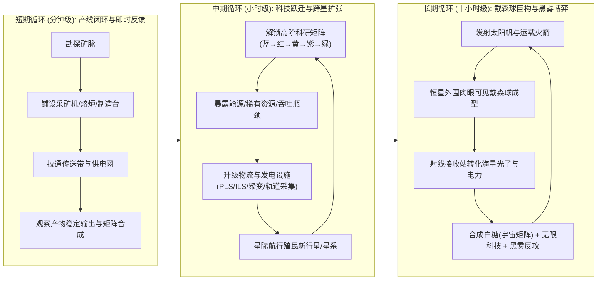

# 01｜产品定位、核心循环与竞品对比分析

> [!NOTE]
> 本文档为《戴森球计划》（Dyson Sphere Program，简称 DSP）专项分析报告第 1 篇，聚焦产品定位、核心玩法循环、尺度跃迁节奏、三大主流自动化竞品横向对比以及客观痛点诊断。配套底层数值见 [04_全建筑与核心配方数值参考手册.md](./04_全建筑与核心配方数值参考手册.md)。

---

## 一、 产品概况与核心卖点

| 维度 | 核心特征 |
| :--- | :--- |
| **产品定位** | 3D 科幻题材星际工厂自动化沙盒 + 太空巨构建设 + 轻度塔防战斗 |
| **开发团队** | 柚子猫游戏 (Youthcat Studio) — 国产独立小团队高完成度代表作 |
| **核心幻想** | 驾驶“伊卡洛斯”机甲，从一颗荒芜行星的手工采矿起步，最终在恒星外围建造包裹整颗恒星的“戴森球”，点亮整片星团 |
| **差异化壁垒** | 1. **球面建厂体验**：将传统 2D 平面/无限地形转化为真实可环绕的 3D 球体行星与立体星图 2. **中式硬核科幻浪漫**：从风车、火电到核聚变、人造恒星、太阳帆与戴森球壳的奇观式视觉正反馈 3. **零“意大利面条”后期物流**：通过行星/星际物流塔将超大规模跨星生产抽象为网络化供需调度 |

---

## 二、 核心玩法循环与心流曲线

### 1. 短 / 中 / 长期三层循环结构

### 2. 尺度跃迁（Scale Escalation）节奏

DSP 最出色的体验设计在于**玩家视角与操作尺度的 6 次平滑跃迁**，每一次跃迁都彻底刷新了游戏体验，避免后期沦为单纯的“复制粘贴”：

1. **机甲单兵期（T0）**：手搓基础件，依靠风力涡轮机和采矿机建立第一条铁/铜冶炼线，强调“从无到有”的生存感。
2. **产线模块期（T1 蓝糖）**：矩阵研究站、分拣器、传送带与四向分流器到位，玩家开始思考 1:6 / 1:12 产线配比与黑盒模块化。
3. **单行星工业化（T2 红糖）**：原油化工引入多产物联产（精炼油 + 氢），发电体系向火电/光伏过渡，开始铺设“赤道太阳能腰带”。
4. **跨行星物流期（T3 黄糖）**：钛矿稀缺迫使玩家第一次飞离母星，并在解锁 **行星内物流运输站 (PLS)** 与 **星际物流运输站 (ILS)** 后，彻底摆脱跨半球拉传送带的体力劳动。
5. **跨恒星帝国期（T4–T5 紫/绿糖）**：空间翘曲器实现跨光年星际货运，玩家开始依据“珍奇矿物分布”挑选资源星、冶炼星与科研星，形成星系分工。
6. **戴森球巨构与无限期（T6 白糖 + 黑雾）**：弹射太阳帆、发射运载火箭，戴森球壳在星空中逐渐合拢；同时《黑雾崛起》迫使玩家建立全球护盾与防线，并利用黑雾掉落物解锁 3x~4x 终极黑雾建筑，挑战每分钟数千上万白糖的极限产能。

---

## 三、 主流自动化竞品横向对比

将《戴森球计划》与同赛道两大标杆《异星工厂 (Factorio)》《幸福工厂 (Satisfactory)》进行 8 维度对比：

| 对比维度 | 《戴森球计划》(DSP) | 《异星工厂》(Factorio) | 《幸福工厂》(Satisfactory) |
| :--- | :--- | :--- | :--- |
| **视角与空间** | 3D 第三人称俯视/自由视角 + 真实球面行星 + 立体宇宙星图 | 2D 俯视角平面无限网格 | 3D 第一人称沉浸式写实地形 |
| **物流核心范式** | **节点式物流塔 (PLS/ILS)** 为主，传送带为产线内部毛细血管 | **火车铁路网 + 无人机群 + 主总线 (Main Bus)** | **长距离传送带 + 火车/卡车/无人机**（无纯空间传送站） |
| **地形与网格** | 球面经纬网格（高纬度存在网格收敛，通过回归线跳变解决），支持填海造陆 | 纯正交二维网格，地形可填埋/炸毁 | 固定手绘大地图，高差与立体建筑空间感极强 |
| **战斗与生存压力** | 可自定义开关的**黑雾系统**（电力驱动威胁度，后期塔防+太空拦截，掉落逆向科技） | **虫群系统**（污染驱动进攻，资源消耗战，核心防御玩法） | 轻度野生生物守矿，无主动拆家与基地塔防压力 |
| **终极视觉奇观** | **包裹恒星的戴森球与戴森云**（全游戏最强视觉正反馈） | 发射火箭（偏象征性通关，太空时代扩展至多星球） | 太空电梯阶段性交付（宏大但静态） |
| **工程减负与蓝图** | 支持**全行星/跨纬度蓝图**、无损原地升级、自动立体立交、跨带堆叠 | 极其成熟的**机器人自动建造与蓝图生态**（行业天花板） | 蓝图受限于“蓝图设计器”尺寸上限，手动铺设比重较高 |
| **前期上手门槛** | **低-中**：引导清晰，手搓顺滑，但球面高纬对齐与氢平衡需适应 | **中-高**：2D 画面硬核，铁路信号与流体管网学习曲线陡峭 | **中**：第一人称空间感好，但大型产线对齐与跑图耗时较多 |
| **核心受众爽点** | **星际尺度扩张 + 宏大科幻奇观 + 极低心智负担的大规模物流** | **极致逻辑精度 + 铁路调度 + 模组与无限基地优化** | **建筑美学 + 第一人称沉浸式立体工厂漫游** |

---

## 四、 核心优势与客观痛点诊断

### 核心优势（为什么它能出圈）
1. **将“物流减负”做到极致**：PLS/ILS 的设计让普通玩家无需掌握复杂的铁路信号逻辑，也能轻松搭建起跨十几个星系的庞大工业帝国。
2. **数值整齐、心算友好**：矿机（0.5/s）、熔炉（1.0s）、传送带（6/12/30 个/s）全部按整数倍对齐，极大降低了玩家的心智计算成本。
3. **无与伦比的浪漫奇观**：太阳帆在恒星周围绕行形成的光环、火箭升空焊接戴森球节点的实景演算，是其他工厂游戏难以替代的情绪价值。

### 客观痛点与摩擦点（自研避坑重点参考）
1. **T2→T3 过渡期的“手动跨星搬钛”痛点**：在解锁星际物流塔（黄糖）之前，母星没有钛矿，玩家必须手动驾驶机甲往返外星人肉背钛矿，虽然强化了“初次太空航行”的仪式感，但重复 2~3 趟后易产生枯燥感。
2. **原油化工“氢气胀库”死锁**：新手在红糖阶段极易因精炼油与氢消耗不对等导致整条化工线停摆，需要依靠火电烧氢或 X 射线裂解才能理解平衡机制。
3. **球面高纬建厂的网格畸变**：越靠近南北极，经线格子越窄，导致赤道设计的标准蓝图无法直接贴合高纬度，玩家通常被迫只在低纬度（±30° 以内）建核心工厂，高纬度仅作发电或射线接收。
4. **后期 CPU 性能与星际监控瓶颈**：当戴森球规模与星系数量上升后，全宇宙物流船/太阳帆/黑雾单位的计算开销骤增，且缺乏类似“全局产线告警/缺料一键定位”的高级运维看板。
