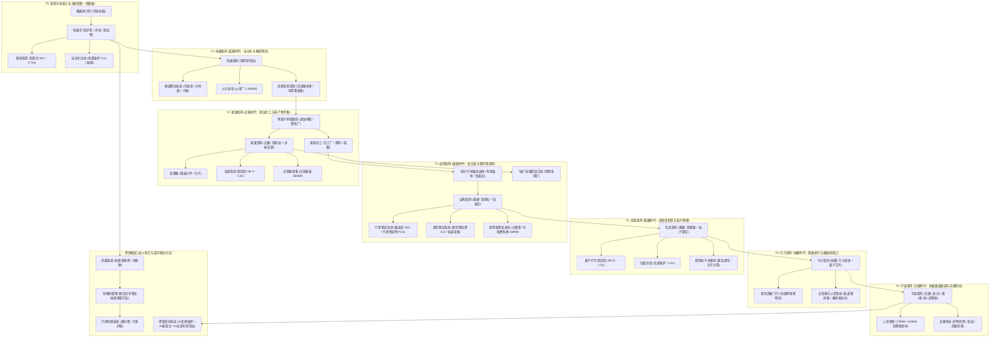
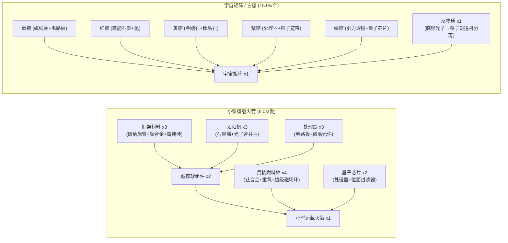

# 02｜科技树、经济数值与能源跃迁深度分析

> [!NOTE]
> 本文档所有数据均严格提取自 `./data/` 目录下的全量解包文件：[dsp_items.json](./data/dsp_items.json)、[dsp_recipes.json](./data/dsp_recipes.json) 与 [dsp_techs.json](./data/dsp_techs.json)。

---

## 一、 全量解包规模总览

| 数据维度 | 解包总量 | 结构细分 | 对应数据文件 |
| :--- | :---: | :--- | :--- |
| **全物品实体** | **175 种** | 材料 31、生产 28、物流 26、元件 25、产物 24、资源 17、深空 7、其他 12、矩阵 3、防御 2 | [dsp_items.json](./data/dsp_items.json) |
| **建筑设施** | **63 种** | 物流运输 18、电力系统 13、生产制造 12、防御作战 10、采矿采集 4、戴森工程 2、科研设施 2、辅助/地形 2 | [dsp_machines.csv](./data/dsp_machines.csv) |
| **生产与科研配方** | **162 个** | 制造台 126、冶炼设备 14、化工设备 9、矩阵研究站 6、粒子对撞机 3、精炼设备 3、分馏设备 1 | [dsp_recipes.csv](./data/dsp_recipes.csv) |
| **科技树节点** | **315 项** | **常规主/支线科技 109 项**（`id < 2000`） + **升级/无限科技 206 项**（`id >= 2000`，含 35 条成长线） | [dsp_tech_tree.csv](./data/dsp_tech_tree.csv) |

---

## 二、 科技树架构与 T0–T6 阶段跃迁

《戴森球计划》将科技解锁与 **6 种科研矩阵（蓝/红/黄/紫/绿/白糖）** 强绑定，每一级矩阵不仅是一道数值门槛，更对应一次**核心资源域或生产范式的切换**：

### 206 项升级/无限科技的留存设计
315 项科技中有 **206 项（65.4%）** 属于升级与无限科技，涵盖 **35 条成长线**，主要服务于三大目标：
1. **机甲与工程效率**：`机甲核心(6)`、`机械骨骼(8)`、`机舱容量(7)`、`无人机引擎(6)`、`批量建造(6)`、`驱动引擎(6)`、`能量回路(6)`、`通讯控制(7)`。
2. **物流吞吐天花板突破**：`分拣器货物叠加(5)`、`分拣器货物集装(1)`、`集装分拣器改良(6)`、`运输船引擎(7)`、`运输机舱扩容(10)`、`运输站集装物流(3)`、`配送范围(5)`。
3. **后期无限产线收益（白糖消耗黑洞）**：`矿物利用`（每级指数级降低采矿损耗，是后期千糖/万糖基地的核心）、`研究速度`、`太阳帆寿命`、`射线传输效率` 以及 11 条战斗/编队升级线。

---

## 三、 能源与燃料热值跃迁分析

DSP 的燃料热值跨度极为惊人——从初期的植物燃料（0.5 MJ）到终极奇异湮灭燃料棒（72,000 MJ），**单件能量密度跨越 144,000 倍**（以煤矿 2.7 MJ 为基准则为 **26,667 倍**）。这种指数级跃迁直接决定了玩家“能源焦虑的消解”与“跨星系远征的可行性”。

以下精确数据提取自 [dsp_items.json](./data/dsp_items.json)：

| 物品ID | 燃料名称 | 燃料类型 | 单件热值 (MJ) | 单格堆叠上限 | 单格总储能 (MJ) | 游戏阶段与设计定位 |
| :---: | :--- | :---: | :---: | :---: | :---: | :--- |
| **1031** | 植物燃料 | 化学燃料 (1) | **0.50 MJ** | 500 | 250 MJ | 开局砍树/割草应急，仅用于机甲初始充能 |
| **1006** | 煤矿 | 化学燃料 (1) | **2.70 MJ** | 100 | 270 MJ | T0-T1 主力火电燃料，热值低但储量丰富 |
| **1007** | 原油 | 化学燃料 (1) | **4.05 MJ** | 20 | 81 MJ | 原始液体燃料，通常精炼后使用 |
| **1114** | 精炼油 | 化学燃料 (1) | **4.50 MJ** | 20 | 90 MJ | T2 过渡燃料，常用于火电消耗多余副产 |
| **1011** | 可燃冰 | 化学燃料 (1) | **4.80 MJ** | 50 | 240 MJ | 珍奇矿物，直接烧亏本，核心用于高效制石墨烯 |
| **1109** | 高能石墨 | 化学燃料 (1) | **6.75 MJ** | 100 | 675 MJ | 2煤→1石墨（2×2.7=5.4→6.75），**能量净赚 25%**，前期机甲最佳口粮 |
| **1120** | 氢 | 化学燃料 (1) | **9.00 MJ** | 20 | 180 MJ | 体积密度低但单件高，火电厂消氢防堵常用 |
| **1801** | 液氢燃料棒 | 化学燃料 (1) | **54.00 MJ** | 30 | 1,620 MJ | 钛+10氢制成，前期太空航行/机甲续航标准燃料 |
| **2207** | 蓄电器（满） | 电能载体 (8) | **540.00 MJ** | 50 | 27,000 MJ | 配合“能量枢纽”实现**跨星球物理运电**（风/光富余星→工业星） |
| **1802** | 氘核燃料棒 | 核聚变 (2) | **600.00 MJ** | 30 | 18,000 MJ | T3 微型聚变站(15MW)核心燃料，中期星际殖民基石 |
| **1803** | 反物质燃料棒 | 反物质 (4) | **7,200.00 MJ** | 30 | 216,000 MJ | T6 人造恒星(72MW~144MW)燃料，单格储能达 216 GJ |
| **1804** | 奇异湮灭燃料棒 | 反物质 (4) | **72,000.00 MJ** | 50 | 3,600,000 MJ | 黑雾+反物质终极燃料棒，单组储能 **3.6 TJ**，彻底终结机甲与电网续航焦虑 |

---

## 四、 珍奇矿物（Rare Veins）的“产线跳级”杠杆

DSP 在母星系外围星系布置了 7 种珍奇矿物，它们并非“不可替代的卡关锁”，而是**极高收益的“产线跳级快捷键”**——用探索成本换取数倍的工厂占地与算力节约：

| 珍奇矿物 | 常规合成路径（无珍奇矿） | 珍奇高效替代配方 | 跳级收益解析 |
| :--- | :--- | :--- | :--- |
| **可燃冰** | `煤矿→高能石墨` + `原油/石矿/水→硫酸` → `石墨烯x2` (3.0s) | `可燃冰x2 → 石墨烯x2 + 氢x1` (2.0s) | **彻底绕过复杂的硫酸化工链**，还额外白嫖氢气 |
| **刺笋结晶** | `石墨烯x3 + 钛块x1 → 碳纳米管x2` (4.0s) | `刺笋结晶x6 → 碳纳米管x2` (4.0s) | 直接砍掉“石墨烯+钛”两道前置，碳纳米管实现单步直出 |
| **金伯利矿石** | `煤矿x2→高能石墨x1` → `金刚石x1` (2.0s) | `金伯利矿石x1 → 金刚石x2` (1.5s) | 省去熔炉炼石墨步骤，且单矿产出翻倍、耗时缩短 25% |
| **分形硅石** | `石矿x10→硅石` 或 `硅矿x2→高纯硅块` → `晶格硅x1` (2.0s) | `分形硅石x1 → 晶格硅x2` (1.5s) | 省去高纯硅块冶炼，产出翻倍，紫糖核心加速器 |
| **光栅石** | 1) `钛晶石x1 + 石墨烯x2 + 氢x12 → 卡西米尔晶体x1` 2) `棱镜x2 + 电路板x1 → 光子合并器x1` | 1) `光栅石x8 + 石墨烯x2 + 氢x12 → 卡西米尔晶体x1` 2) `光栅石x1 + 电路板x1 → 光子合并器x1` | **绕过极其繁琐的有机晶体与钛晶石产线**，是后期绿糖/量子芯片的核心减负矿 |
| **单极磁石** | `电磁涡轮x2 + 铜块x2 + 石墨烯x2 → 粒子容器x1` | `单极磁石x10 + 铜块x2 → 粒子容器x1` | 砍掉电动机/涡轮/石墨烯整条前置链（但全图储量极少，后期高矿物利用下才划算） |
| **有机晶体矿** | `塑料x2 + 精炼油x1 + 水x1 → 有机晶体x1` (6.0s) | **直接采矿机采集** | 彻底解放原油产能，黄糖不再受制于塑料化工 |

---

## 五、 增产剂（Proliferator）机制与复利数学模型

DSP 在中后期引入了 **增产剂（Mk.I / Mk.II / Mk.III）**，通过喷涂机对传送带上的原料进行喷涂，提供两种互斥的全局增益模式：

| 等级 | 配方原料 | 喷涂次数 | 额外产出模式（省料/增产） | 生产加速模式（省地/省机） | 额外功耗代价 |
| :--- | :--- | :---: | :---: | :---: | :---: |
| **Mk.I** | 煤矿 x1 (0.5s) | 12 次 | **+12.5%** | **+25%** | +30% |
| **Mk.II** | Mk.I x2 + 金刚石 x1 (1.0s) | 24 次 | **+20.0%** | **+50%** | +70% |
| **Mk.III** | Mk.II x2 + 碳纳米管 x1 (2.0s) | 60 次 | **+25.0%** | **+100%** | +150% |

### 核心经济策略：全链路“额外产出”的复利效应
* **越靠近下游终极产物，使用“额外产出 +25%”的收益越高**。以白糖（宇宙矩阵）为例，其上游经过约 5~7 级加工，若每一级均使用 Mk.III 增产剂开启额外产出：
  $$\text{理论总产出放大倍数} \approx 1.25^6 \approx 3.81\text{ 倍}$$
  即消耗同样数量的底层铁矿/铜矿/原油，最终产出的白糖数量接近 **4 倍**，大幅延缓了矿脉枯竭与跨星采矿频率。
* **唯一不适合用“额外产出”的场景**：需要严格控制原料循环或无法触发额外产出的配方（如分馏、光子分离等，系统会锁定仅允许加速或禁止增产），以及电力极度充裕、只追求极致少建机器的加速产线（开启 +100% 加速可直接让产线建筑数量减半）。

---

## 六、 终极产物产线复杂度剖析（火箭与白糖）

《戴森球计划》的终极复杂度集中在 **小型运载火箭**（构筑戴森球实体）与 **宇宙矩阵/白糖**（科技与无限升级）：

### 后期产线三大核心瓶颈节点
1. **氢与重氢吞吐**：卡西米尔晶体（单次消耗 `氢x12`）、氘核燃料棒（单次消耗 `重氢x20`）导致后期对气态巨星“轨道采集器”的需求呈爆发式增长。
2. **量子芯片与位面过滤器**：单颗量子芯片需要 2 个位面过滤器（12.0s 极长耗时）+ 2 个处理器，是紫糖之后最吃制造台数量的组件。
3. **临界光子产能**：白糖与反物质燃料棒均强依赖戴森球发电量转化而来的临界光子（射线接收站切换为“光子生成”模式，配合引力透镜可将单站产出翻倍），形成了 **“发火箭建球 → 收光子产白糖 → 点科技造更大球”** 的终极正反馈闭环。
