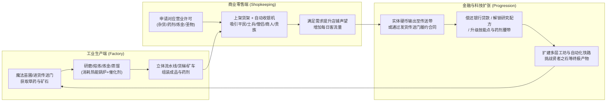

# 01｜《炼金工厂》(Alchemy Factory) 产品定位、核心玩法循环与系统架构分析

> [!NOTE]
> 本报告基于《炼金工厂》（UE 5.6 正式资源包解包）全量 **56 张 DataTable**、**163 个配方**、**147 项建筑/结构件**、**188 种物品** 以及 **65 条官方中文说明书** 整理编写。

---

## 一、 产品定位与核心差异化

| 维度 | 核心特征 |
| :--- | :--- |
| **产品定位** | **3D 第一人称中世纪魔幻炼金自动化工厂 + 店铺商业经营模拟** |
| **引擎与体量** | Unreal Engine 5.6，立体体素/网格自由建造（含地板、墙体、梁柱、吊桥与立体流水线） |
| **核心幻想** | 在中世纪魔法工坊中，从手工研粉、烧锅炉、摆货架收银起步，逐步搭建多层立体炼金流水线、矿车铁路与传送门网络，最终量产贤者之石与发条鸟，打造自动化魔法商业帝国 |
| **三大差异化壁垒** | 1. **实体货币闭环**：金币/银币/铜币不是虚拟数字，而是**可以放在传送带上运输的实体物品**（自动收银机吐币 → 传送带直接送进进货传送门自动买原料） 2. **物理抛射与立体魔幻物流**：除常规传送带/管道/货梯外，独创**投掷器/大炮/弹跳菇**抛射物流，以及**变形机**（缩小身体钻进机械缝隙） 3. **生产 × 零售 × 金融三核驱动**：没有纯数值的“科研糖块”，而是用**店铺声望、营业许可、银行贷款、供应合同**把每一条产线直接转化为现金流 |

---

## 二、 核心玩法循环（生产 × 零售 × 金融）

---

## 三、 八大特色核心机制拆解（官方说明书实证）

根据 [alchemy_manuals_zh.json](./data/alchemy_manuals_zh.json) 中的 65 条官方机制说明，《炼金工厂》拥有大量区别于传统科幻工厂游戏的独特设计：

1. **实体硬币与“进货/发货传送门”闭环**
   * **自动收银机**：建在结账台上自动收银，单台容量 10,000 枚硬币，支持**直接连接传送带把硬币运走**。
   * **进货传送门（Supply Portal）**：接收任意种类硬币（手动或传送带输入，自动汇率兑换），全自动购买商店出售的原材料。
   * **发货传送门（Dispatch Portal）**：完成“样品征集”任务解锁采购合同后，可通过发货传送门以低于市场价批量出货，实现不依赖门店客流的 B2B 大宗贸易。
2. **魔法苗圃（AutoNursery）与不消耗种子设计**
   * 放入任意植物种子（如亚麻、鼠尾草、薰衣草、洋甘菊、龙胆花、幽暗菇）后**种子本身不会被消耗**，仅消耗肥料的 **营养值 V（维塔）**，且产出速度完全取决于肥料肥力（初级/高级肥料 → 万灵药兼作超级肥料）。
3. **热能与蒸汽锅炉体系（Heating & Steam）**
   * 游戏没有“电网”，所有需要加热的实验/冶炼设备**必须直接建造在加热设施之上**，通过燃料（木炭、煤炭、焦炭、万灵药等）提供热量；后期通过蒸汽锅炉产生压力驱动高阶机械。
4. **物理抛射物流（ShootDevice / 投掷器 / 大炮 / 弹跳菇）**
   * 投掷器/大炮可将物品直接抛射进**漏斗、货架、炼铁炉和炼金锅等敞口设备**，配合 **弹跳菇（BounceShroom）** 实现无需连续传送带的跨空间“空中接力”。
5. **矿车铁路与逻辑过滤规则（Wagon System）**
   * 由 **启动站 + 装载站 + 卸载站 + 回收站 + 分流轨道** 组成完整铁路网。
   * 支持为矿车设置**颜色与前缀标签**（如 `AA.BB` 可匹配 `AA`），并在分流/卸载处配置 **“与 / 或 / 非”逻辑组合过滤**，是中后期跨区大宗物料调度的核心。
6. **四类炼金催化剂（Catalyst）**
   * 高级炼金炉支持同时放入多种催化剂（按充能次数消耗）：
     * **Fertile**：产物生成数量翻倍
     * **Resonant**：同时生成所有产物（消除随机副产物概率）
     * **Unstable**：改变产物生成概率
     * **Eternal**：配方不消耗材料
7. **变形机（Transmuter）与特殊交互**
   * 放入变形药水与目标物品后可将玩家自身变形为该物品（如缩小体型钻过狭窄管道缝隙、扩大背包等），是极具创意的第一人称沙盒交互。
8. **昼夜作息与“通宵营业”成长**
   * 夜晚玩家睡觉会强制关闭店铺并清空顾客；通过升级**药剂腰带**缩短睡眠需求时间，当睡眠时间减至 0 时即可解锁**24 小时通宵营业**，大幅拉高日流水上限。

---

## 四、 与主流自动化竞品横向对比

| 对比维度 | 《炼金工厂》(Alchemy Factory) | 《戴森球计划》(DSP) | 《幸福工厂》(Satisfactory) |
| :--- | :--- | :--- | :--- |
| **题材与美术** | 中世纪魔幻炼金 + 蒸汽朋克 | 硬核太空科幻 + 星际工业 | 外星科幻写实工业 |
| **视角与建造** | **3D 第一人称** + 建筑结构件自由搭楼 | 3D 第三人称俯视 + 球面网格 | 3D 第一人称 + 立体厂房 |
| **能源体系** | **燃料热能（直接垫在设备下方）+ 蒸汽** | 点对点无线电网 + 戴森球 | 电网连线 + 煤/油/核电 |
| **核心驱动力** | **开店卖货赚实体硬币 + 营业许可 + 合同** | 6 色科研矩阵（蓝→白糖） | 太空电梯阶段性物资交付 |
| **特色物流** | 传送带/货梯 + 矿车逻辑过滤 + **空中抛射** + **传送门** | PLS/ILS 发布-订阅物流塔 | 传送带 + 火车/卡车/无人机 |
| **农业/副产** | **种子不消耗，肥料肥力决定产速** | 无农业，偏重化工联产平衡 | 无农业，偏重矿产与流体 |
