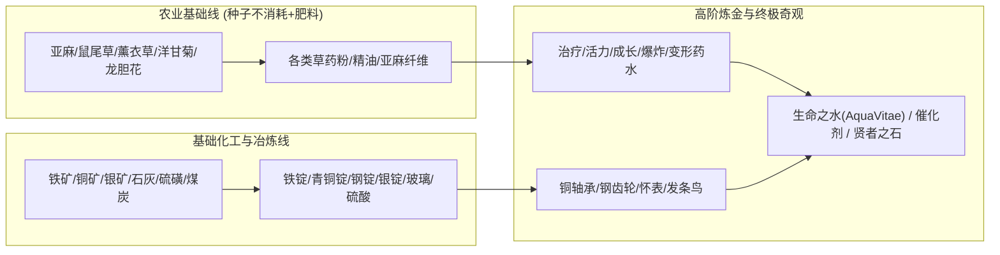

# 03｜全物品经济、163 配方树与炼金产线深度分析

> [!NOTE]
> 本手册基于解包提取的 **163 个配方**（[alchemy_recipes.csv](./data/alchemy_recipes.csv)）与 **188 种物品**（[alchemy_items.csv](./data/alchemy_items.csv)）整理，涵盖全部配方耗时、单机每分钟产出（个/分）及阶位分布。

---

## 一、 配方阶位分布总览

| 阶位 (Tier) | 配方数量 | 代表性产物 |
| :---: | :---: | :--- |
| Tier 0 | 8 | 亚麻、鼠尾草、红醋栗、薰衣草、洋甘菊、龙胆花 |
| Tier 1 | 2 | 木材、木制大齿轮 |
| Tier 2 | 7 | 碎石、沙子、Mortar、亚麻纤维、LinenThread、LinenRope |
| Tier 3 | 8 | 铁锭、铁钉、铁砂、植物灰、鼠尾草粉、治疗药水 |
| Tier 4 | 18 | 生石灰、石灰粉、木炭、木炭粉、木滑轮、黏土 |
| Tier 5 | 11 | 绿松石、木星、焦炭、焦炭粉、钢锭、钢齿轮 |
| Tier 6 | 37 | 洋甘菊粉、硫磺、硫磺粉、煤炭、盐、盐水 |
| Tier 7 | 11 | 薰衣草精油、白兰地、硫酸、黄玉、爆炸药水、Catalyst2 |
| Tier 8 | 17 | 龙胆花粉、龙胆花蜜、银粉、SilverPowder2、SilverPowder3、火山灰 |
| Tier 9 | 15 | 砂金、GoldDust2、GoldDust3、GoldDust5、金锭、金币 |
| Tier 10 | 1 | 日曜 |
| Tier 20 | 19 | Salt_Alt、Meteorite_Alt、Coke_Alt、CopperPowder2_Alt、SilverPowder3_Alt、GoldDust3_Alt |
| Tier 90 | 9 | 铁护符、高级绷带、铜护符、紫晶、魅惑药水、Sulfur_Alt |

---

## 二、 核心高阶炼金产线依赖链（示例）

---

## 三、 全量 163 个配方明细表（按阶位排序）

### Tier 0 配方（共 8 个）

| 配方ID | 产物名称 | 耗时(秒) | 单机产出(个/分) | 输入原料 | 输出产物 |
| :--- | :--- | :---: | :---: | :--- | :--- |
| `Flax` | **亚麻** | 52 | 1.15 | 亚麻种子 + 生命之水 | 亚麻 |
| `Sage` | **鼠尾草** | 127 | 0.47 | 鼠尾草种子 + 生命之水 | 鼠尾草 |
| `Redcurrant` | **红醋栗** | 121 | 0.5 | 红醋栗种子 + 生命之水 | 红醋栗 |
| `Lavender` | **薰衣草** | 84 | 0.71 | 薰衣草种子 + 生命之水 | 薰衣草 |
| `Chamomile` | **洋甘菊** | 17 | 3.53 | 洋甘菊种子 + 生命之水 | 洋甘菊 |
| `Gentian` | **龙胆花** | 56 | 1.07 | 龙胆花种子 + 龙胆花蜜 | 龙胆花 |
| `AdvancedFertilizer` | **高级肥料** | 0 | 0 |  | 高级肥料 |
| `SilverPowder3` | **SilverPowder3** | 259 | 0.23 | 水银 + 砂金 | SilverPowder3 |

### Tier 1 配方（共 2 个）

| 配方ID | 产物名称 | 耗时(秒) | 单机产出(个/分) | 输入原料 | 输出产物 |
| :--- | :--- | :---: | :---: | :--- | :--- |
| `WoodBoard` | **木材** | 177 | 0.34 | 原木 + 生命之水 | 木材 |
| `LargeWoodGear` | **木制大齿轮** | 83 | 0.72 | 木材 + 生命之水 | 木制大齿轮 |

### Tier 2 配方（共 7 个）

| 配方ID | 产物名称 | 耗时(秒) | 单机产出(个/分) | 输入原料 | 输出产物 |
| :--- | :--- | :---: | :---: | :--- | :--- |
| `Stone` | **碎石** | 163 | 0.37 | 石灰石 + 生命之水 | 碎石 |
| `Sand` | **沙子** | 133 | 0.45 | 碎石 + 生命之水 | 沙子 |
| `Mortar` | **Mortar** | 107 | 0.56 | 碎石 + 生命之水 | Mortar |
| `FlaxFiber` | **亚麻纤维** | 53 | 1.13 | 亚麻 + 生命之水 | 亚麻纤维 |
| `LinenThread` | **LinenThread** | 92 | 0.65 | 亚麻纤维 + 生命之水 | LinenThread |
| `LinenRope` | **LinenRope** | 91 | 0.66 | LinenThread + 生命之水 | LinenRope |
| `WoodGear` | **木齿轮** | 178 | 0.34 | 木制大齿轮 + 生命之水 | 木齿轮 |

### Tier 3 配方（共 8 个）

| 配方ID | 产物名称 | 耗时(秒) | 单机产出(个/分) | 输入原料 | 输出产物 |
| :--- | :--- | :---: | :---: | :--- | :--- |
| `IronIngot` | **铁锭** | 77 | 0.78 | 铁矿石 + 生命之水 | 铁锭 |
| `Nails` | **铁钉** | 108 | 0.56 | 铁锭 + 生命之水 | 铁钉 |
| `IronSand` | **铁砂** | 80 | 0.75 | 铁锭 + 生命之水 | 铁砂 |
| `PlantAsh` | **植物灰** | 115 | 0.52 | 鼠尾草 + 生命之水 | 植物灰 |
| `SagePowder` | **鼠尾草粉** | 128 | 0.47 | 鼠尾草 + 生命之水 | 鼠尾草粉 |
| `HealingPotion` | **治疗药水** | 53 | 1.13 | 鼠尾草粉 + 亚麻纤维 + 生命之水 | 治疗药水 |
| `Linen` | **麻布** | 90 | 0.67 | LinenThread + 生命之水 | 麻布 |
| `Bandage` | **绷带** | 74 | 0.81 | 麻布 + 治疗药水 + 生命之水 | 绷带 |

### Tier 4 配方（共 18 个）

| 配方ID | 产物名称 | 耗时(秒) | 单机产出(个/分) | 输入原料 | 输出产物 |
| :--- | :--- | :---: | :---: | :--- | :--- |
| `Quicklime` | **生石灰** | 119 | 0.5 | 碎石 + 生命之水 | 生石灰 |
| `QuicklimePowder` | **石灰粉** | 120 | 0.5 | 生石灰 + 生命之水 | 石灰粉 |
| `Charcoal` | **木炭** | 20 | 3.0 | 木材 + 生命之水 | 木炭 |
| `CharcoalPowder` | **木炭粉** | 21 | 2.86 | 木炭 + 生命之水 | 木炭粉 |
| `WoodPulley` | **木滑轮** | 91 | 0.66 | 木材 + LinenRope + 生命之水 | 木滑轮 |
| `Clay` | **黏土** | 133 | 0.45 | 木炭粉 + 沙子 + 生命之水 | 黏土 |
| `ClayPowder` | **黏土粉** | 24 | 2.5 | 黏土 + 生命之水 | 黏土粉 |
| `Brick` | **砖块** | 9 | 6.67 | 黏土 + 生命之水 | 砖块 |
| `LinseedOil` | **亚麻籽油** | 93 | 0.65 | 亚麻 + 生命之水 | 亚麻籽油 |
| `FruitWine` | **浆果酒** | 55 | 1.09 | 红醋栗 + 生命之水 | 浆果酒 |
| `Limewater` | **石灰水** | 89 | 0.67 | 石灰粉 + 生命之水 | 石灰水 |
| `Glass` | **玻璃** | 60 | 1.0 | 沙子 + 生命之水 | 玻璃 |
| `Soap` | **肥皂** | 93 | 0.65 | 植物灰 + 亚麻籽油 + 生命之水 | 肥皂 |
| `SoapPowder` | **肥皂粉** | 158 | 0.38 | 肥皂 + 生命之水 | 肥皂粉 |
| `VitalityPotion` | **活力药水** | 55 | 1.09 | 石灰粉 + 浆果酒 + 生命之水 | 活力药水 |
| `BasicFertilizer` | **初级肥料** | 120 | 0.5 | 植物灰 + 石灰粉 + 生命之水 | 初级肥料 |
| `WhisperingFields` | **田野低语** | 55 | 1.09 | 亚麻籽油 + 浆果酒 + 生命之水 | 田野低语 |
| `Cart` | **矿车** | 12 | 5.0 | 铁锭 + 生命之水 | 矿车 |

### Tier 5 配方（共 11 个）

| 配方ID | 产物名称 | 耗时(秒) | 单机产出(个/分) | 输入原料 | 输出产物 |
| :--- | :--- | :---: | :---: | :--- | :--- |
| `Turquoise` | **绿松石** | 133 | 0.45 | 治疗药水 + 沙子 + 生命之水 | 绿松石 |
| `Jupiter` | **木星** | 178 | 0.34 | 木材 + 木齿轮 + 木滑轮 + 生命之水 | 木星 |
| `Coke` | **焦炭** | 28 | 2.14 | 木炭粉 + 木炭 | 焦炭 |
| `CokePowder` | **焦炭粉** | 30 | 2.0 | 焦炭 + 生命之水 | 焦炭粉 |
| `SteelIngot` | **钢锭** | 30 | 2.0 | 铁锭 + 焦炭粉 | 钢锭 |
| `SteelGear` | **钢齿轮** | 161 | 0.37 | 钢锭 + 生命之水 | 钢齿轮 |
| `YeastPowder` | **酵母粉** | 55 | 1.09 | 肥皂粉 + 浆果酒 + 生命之水 | 酵母粉 |
| `ManaPotion` | **ManaPotion** | 62 | 0.97 | 焦炭粉 + 幽暗孢子 + 生命之水 | ManaPotion |
| `GloomFungus` | **幽暗菇** | 61 | 0.98 | 腐烂原木 + 木材 | 幽暗菇 |
| `GloomSpores` | **幽暗孢子** | 183 | 0.33 | 幽暗菇 + 酵母粉 + 生命之水 | 幽暗孢子 |
| `AdvancedFertilizer` | **高级肥料** | 61 | 0.98 | 初级肥料 + 幽暗菇 + 生命之水 | 高级肥料 |

### Tier 6 配方（共 37 个）

| 配方ID | 产物名称 | 耗时(秒) | 单机产出(个/分) | 输入原料 | 输出产物 |
| :--- | :--- | :---: | :---: | :--- | :--- |
| `ChamomilePowder` | **洋甘菊粉** | 18 | 3.33 | 洋甘菊 + 生命之水 | 洋甘菊粉 |
| `Sulfur` | **硫磺** | 165 | 0.36 | 硫铁矿 + 铁锭 | 硫磺 |
| `SulfurPowder` | **硫磺粉** | 168 | 0.36 | 硫磺 + 生命之水 | 硫磺粉 |
| `Coal` | **煤炭** | 26 | 2.31 | 煤矿石 + 生命之水 | 煤炭 |
| `Salt` | **盐** | 120 | 0.5 | 木炭粉 + 石灰粉 + 沙子 | 盐 |
| `SaltWater` | **盐水** | 132 | 0.45 | 盐 + 生命之水 | 盐水 |
| `CopperPowder` | **铜粉** | 158 | 0.38 | 铁砂 + 肥皂粉 | 铜粉 |
| `CopperPowder2` | **CopperPowder2** | 158 | 0.38 | 铁砂 + 肥皂粉 + 铜粉 | CopperPowder2 |
| `BronzeIngot` | **青铜锭** | 10 | 6.0 | 铜粉 + 生命之水 | 青铜锭 |
| `CopperIngot` | **铜锭** | 34 | 1.76 | CopperPowder2 + 生命之水 | 铜锭 |
| `CopperCoin` | **铜币** | 33 | 1.82 | 铜锭 + 生命之水 | 铜币 |
| `CopperBearing` | **铜轴承** | 32 | 1.88 | 铜锭 + 生命之水 | 铜轴承 |
| `BronzeRivet` | **BronzeRivet** | 11 | 5.45 | 青铜锭 + 生命之水 | BronzeRivet |
| `BlackPowder` | **BlackPowder** | 21 | 2.86 | 硫磺粉 + 木炭粉 + 石灰水 + 生命之水 | BlackPowder |
| `GrowthPotion` | **成长药水** | 24 | 2.5 | 洋甘菊粉 + 黏土粉 + 盐水 + 生命之水 | 成长药水 |
| `Catalyst1` | **Catalyst1** | 62 | 0.97 | 洋甘菊粉 + 幽暗孢子 + 生命之水 | Catalyst1 |
| `PocketWatch` | **怀表** | 32 | 1.88 | 钢齿轮 + 铜轴承 + 玻璃 + 生命之水 | 怀表 |
| `Malachite` | **孔雀石** | 24 | 2.5 | 铜粉 + 黏土粉 + Shard1 | 孔雀石 |
| `ClockworkBird` | **发条鸟** | 161 | 0.37 | 钢锭 + 钢齿轮 + 孔雀石 + 生命之水 | 发条鸟 |
| `Saturn` | **土星** | 9 | 6.67 | 盐 + 砖块 + 玻璃 + 生命之水 | 土星 |
| `Mars` | **火星** | 161 | 0.37 | 铁钉 + 钢齿轮 + BronzeRivet + 铜轴承 + 生命之水 | 火星 |
| `Sand2` | **Sand2** | 134 | 0.45 | 沙子 + 生命之水 | Sand2 |
| `Sand3` | **Sand3** | 135 | 0.44 | Sand2 + 生命之水 | Sand3 |
| `Sand4` | **Sand4** | 136 | 0.44 | Sand3 + 生命之水 | Sand4 |
| `Sand5` | **Sand5** | 137 | 0.44 | Sand4 + 生命之水 | Sand5 |
| `Sand6` | **Sand6** | 138 | 0.43 | Sand5 + 生命之水 | Sand6 |
| `Sand8` | **Sand8** | 140 | 0.43 | Sand6 + 生命之水 | Sand8 |
| `Shard1` | **Shard1** | 144 | 0.42 | Sand8 + 生命之水 | Shard1 |
| `Shard2` | **Shard2** | 146 | 0.41 | Shard1 + 生命之水 | Shard2 |
| `Shard3` | **Shard3** | 147 | 0.41 | Shard2 + 生命之水 | Shard3 |
| `Crystal1` | **Crystal1** | 41 | 1.46 | Shard3 + 生命之水 | Crystal1 |
| `Crystal2` | **Crystal2** | 42 | 1.43 | Crystal1 + 生命之水 | Crystal2 |
| `Crystal3` | **Crystal3** | 43 | 1.4 | Crystal2 + 生命之水 | Crystal3 |
| `Diamond1` | **Diamond1** | 44 | 1.36 | Crystal3 + 生命之水 | Diamond1 |
| `Diamond2` | **Diamond2** | 45 | 1.33 | Diamond1 + 生命之水 | Diamond2 |
| `Diamond3` | **Diamond3** | 46 | 1.3 | Diamond2 + 生命之水 | Diamond3 |
| `StrangeTide` | **奇异潮汐** | 89 | 0.67 | 盐水 + 石灰水 + 浆果酒 + 生命之水 | 奇异潮汐 |

### Tier 7 配方（共 11 个）

| 配方ID | 产物名称 | 耗时(秒) | 单机产出(个/分) | 输入原料 | 输出产物 |
| :--- | :--- | :---: | :---: | :--- | :--- |
| `LavenderEssentialOil` | **薰衣草精油** | 93 | 0.65 | 薰衣草 + 亚麻籽油 + 生命之水 | 薰衣草精油 |
| `Brandy` | **白兰地** | 55 | 1.09 | 焦炭粉 + 浆果酒 + 生命之水 | 白兰地 |
| `SulfuricAcid` | **硫酸** | 132 | 0.45 | 硫磺粉 + 盐水 + 生命之水 | 硫酸 |
| `Topaz` | **黄玉** | 167 | 0.36 | Shard1 + 硫酸 + 生命之水 | 黄玉 |
| `BlastPotion` | **爆炸药水** | 6 | 10.0 | Mors + BlackPowder + 白兰地 + 生命之水 | 爆炸药水 |
| `Catalyst2` | **Catalyst2** | 172 | 0.35 | Catalyst1 + Vitae + 薰衣草精油 + 生命之水 | Catalyst2 |
| `PerfumedSoap` | **香皂** | 86 | 0.7 | 肥皂粉 + 薰衣草精油 + 生命之水 | 香皂 |
| `PerfumedSoapPowder` | **香皂粉** | 112 | 0.54 | 香皂 + 生命之水 | 香皂粉 |
| `Vitae` | **Vitae** | 172 | 0.35 | Mors + 生命之水 | Vitae |
| `Venus` | **金星** | 173 | 0.35 | 治疗药水 + 活力药水 + ManaPotion + 成长药水 + 爆炸药水 | 金星 |
| `LavenderDream` | **薰衣草之梦** | 8 | 7.5 | 薰衣草精油 + 白兰地 + 生命之水 | 薰衣草之梦 |

### Tier 8 配方（共 17 个）

| 配方ID | 产物名称 | 耗时(秒) | 单机产出(个/分) | 输入原料 | 输出产物 |
| :--- | :--- | :---: | :---: | :--- | :--- |
| `GentianPowder` | **龙胆花粉** | 58 | 1.03 | 龙胆花 + 生命之水 | 龙胆花粉 |
| `GentianNectar` | **龙胆花蜜** | 57 | 1.05 | 龙胆花种子 + 龙胆花 | 龙胆花蜜 |
| `SilverPowder` | **银粉** | 6 | 10.0 | CopperPowder2 + BlackPowder | 银粉 |
| `SilverPowder2` | **SilverPowder2** | 153 | 0.39 | 银粉 + 生命之水 | SilverPowder2 |
| `SilverPowder3` | **SilverPowder3** | 6 | 10.0 | CopperPowder2 + BlackPowder | SilverPowder3 |
| `VolcanicAsh` | **火山灰** | 174 | 0.34 | 黑曜石 + 生命之水 | 火山灰 |
| `Obsidian` | **黑曜石** | 41 | 1.46 | Mors + Crystal1 + 大理石 | 黑曜石 |
| `SilverIngot` | **银锭** | 150 | 0.4 | SilverPowder3 + 生命之水 | 银锭 |
| `SilverCoin` | **银币** | 149 | 0.4 | 银锭 + 生命之水 | 银币 |
| `SilverAmulet` | **银护符** | 82 | 0.73 | 银锭 + 青金石 + 生命之水 | 银护符 |
| `Mercury` | **水银** | 172 | 0.35 | 银粉 + Vitae + 硫酸 + 生命之水 | 水银 |
| `AquaVitae` | **生命之水** | 181 | 0.33 | 龙胆花蜜 + 世界树之叶 + 白兰地 | 生命之水 |
| `LapisLazuli` | **青金石** | 41 | 1.46 | SilverPowder2 + Crystal1 | 青金石 |
| `MercuryP` | **水星** | 95 | 0.63 | 绿松石 + 孔雀石 + 黄玉 + 黑曜石 + 青金石 | 水星 |
| `Catalyst3` | **Catalyst3** | 174 | 0.34 | Catalyst2 + 火山灰 + 生命之水 | Catalyst3 |
| `PanaceaElixir` | **万灵药** | 7 | 8.57 | Catalyst2 + 爆炸药水 + 生命之水 | 万灵药 |
| `WorldTreeVintage` | **世界树秘酿** | 55 | 1.09 | 生命之水 + 浆果酒 | 世界树秘酿 |

### Tier 9 配方（共 15 个）

| 配方ID | 产物名称 | 耗时(秒) | 单机产出(个/分) | 输入原料 | 输出产物 |
| :--- | :--- | :---: | :---: | :--- | :--- |
| `GoldDust` | **砂金** | 99 | 0.61 | 水银 | 砂金 |
| `GoldDust2` | **GoldDust2** | 65 | 0.92 | 砂金 + 生命之水 | GoldDust2 |
| `GoldDust3` | **GoldDust3** | 174 | 0.34 | SilverPowder3 + 火山灰 + 水银 | GoldDust3 |
| `GoldDust5` | **GoldDust5** | 69 | 0.87 | GoldDust3 + 生命之水 | GoldDust5 |
| `GoldIngot` | **金锭** | 71 | 0.85 | GoldDust5 + 生命之水 | 金锭 |
| `GoldCoin` | **金币** | 63 | 0.95 | 金锭 + 生命之水 | 金币 |
| `Crown` | **皇冠** | 125 | 0.48 | 金锭 + 红宝石 + 蓝宝石 + 生命之水 | 皇冠 |
| `Catalyst4` | **Catalyst4** | 113 | 0.53 | Catalyst3 + 贤者之石 + 生命之水 | Catalyst4 |
| `StarDust` | **星之尘** | 143 | 0.42 | 木星 + 土星 + 火星 + 生命之水 | 星之尘 |
| `FairyDust` | **精灵粉末** | 58 | 1.03 | 洋甘菊粉 + 龙胆花粉 + 世界树之叶 + 生命之水 | 精灵粉末 |
| `FairyTear` | **精灵之泪** | 50 | 1.2 | 精灵粉末 + 生命之水 | 精灵之泪 |
| `MoonTear` | **月之泪** | 50 | 1.2 | 星之尘 + 精灵之泪 + 生命之水 | 月之泪 |
| `MoonlitSoap` | **月光皂** | 104 | 0.58 | 香皂粉 + 月之泪 + 生命之水 | 月光皂 |
| `Luna` | **月曜** | 10 | 6.0 | 钢锭 + 青铜锭 + 铜锭 + 银锭 + 金锭 | 月曜 |
| `AlchemistSigh` | **炼金术士的叹息** | 99 | 0.61 | 月之泪 + 水银 + 白兰地 + 生命之水 | 炼金术士的叹息 |

### Tier 10 配方（共 1 个）

| 配方ID | 产物名称 | 耗时(秒) | 单机产出(个/分) | 输入原料 | 输出产物 |
| :--- | :--- | :---: | :---: | :--- | :--- |
| `Sol` | **日曜** | 143 | 0.42 | 木星 + 土星 + 火星 + 金星 + 水星 | 日曜 |

### Tier 20 配方（共 19 个）

| 配方ID | 产物名称 | 耗时(秒) | 单机产出(个/分) | 输入原料 | 输出产物 |
| :--- | :--- | :---: | :---: | :--- | :--- |
| `Salt_Alt` | **Salt_Alt** | 130 | 0.46 | 岩盐 + 沙子 | 盐 |
| `Meteorite_Alt` | **Meteorite_Alt** | 163 | 0.37 | 碎石 | 陨石 |
| `Coke_Alt` | **Coke_Alt** | 28 | 2.14 | 煤炭 | 焦炭 |
| `CopperPowder2_Alt` | **CopperPowder2_Alt** | 37 | 1.62 |  | 铜粉 + CopperPowder2 |
| `SilverPowder3_Alt` | **SilverPowder3_Alt** | 154 | 0.39 | SilverPowder2 | SilverPowder3 |
| `GoldDust3_Alt` | **GoldDust3_Alt** | 66 | 0.91 | GoldDust2 | GoldDust3 |
| `CopperIngot_Alt` | **CopperIngot_Alt** | 34 | 1.76 | 铜币 | 铜锭 |
| `SilverIngot_Alt` | **SilverIngot_Alt** | 150 | 0.4 | 银币 | 银锭 |
| `GoldIngot_Alt` | **GoldIngot_Alt** | 71 | 0.85 | 金币 | 金锭 |
| `IronIngot_Alt` | **IronIngot_Alt** | 77 | 0.78 | 铁砂 | 铁锭 |
| `CopperPowder2_Alt2` | **CopperPowder2_Alt2** | 37 | 1.62 | 铜锭 | CopperPowder2 |
| `SilverPowder3_Alt3` | **SilverPowder3_Alt3** | 154 | 0.39 | 银锭 | SilverPowder3 |
| `GoldDust5_Alt` | **GoldDust5_Alt** | 69 | 0.87 | 金锭 | GoldDust5 |
| `Shard1_Alt` | **Shard1_Alt** | 144 | 0.42 | 石英矿 | Shard1 |
| `Mors_Alt` | **Mors_Alt** | 105 | 0.57 | Vitae | Mors |
| `PhilosopherStone_Alt` | **PhilosopherStone_Alt** | 141 | 0.43 | 红宝石 + 蓝宝石 + 祖母绿 | 贤者之石 |
| `Ruby_Alt` | **Ruby_Alt** | 69 | 0.87 | Diamond2 + GoldDust5 + Catalyst3 | 红宝石 |
| `Sapphire_Alt` | **Sapphire_Alt** | 180 | 0.33 | Diamond3 + 世界树核心 + Catalyst1 | 蓝宝石 |
| `Emerald_Alt` | **Emerald_Alt** | 82 | 0.73 | 月光皂 + 青金石 + Catalyst2 | 祖母绿 |

### Tier 90 配方（共 9 个）

| 配方ID | 产物名称 | 耗时(秒) | 单机产出(个/分) | 输入原料 | 输出产物 |
| :--- | :--- | :---: | :---: | :--- | :--- |
| `IronAmulet` | **铁护符** | 91 | 0.66 | 铁锭 + LinenRope | 铁护符 |
| `FineBandage` | **高级绷带** | 74 | 0.81 | 麻布 + 治疗药水 | 高级绷带 |
| `CopperAmulet` | **铜护符** | 170 | 0.35 | 铜锭 + 绿松石 | 铜护符 |
| `Amethyst` | **紫晶** | 18 | 3.33 | 硫磺粉 + 洋甘菊粉 + 薰衣草精油 | 紫晶 |
| `CharismaPotion` | **魅惑药水** | 112 | 0.54 | BlackPowder + 香皂粉 + 白兰地 | 魅惑药水 |
| `Sulfur_Alt` | **Sulfur_Alt** | 30 | 2.0 | 洋甘菊粉 + 焦炭粉 + 盐水 | Sulfur_Alt |
| `Sand7` | **Sand7** | 139 | 0.43 | Sand6 | Sand7 |
| `InvisbilityPotion` | **InvisbilityPotion** | 57 | 1.05 | 火山灰 + 龙胆花蜜 + 水银 | InvisbilityPotion |
| `GoldDust4` | **GoldDust4** | 68 | 0.88 | GoldDust3 | GoldDust4 |
